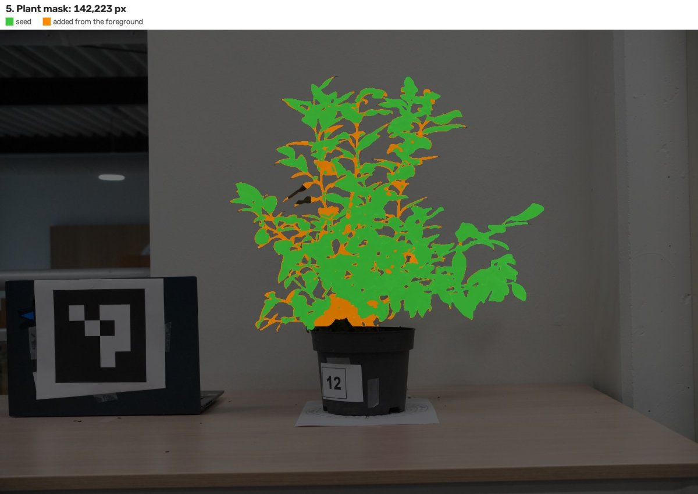
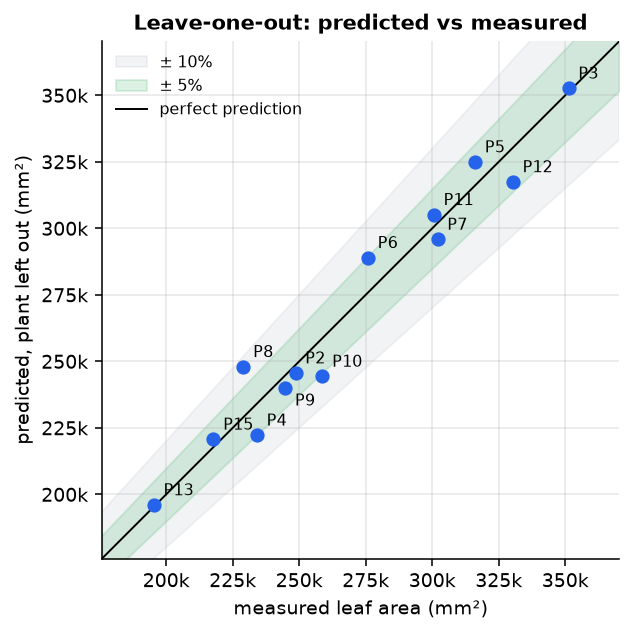
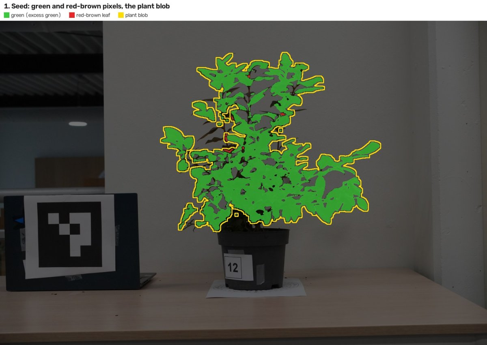
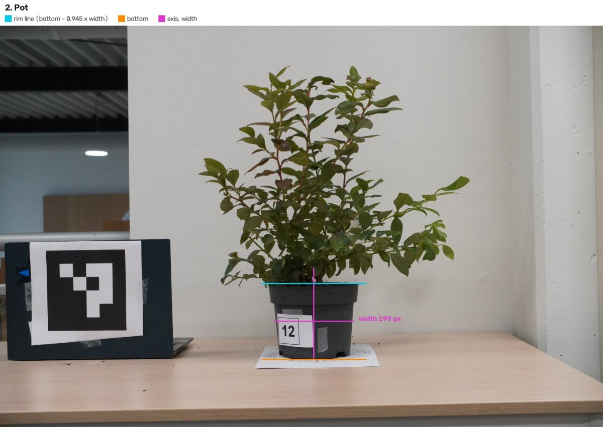
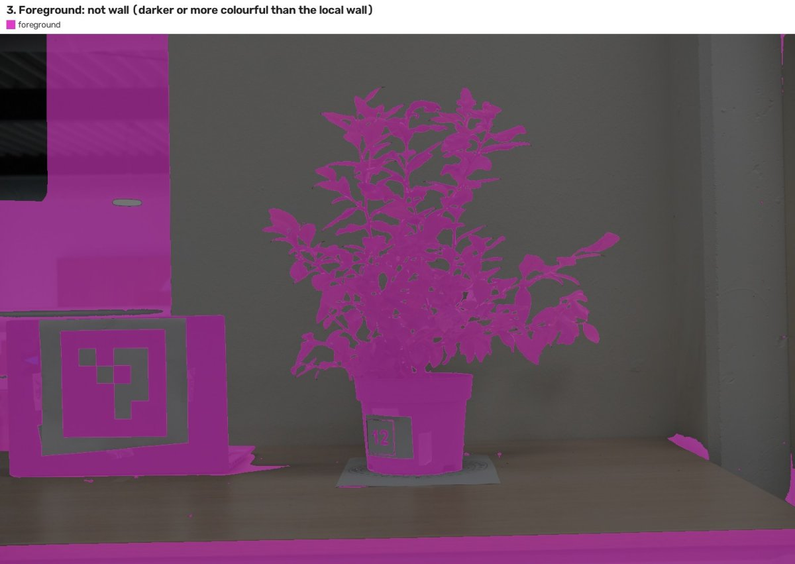
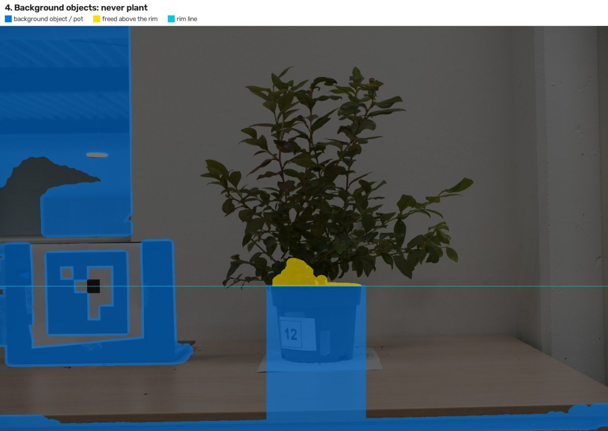
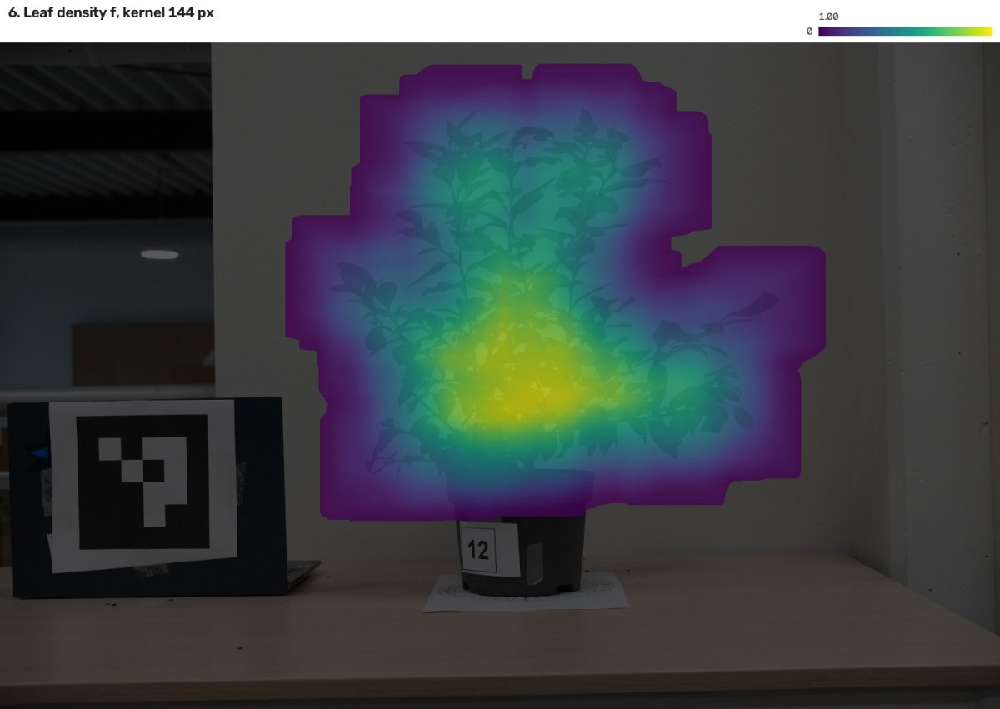
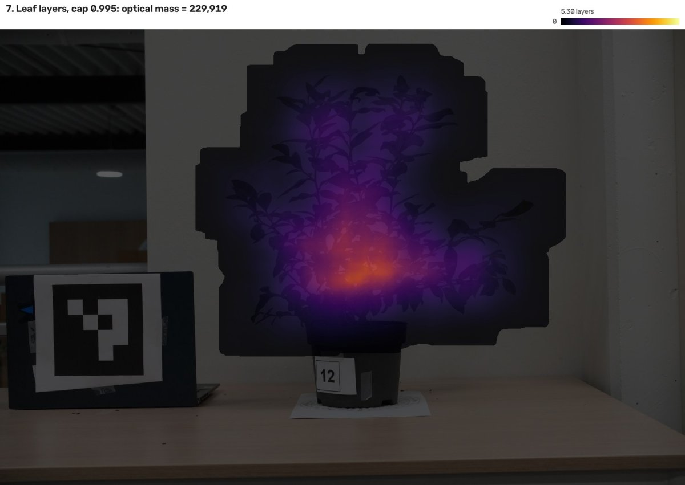

# Plant leaf area from photos
This is a group school project done in Semester 7 in HBO Software Engineering
study. 

Project is about measuring the leaf area of a blueberry plant **without picking its leaves**.
The plant is photographed from all sides, every photo is turned into one number
that grows with the amount of leaf (the *optical mass*), and a regression model
turns that number into leaf area in mm². The usual way to get a plant's true
leaf area is destructive: pick every leaf, lay the leaves flat and measure
them. 



The [Blueberry Photo Set](https://stichtingfontys-my.sharepoint.com/:f:/g/personal/543803_student_fontys_nl/IgCi29rLNlV9RLbcR7yX7a66AegQ3kuBNeGg2IEwI7AZd3g?e=TViqY2) that we created is posted on School Organization OneDrive. You should be 
able to see it with the Microsoft account (I hope).

## AI usage

The coding was mostly delegated to AI. The project is about developing the **method**: how to get from photos to
a leaf area that can be trusted. The software is how the method is tested. With AI writing the code, many
image-processing settings and methods could be tried in a short time, and the time went into analysing the results,
finding where and why the method fails, and deciding what to try next. The decisions, the analysis of the results
and the measurements are ours.

## Important limitations

- **Only 13 plants.** The method was developed and tested on 13 plants with a measured leaf area. That is too small a
  sample for real results: one plant more or less moves the error by about a point, and a model tested on 13 plants
  can look better than it is. The project runs in the winter semester, when blueberry plants lose their leaves, so
  no more plants could be measured.
- **The settings were chosen on the same plants.** The window size and the cap of the optical mass (below) were
  picked because they gave the lowest error on these 13 plants. The error reported here is therefore somewhat
  optimistic; new plants are needed for an independent test.
- **One setup.** All photos were taken in the same place: the same camera distance, a bright wall behind the plant,
  the same pot model. The model's factor c is valid for that setup only; another camera distance or background needs
  a new calibration.
- **Late-season plants.** Many leaves were already turning red and brown. The method is built to count them, but it
  hasn't been tested on green summer plants.

## Results
[RESTULTS REPORT HERE](./results/report.md)

The program was run on the whole photo set (270 photos of 15 plants) with its default settings: kernel 144, cap
0.995, 1/4 resolution. The leaf area of the 13 plants with a measured leaf area was predicted with leave-one-out
(see [Regression](#regression)):

| | |
|---|---|
| **typical error** (RMSE as % of the mean leaf area) | **3.59%** |
| R² | 0.955 |
| mean absolute error | 3.0% |
| plants within 5% | 10 of 13 (outside: P8 +8.3%, P10 −5.5%, P4 −5.1%) |
| c | 1.320 mm² per unit of optical mass (1.314–1.326 over the 13 leave-one-out rounds) |
| shuffle test | with the leaf areas shuffled between the plants, the error is 25% (median of 1000 shuffles); none comes near 3.59% |

The shuffle test checks that the result is not luck: if the optical mass carried no information about leaf area,
shuffling the leaf areas between the plants wouldn't make the error worse.



**Full report, with every plant and all the charts** (the fit, the error per plant, the spread over the photos, c in
every round, the shuffle test): [`results/report.md`](results/report.md). The CSVs of the run (every photo, every
plant, the predictions) are in [`results/`](results/). The step pictures (`--overlays`) aren't included: seven per photo,
about 1,900 pictures; run the program with `--overlays` to make them.

## The method

Each plant is photographed from 18 sides, every 20°, in front of a bright wall. Each photo goes through the steps
below (at 1/4 resolution, 1500 × 1000 px, unless `--full-res` is given), and gives one number, the optical mass. The
mean over the 18 photos is the plant's optical mass.

The pictures are the program's own overlays for plant P12 at 0° (`--overlays` saves them for every photo).

### 1. Seed: where the plant is

Green pixels are found with the *excess green* index (2G − R − B, thresholded automatically with Otsu's method).
Red-brown leaves, which the green rule misses, are added by hue and saturation where they lie next to green.
Nearby pixels are grouped, and the largest group is the plant (yellow outline); stray green elsewhere is dropped.

Colour is used only for this: to find **where** the plant is. It doesn't decide what counts as plant.



### 2. Pot

The pot is the largest dark grey blob of pot size under the plant. Its width is measured in the middle of the pot.
The rim line is measured **from the bottom** (bottom − 0.945 × width): all pots are the same model, and the bottom is
never hidden, while leaves often hang over the rim and make the pot look taller.



### 3. Foreground: everything that isn't wall

The wall's colour is estimated locally, around every pixel, so shading and light gradients on the wall are followed.
A pixel is foreground if it's clearly darker or more colourful than the wall behind it: leaves of any colour,
twigs, but also the pot, the table and other objects.



### 4. Background objects

Large dark blobs that aren't next to green are background objects and never count as plant: the dark opening on the
left, the laptop with the marker, the table front, the pot. Dark, shaded leaves right above the pot touch it and merge
with it into one blob; the part of that blob **above the rim line** is freed (yellow), so those leaves are counted.
Everything under the rim is pot.



### 5. Plant mask

The plant is all foreground outside the background objects, within 25 px of the seed, plus the seed itself. Leaves
and twigs are **not** told apart: a twig carries leaves and blocks the view like a leaf, and its colour changes over
the season (green in summer, red in autumn), so no colour rule could separate them reliably. Orange is what the
foreground added to the seed: twigs, dark and brown leaves, and leaf edges.


### 6. Leaf density

A side photo shows only the leaves in front; in a dense plant, leaves hide other leaves. The plant mask alone
therefore underestimates big, dense plants. For every pixel, the **leaf density** *f* is the plant's share of the
144 × 144 px window around it: 0 on bare wall, near 1 in the dense middle.



### 7. Leaf layers and the optical mass

Like light through layers of leaves (Beer-Lambert), a density *f* corresponds to −ln(1 − *f*) layers of leaf: a
window that is half covered holds about 0.7 layers, one that is 99% covered about 4.6. The density is capped at 0.995
first, so a fully covered window counts a finite number of layers (5.3). The **optical mass** of the photo is the sum
of the layers over all pixels: the more leaf, and the more it overlaps, the larger it is.



## Regression

The optical mass is a number of pixels, not mm². The model that turns it into leaf area is a line through zero:

    leaf area = c × optical mass

One number, c, learned from plants whose leaf area is known: no leaf, no optical mass. To learn it, the leaves of a
sample of plants have to be **picked and measured by hand first**: every leaf laid flat on a sheet, photographed from
above together with a marker of known size, and its area measured. That destroys the sample plants; it is done once,
to calibrate. After that, any plant photographed in the same setup gets its leaf area from c × its optical mass.

**Testing it: leave-one-out.** With so few plants, there is no separate test set. Instead, each plant in turn is left
out, c is learned from the other 12, and the left-out plant is predicted. Every plant is predicted by a model that
never saw it. The main score is the **typical error**: the RMSE of those predictions as a % of the mean leaf area.

The results of this test are at the top of this page, under [Results](#results).

## How the method was developed

The method wasn't designed in one go. It started from the work of **Mosa, a team member**, whose regression found
that the optical mass of the leaf mask (kernel 64, cap 0.9) predicts the leaf area best: **4.05%** on these plants.
From there, twelve experiments each tested one change: what the mask should count, how the optical mass is computed,
which photos to use, why the worst plants fail, and whether twigs can be told apart from leaves. Some helped, several
didn't, and the best-scoring one (2.93%) was deliberately not used, because it depends on the colour of the twigs.

The whole story, with every experiment's question, result and decision: **[experiments/](experiments/)**.

## Data

The leaf areas measured from the picked leaves are in [`data/real_leaf_area_mm2.csv`](data/real_leaf_area_mm2.csv).
The photo set (15 plants, 18 side photos and one top photo each, 3.6 GB) is too large for GitHub; it will be
available here: *link to follow*.

## Running it

```bash
python -m venv .venv
.venv/bin/pip install -e .

.venv/bin/plant-leaf-area PHOTO_SET                 # optical mass of every photo + the leave-one-out evaluation
.venv/bin/plant-leaf-area PHOTO_SET --overlays      # ... and the pictures of every step, with a viewer page
```

`PHOTO_SET` is a folder of plant folders (`P01/P01_side00.JPG`, `P01_side20.JPG`, ...); single plant folders or photo
files work too. The measured leaf areas are read from `data/real_leaf_area_mm2.csv` (run from the repository root,
or pass `--labels`). Options: `--kernel` (window size, default 144), `--cap` (default 0.995), `--full-res`, `--out`
(default `output/`), `--jobs`.

Output in `output/`:

| file | |
|---|---|
| `report.md` | the whole result on one page: scores, every plant, the charts (in `report_files/`) |
| `per_photo.csv` | optical mass, plant pixels and pot width of every photo |
| `per_plant.csv` | mean optical mass per plant, and its spread over the photos |
| `evaluation.csv` | per plant: measured and predicted leaf area (plant left out), error % |
| `evaluation.json` | the scores, c, the shuffle test and the run's settings |
| `overlays/index.html` | with `--overlays`: a page to browse the step pictures by plant, angle and step |

## Repository

```text
src/plant_leaf_area/
├── config.py          all settings
├── photos.py          finding and reading the side photos
├── segmentation.py    photo → plant mask (steps 1–5)
├── optical_mass.py    plant mask → density → layers → optical mass (steps 6–7)
├── evaluation.py      leave-one-out regression
├── overlays.py        the step pictures
├── viewer.py          the page to browse them
└── cli.py             the command
data/                  measured leaf areas
experiments/           the experiments that led to the method (own README and code)
results/               the run on the whole photo set: report.md and the CSVs
docs/images/           pictures for this README
```
