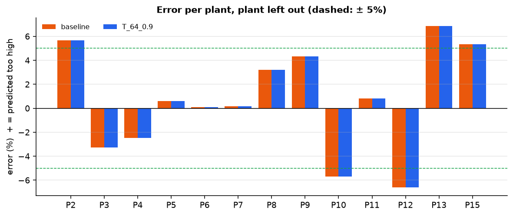
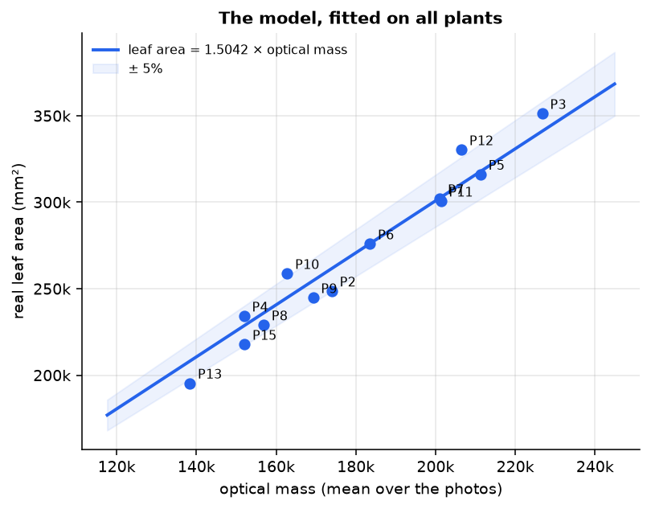
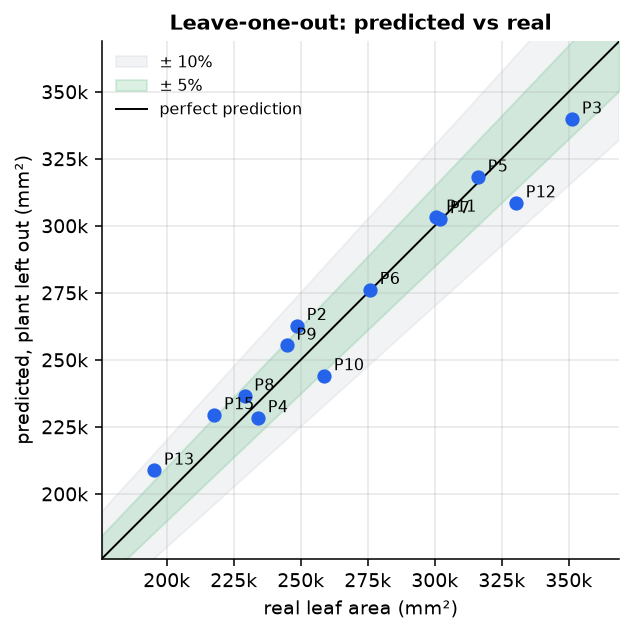
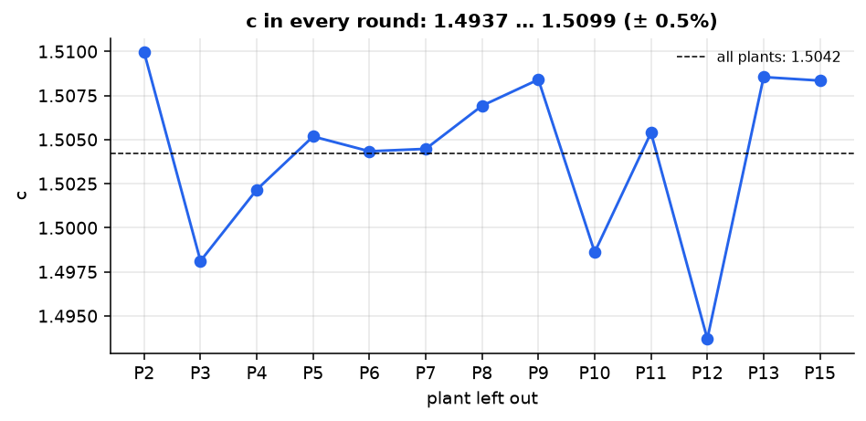
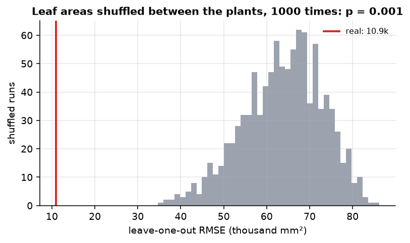

# Baseline report: T_64_0.9 (leaf mask, kernel 64, cap 0.90)

1 run + baseline · 13 plants (P2, P3, P4, P5, P6, P7, P8, P9, P10, P11, P12, P13, P15) · leaf area = c × optical mass, leave-one-out

**Contents**

1. [Summary](#summary) — the baseline, the best run and the honest score, and the verdict
2. [The method](#the-method) — what the experiment changes, its settings and how many runs it makes
3. [All runs](#all-runs) — how the runs are spread, what each setting does, the best runs
4. [Per plant: baseline vs best run](#per-plant-baseline-vs-best-run) — how far off each plant is, the baseline next to the best run, T_64_0.9
5. [Best run in detail](#best-run-in-detail-t_64_09) — its fit, every plant's prediction, whether one plant decides the model, and the shuffle test

How to read this page

**The model.** `leaf area = c × optical mass`: a straight line through zero, with c the one number learned from the plants. It is the model of the regression (`Regression/docs/single_feature_model.md`).

**Leave-one-out.** Every plant in turn is left out, c is learned from the others, and the left-out plant is predicted. Each plant is predicted by a model that never saw it.

**Typical error** = the RMSE of those predictions as a % of the average leaf area, the number the regression reports. **Mean error** = the average of the absolute errors in %. **R²**: 1 is perfect, 0 is no better than guessing the average plant.

**Baseline** = the current method, `T_64_0.9`: 64 px window, cap 0.9, leaf mask M1, mean over all side photos. Every experiment is compared with it on the same plants and leaf areas.

**Nested (honest) score.** With many runs, the best one is partly lucky: its settings happen to suit these plants. The nested score repeats the whole search once per plant: the best run is chosen on the other plants only, then predicts the left-out plant. Compare **that** number with the baseline.

**Noise.** With 14 plants, one plant can move the typical error by about a point. Differences below about 1 point are not a result.

## Summary

- **4.05%** baseline T_64_0.9
- **4.05%** best run: T_64_0.9

**Verdict:** the best run gives **4.05%**, against **4.05%** for the baseline (+0.00 points). That is within the ~1 point of noise: **no clear difference**.

## The method

**Runs:** 1 run, plus the baseline.

## All runs

### The best runs

| run | c | typical error | mean error | R² | within 5% | vs baseline |
|---|---|---|---|---|---|---|
| baseline | 1.5042 | 4.05% | 3.48% | 0.942 | 8/13 | +0.00 |
| T_64_0.9 | 1.5042 | 4.05% | 3.48% | 0.942 | 8/13 | +0.00 |

## Per plant: baseline vs best run

The error of every plant when it is predicted by the model learned without it, for the baseline (orange) and the best run, T_64_0.9. Above 0: predicted too high; below: too low. Between the green dashed lines the plant is within 5%. A plant that is off the same way for both is missed by the optical mass itself, not by the setting.

## Best run in detail: T_64_0.9

settings: —

- **4.1%** typical error
- **0.94** R²
- **8 / 13** plants within 5%
- **1.5042** c, fitted on all plants

### The fit and the predictions

Left: every plant's optical mass against its real leaf area, with the line `leaf area = c × optical mass` fitted on all plants. Right: each plant predicted by the model learned without it (leave-one-out), against its real leaf area. On the black line the prediction is perfect; inside the green band it is within 5%.

### Per plant

| plant | optical mass | real mm² | predicted mm² | error | baseline error |
|---|---|---|---|---|---|
| P2 | 173,982 | 248,603 | 262,702 | +5.7% | +5.7% |
| P3 | 226,759 | 351,253 | 339,711 | -3.3% | -3.3% |
| P4 | 151,977 | 234,098 | 228,294 | -2.5% | -2.5% |
| P5 | 211,302 | 316,107 | 318,047 | +0.6% | +0.6% |
| P6 | 183,546 | 275,843 | 276,114 | +0.1% | +0.1% |
| P7 | 201,092 | 301,997 | 302,538 | +0.2% | +0.2% |
| P8 | 156,880 | 229,026 | 236,406 | +3.2% | +3.2% |
| P9 | 169,281 | 244,749 | 255,344 | +4.3% | +4.3% |
| P10 | 162,788 | 258,726 | 243,957 | -5.7% | -5.7% |
| P11 | 201,345 | 300,609 | 303,103 | +0.8% | +0.8% |
| P12 | 206,502 | 330,299 | 308,451 | -6.6% | -6.6% |
| P13 | 138,375 | 195,339 | 208,745 | +6.9% | +6.9% |
| P15 | 152,085 | 217,768 | 229,397 | +5.3% | +5.3% |

### c in every round: does one plant decide the model?

Leave-one-out fits c 13 times, each time without one plant. Each point is the c fitted **without** the plant on the x-axis; the dashed line is c fitted on all plants. A flat line means no single plant drives the model. A point far from the line means that plant on its own pulls c up or down, and it is usually also predicted badly. Here c moves by ± 0.5%; the plant that moves it most is P12.

### Shuffle test: is the fit real or luck?

The leaf areas are shuffled randomly between the plants 1000 times, so they no longer belong to their photos, and the same leave-one-out test is run each time. Grey: the errors of the shuffled data. Red: the error of the real data. If red lies left of nearly all of grey, the optical mass really carries the leaf area. p is the share of shuffles that did as well as the real data (p < 0.05: not luck). It says the run is not noise, not that it beats the baseline. Here 0 of 1000 shuffles did as well (p = 0.001, so it is not luck).

