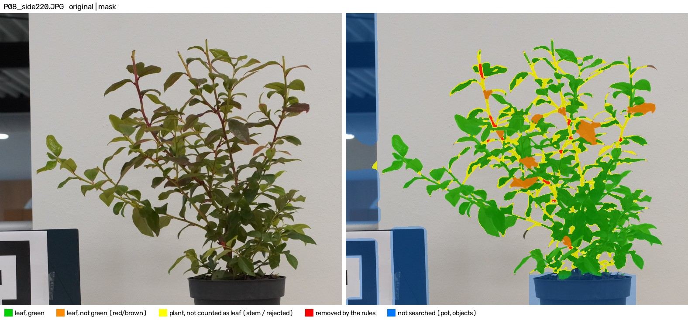
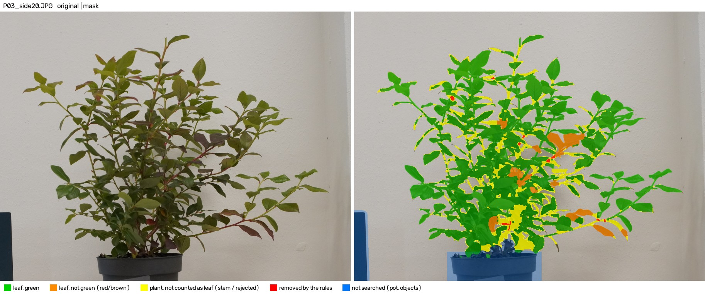
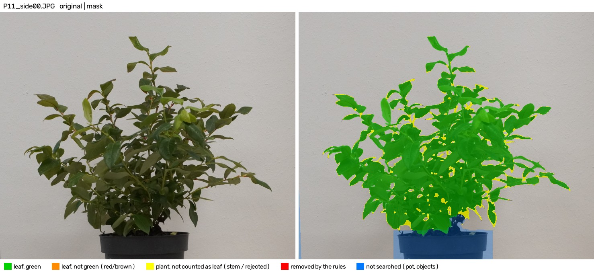
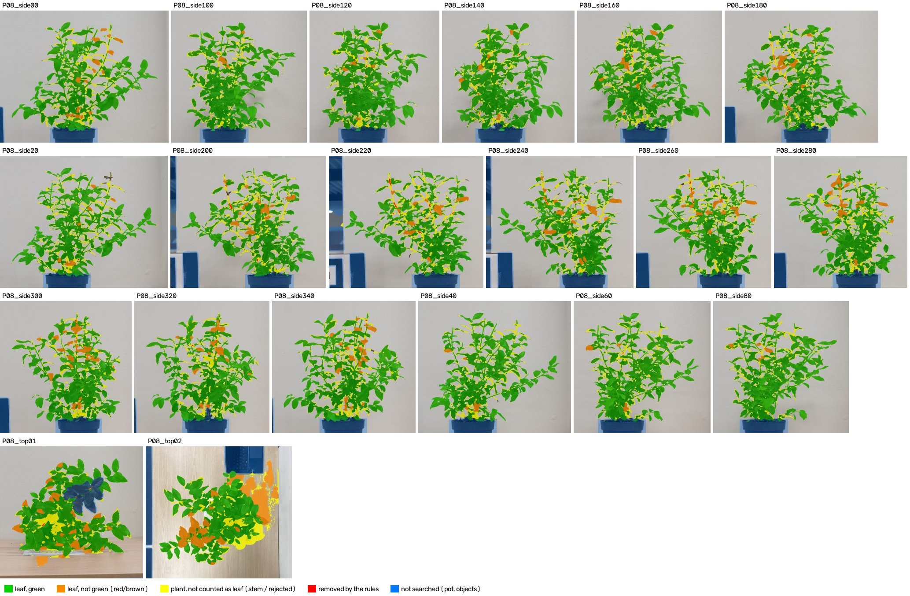

# 02 Mask check

**Results:** [example pictures](results/examples/) · the pixel counts of every photo: [`pixels.csv`](results/pixels.csv)

**This experiment doesn't test anything with the regression.** It only draws the leaf mask over the photos, so you
can check by eye what the image processing really detects as leaf. There is no `runs.csv` and no report: the result
is the pictures.

**Why:** every optical mass is computed from the leaf mask, so it can only be as good as the mask. With winter
coming, many leaves turn red or brown. Is every leaf in the mask, and is nothing else in it?

## What it does

It runs the leaf mask of the regression (`image_processing/masks.py`, mask M1, 1/4 resolution, exactly what the
optical mass uses) on all 299 photos of the 15 plants, side and top. Each photo is saved as **original | overlay**,
and each colour shows how the segmentation classified a pixel:

| colour | meaning |
|---|---|
| green | counted as leaf, green |
| orange | counted as leaf, not green (red or brown leaves the M1 rules accept) |
| yellow | plant, but **not** counted as leaf: stems, and non-green parts the rules didn't accept. A red or brown leaf painted yellow is a **missed leaf** |
| red | green-ish pixels the rules removed again (wall noise, or a dropped leaf) |
| blue tint | not searched for leaves (pot, soil, objects in the room) |

```bash
.venv/bin/python 02_mask_check/mask_check.py $PHOTOS     # about 40 s
```

Output in `results/`:

- `<plant>/sheet.jpg`: all photos of one plant on one page (not in this repository; P8's is in `examples/`).
- `examples/`: the three photos shown below, at full size.
- `pixels.csv`: per photo, the leaf pixels (green and not green), the plant pixels not counted, and the removed
  pixels.
- `index.html`: every photo as a thumbnail; click one for the full size. It and the full-size pictures are rebuilt
  by the script and not kept in git.

## What the pictures show

**P8, the plant with the most uncounted plant parts** (27% of its leaf pixels in this photo). The red twigs are
yellow: the mask leaves them out on purpose. Some reddish leaves are orange, so the dark-leaf rule does catch them,
and a few small red bits on the twigs are removed again (red).



**P3, missed leaf.** The dark, reddish leaves low in the middle of the plant are yellow: they are leaf, but the mask
doesn't count them. Several reddish leaves on the right are caught (orange).



**P11, a clean mask.** Almost everything is green; only thin leaf edges and a few twig bits are yellow. This is the
plant with the least uncounted plant parts (12%).



**All photos of P8** (the script makes one for every plant, in `results/<plant>/sheet.jpg`):



## In numbers (side photos, `pixels.csv`)

| | |
|---|---|
| leaf counted that isn't green (orange), as % of the leaf | 0.6% (P1, P7) to 5.4% (P8) |
| plant not counted as leaf (yellow), as % of the leaf | 11.6% (P11) to 19.7% (P8) |
| most yellow | P08_side220 (27%), P08_side200, P13_side40, P03_side20, P08_side20 (23–24%) |

- **Most of the yellow is red stems and twigs,** which the mask leaves out on purpose.
- **Some of it is leaf:** brownish leaf edges and dark reddish leaves, like the ones in P3.
- **Plants with more red and brown leaves lose more:** P8, P15, P6, P3.

## What came out of it

The mask leaves out 12–20% of what the segmentation sees as plant, and how much differs between plants. Some of it
is leaf, most of it is twigs. Twigs also block the view, like leaves do, so they may belong in the gap fraction too.
Experiment 03 tests counting all of it, and experiment 04 the cap on both masks.
