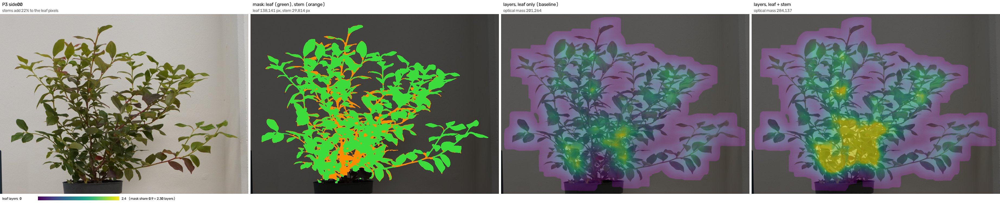

# 03 Stems as leaf

**Results:** [full report](results/report.md)

**Question:** does the optical mass get better if the stems and twigs count as leaf?

Experiment 02 showed that the leaf mask leaves out 12–20% of the plant: twigs, brown leaf edges and parts of reddish
leaves. The segmentation calls them "stem". Two reasons they might belong in the optical mass:

- **Some of it is leaf** the mask misses (brown edges, reddish leaves).
- **Twigs block the view** like leaves do. The optical mass reads how much wall shows through the plant, and a
  twig in front of the wall is not a gap.

## Method

The baseline with only the mask changed:

```
mask:       leaf (M1, the baseline)   or   leaf + stem (everything the segmentation sees as plant, without the pot)
per pixel:  f = mask share in the 64 px window,   −ln(1 − min(f, 0.9))
per photo:  sum over all pixels;   per plant: mean over its side photos
```

One run (leaf + stem) against the baseline (leaf). The kernel (64 px) and the cap (0.90) are the baseline's; the cap
is tested in experiment 04. Nothing is tuned, so there is no luck from choosing among runs.

```bash
.venv/bin/python 03_stems_as_leaf/stems_as_leaf.py $PHOTOS     # about 5 s with cached masks
.venv/bin/python 00_evaluation/evaluate.py 03_stems_as_leaf/results/runs.csv
```

The stems add 12% (P11) to 20% (P8) to the mask pixels (`results/stem_share.csv`).

### What it looks like

One photo four ways: the photo, the mask (leaf green, stem orange), and the leaf layers per pixel with leaf only (the
baseline) and with leaf + stem (purple 0, yellow = the cap).



P3, a dense plant. The stems sit mostly in the lower core, between the leaves and on reddish leaf parts. Counted in,
the core fills up to the cap over a large area: the optical mass of this photo rises by 41%, much more than the 22%
extra pixels, because a fuller window counts for more layers.

P8 (the most red twigs) and P10 (an open plant) are in `results/pictures/` too, and all three are in the report.

## Result

Tested on the current leaf areas (`common/real_leaf_area_mm2.csv`, from `01_leaf_measurement/results/monday.csv`): 13 plants, P1 left
out.

| mask | c | typical error | R² | mean error | plants within 5% |
|---|---|---|---|---|---|
| leaf (baseline) | 1.504 | **4.05%** | 0.942 | 3.5% | 8 / 13 |
| leaf + stem | 1.215 | **4.16%** | 0.939 | 3.8% | 10 / 13 |

Error per plant (plant left out, + = predicted too high):

| | P2 | P3 | P4 | P5 | P6 | P7 | P8 | P9 | P10 | P11 | P12 | P13 | P15 |
|---|---|---|---|---|---|---|---|---|---|---|---|---|---|
| leaf (baseline) | +5.7 | −3.3 | −2.5 | +0.6 | +0.1 | +0.2 | +3.2 | +4.3 | −5.7 | +0.8 | −6.6 | +6.9 | +5.3 |
| leaf + stem | +1.5 | −1.3 | −2.4 | +2.8 | +2.2 | −2.3 | **+9.8** | +1.6 | −3.8 | −5.0 | −5.5 | +5.8 | +4.7 |

- **No gain on its own:** 4.16% against 4.05%, within the noise. More plants end up within 5% (10 instead of 8),
  but the typical error, which weighs the worst plants most, doesn't improve.
- **Most of the worst plants improve:** P2 (+5.7 → +1.5%), P9 (+4.3 → +1.6%), P10 (−5.7 → −3.8%), P13 and P15
  a little.
- **P8 gets much worse** (+3 → +10%). It has the most red twigs (+20% pixels), and they are twigs, not missed leaf,
  so counting them overshoots. P11 goes the other way (+1 → −5%): it has the fewest stem pixels (12%).
- **c drops** (1.50 → 1.22), because the same leaf area is now spread over more counted pixels.

## Conclusion

Counting the stems moves the right plants in the right direction, but P8's red twigs cancel the gain. At the
baseline's cap of 0.90 it is no better than leaf only. Two things to try next: a different cap, since the stems fill
the windows and the cap then acts on more of the plant (experiment 04), and counting the twigs differently from the
missed leaf parts (experiment 10).

On the first hand measurement (14 plants, with P1) the same change gained about 1 point, mostly from P1 (+11 → +6%)
and P3. With P1 left out and P3 re-measured, that gain is gone.
