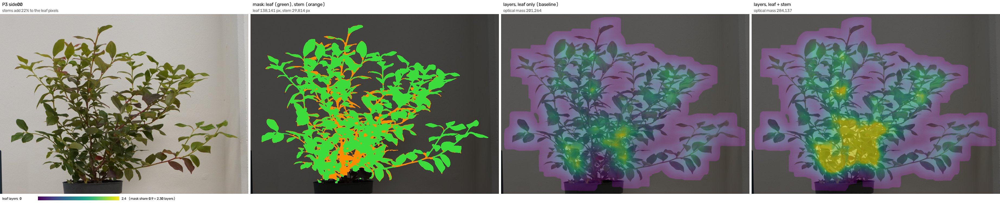
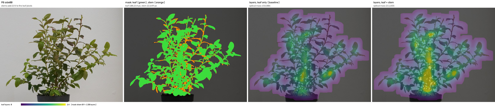
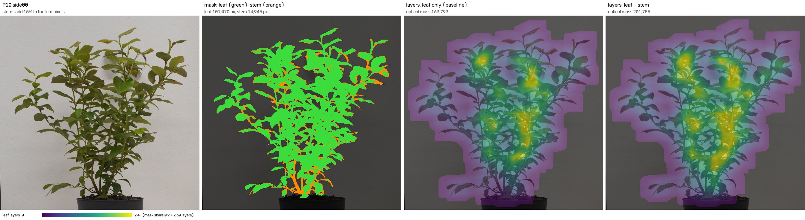
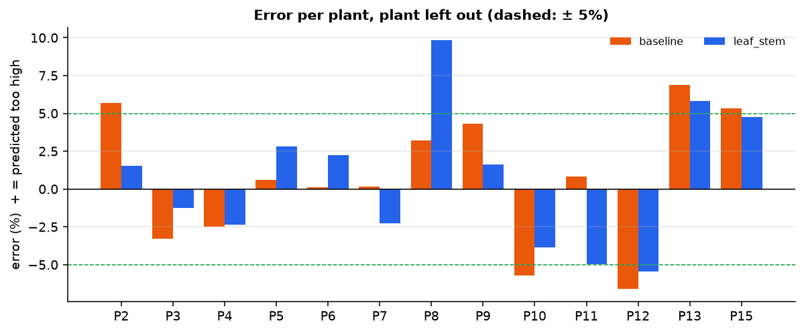
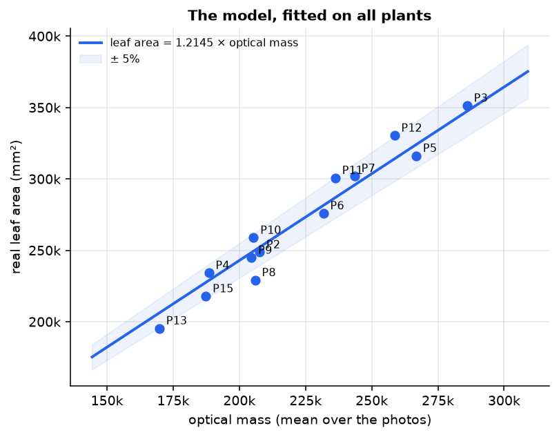
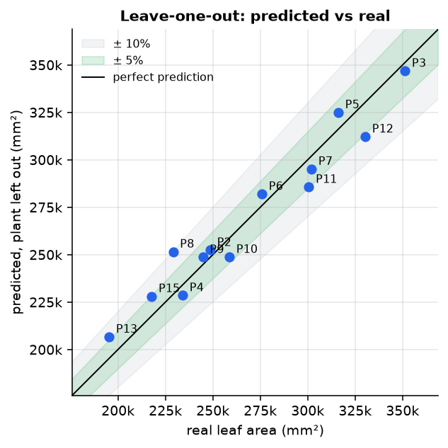
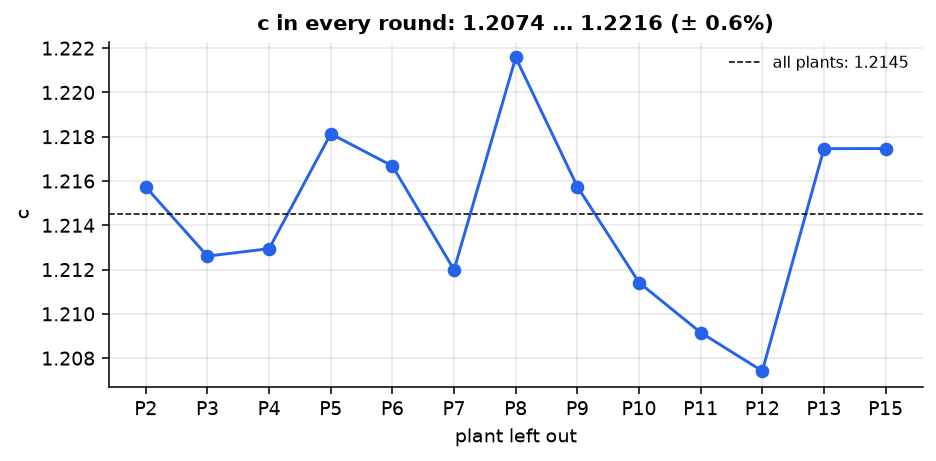
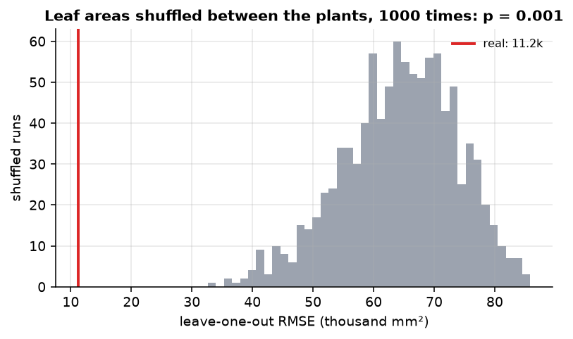

# Experiment 03_stems_as_leaf

1 run + baseline · 13 plants (P2, P3, P4, P5, P6, P7, P8, P9, P10, P11, P12, P13, P15) · leaf area = c × optical mass, leave-one-out

**Contents**

1. [Summary](#summary) — the baseline, the best run and the honest score, and the verdict
2. [The method](#the-method) — what the experiment changes, its settings and how many runs it makes
3. [What the method looks like](#what-the-method-looks-like) — the method drawn on example photos
4. [All runs](#all-runs) — how the runs are spread, what each setting does, the best runs
5. [Per plant: baseline vs best run](#per-plant-baseline-vs-best-run) — how far off each plant is, the baseline next to the best run, leaf_stem
6. [Best run in detail](#best-run-in-detail-leaf_stem) — its fit, every plant's prediction, whether one plant decides the model, and the shuffle test

How to read this page

**The model.** `leaf area = c × optical mass`: a straight line through zero, with c the one number learned from the plants. It is the model of the regression (`Regression/docs/single_feature_model.md`).

**Leave-one-out.** Every plant in turn is left out, c is learned from the others, and the left-out plant is predicted. Each plant is predicted by a model that never saw it.

**Typical error** = the RMSE of those predictions as a % of the average leaf area, the number the regression reports. **Mean error** = the average of the absolute errors in %. **R²**: 1 is perfect, 0 is no better than guessing the average plant.

**Baseline** = the current method, `T_64_0.9`: 64 px window, cap 0.9, leaf mask M1, mean over all side photos. Every experiment is compared with it on the same plants and leaf areas.

**Nested (honest) score.** With many runs, the best one is partly lucky: its settings happen to suit these plants. The nested score repeats the whole search once per plant: the best run is chosen on the other plants only, then predicts the left-out plant. Compare **that** number with the baseline.

**Noise.** With 14 plants, one plant can move the typical error by about a point. Differences below about 1 point are not a result.

## Summary

- **4.05%** baseline T_64_0.9
- **4.16%** best run: leaf_stem

**Verdict:** the best run gives **4.16%**, against **4.05%** for the baseline (+0.11 points). That is within the ~1 point of noise: **no clear difference**.

## The method

**Question:** does the optical mass get better if the stems and twigs count as leaf?

The mask check (experiment 01) showed that the leaf mask leaves out 12–20% of the plant: twigs, brown leaf edges and parts of reddish leaves. The segmentation calls them "stem". Two reasons they might belong in the optical mass:

- **Some of it is leaf** the mask misses (brown edges, reddish leaves).
- **Twigs block the view** like leaves do. The optical mass reads how much wall shows through the plant, and a twig in front of the wall is not a gap.

**The method** is the baseline with only the mask changed:

1. **Mask:** leaf + stem, i.e. everything the segmentation sees as plant (without the pot), instead of leaf only.
2. **Per pixel:** f = the mask's share in the 64 px window around it, layers = −ln(1 − min(f, 0.9)).
3. **Per photo:** the sum of the layers over all pixels; **per plant:** the mean over its side photos.

One run against the baseline, with nothing tuned, so the honest score is the run's own score. The kernel (64 px) and the cap (0.90) are the baseline's; the cap is tested in experiment 03.

### The settings

What the settings in the run names and tables mean.

| setting | what it does | values tried |
|---|---|---|
| **mask** | which pixels count as plant: leaf only (the baseline), or leaf + stem (everything the segmentation sees as plant, without the pot) | leaf (baseline), leaf+stem |

**Runs:** 1 run, plus the baseline.

## What the method looks like

*P3, a dense plant. The stems sit mostly in the lower core, between the leaves and on reddish leaf parts. Counted in, the core fills up to the cap over a large area: the optical mass rises by 41% (201,264 to 284,137), much more than the 22% extra pixels, because a fuller window counts for more layers.*

*P8, the plant with the most red twigs (here the stems add 21% to the leaf pixels). The twigs (orange) run through the whole plant; counted in, they fill the gaps in its central column, which reaches the cap (yellow). The optical mass rises by 35% (156,806 to 211,835).*

*P10, an open plant. The stems are mainly the bare shoots at the base and some leaf edges. The dense clumps grow a little and the optical mass rises by 23% (163,793 to 201,755).*

## All runs

### The best runs

| run | mask | c | typical error | mean error | R² | within 5% | vs baseline |
|---|---|---|---|---|---|---|---|
| baseline | leaf | 1.5042 | 4.05% | 3.48% | 0.942 | 8/13 | +0.00 |
| leaf_stem | leaf+stem | 1.2145 | 4.16% | 3.75% | 0.939 | 10/13 | +0.11 |

## Per plant: baseline vs best run

The error of every plant when it is predicted by the model learned without it, for the baseline (orange) and the best run, leaf_stem. Above 0: predicted too high; below: too low. Between the green dashed lines the plant is within 5%. A plant that is off the same way for both is missed by the optical mass itself, not by the setting.

## Best run in detail: leaf_stem

settings: mask **leaf+stem**

- **4.2%** typical error
- **0.94** R²
- **10 / 13** plants within 5%
- **1.2145** c, fitted on all plants

### The fit and the predictions

Left: every plant's optical mass against its real leaf area, with the line `leaf area = c × optical mass` fitted on all plants. Right: each plant predicted by the model learned without it (leave-one-out), against its real leaf area. On the black line the prediction is perfect; inside the green band it is within 5%.

### Per plant

| plant | optical mass | real mm² | predicted mm² | error | baseline error |
|---|---|---|---|---|---|
| P2 | 207,630 | 248,603 | 252,422 | +1.5% | +5.7% |
| P3 | 286,037 | 351,253 | 346,850 | -1.3% | -3.3% |
| P4 | 188,461 | 234,098 | 228,593 | -2.4% | -2.5% |
| P5 | 266,806 | 316,107 | 325,004 | +2.8% | +0.6% |
| P6 | 231,749 | 275,843 | 281,963 | +2.2% | +0.1% |
| P7 | 243,532 | 301,997 | 295,159 | -2.3% | +0.2% |
| P8 | 205,937 | 229,026 | 251,568 | +9.8% | +3.2% |
| P9 | 204,553 | 244,749 | 248,684 | +1.6% | +4.3% |
| P10 | 205,363 | 258,726 | 248,780 | -3.8% | -5.7% |
| P11 | 236,259 | 300,609 | 285,674 | -5.0% | +0.8% |
| P12 | 258,593 | 330,299 | 312,230 | -5.5% | -6.6% |
| P13 | 169,794 | 195,339 | 206,718 | +5.8% | +6.9% |
| P15 | 187,358 | 217,768 | 228,102 | +4.7% | +5.3% |

### c in every round: does one plant decide the model?

Leave-one-out fits c 13 times, each time without one plant. Each point is the c fitted **without** the plant on the x-axis; the dashed line is c fitted on all plants. A flat line means no single plant drives the model. A point far from the line means that plant on its own pulls c up or down, and it is usually also predicted badly. Here c moves by ± 0.6%; the plant that moves it most is P12.

### Shuffle test: is the fit real or luck?

The leaf areas are shuffled randomly between the plants 1000 times, so they no longer belong to their photos, and the same leave-one-out test is run each time. Grey: the errors of the shuffled data. Red: the error of the real data. If red lies left of nearly all of grey, the optical mass really carries the leaf area. p is the share of shuffles that did as well as the real data (p < 0.05: not luck). It says the run is not noise, not that it beats the baseline. Here 0 of 1000 shuffles did as well (p = 0.001, so it is not luck).

