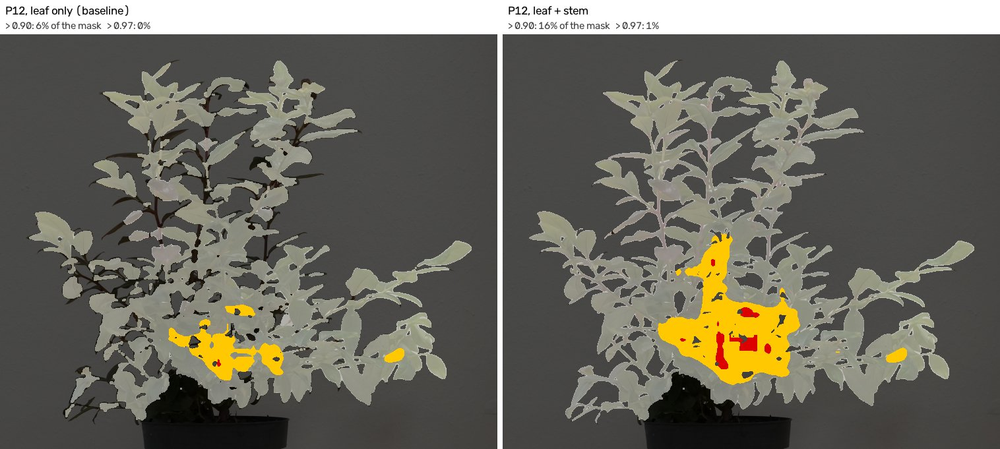

# 04 Cap

**Results:** [full report](results/report.md)

**Question:** is 0.90 the right cap, and does the answer change when the stems are counted in?

Every pixel gets `−ln(1 − min(f, cap))` leaf layers, where f is the mask's share in the 64 px window around it. The
cap stops a nearly solid window from counting for an unlimited number of layers. At 0.90 a window counts for at most
2.30 layers, but in a dense core leaves hide behind leaves deeper than that. A higher cap lets those windows count
for more:

| cap | 0.85 | 0.90 | 0.95 | 0.97 | 0.98 | 0.99 | 0.995 | 0.999 |
|---|---|---|---|---|---|---|---|---|
| max layers | 1.90 | 2.30 | 3.00 | 3.51 | 3.91 | 4.61 | 5.30 | 6.91 |

## Method

The baseline with the cap changed, on both masks: leaf only (the baseline) and leaf + stem (experiment 03). 11 caps
from 0.85 to 0.999, at the baseline's kernel of 64 px: 22 runs. `leaf_cap_0.900` is the baseline itself.

```bash
.venv/bin/python 04_cap/cap.py $PHOTOS          # about 5 s with cached masks
.venv/bin/python 00_evaluation/evaluate.py 04_cap/results/runs.csv
```

The cap only changes pixels whose window is fuller than the cap. Counting the stems fills the windows, so with
leaf + stem the cap acts on about twice as much of the plant (`results/capped_share.csv`, share of the mask whose
window is fuller than 0.90):

| | open plants (P2, P10) | dense plants (P6, P11, P12) |
|---|---|---|
| leaf | 1–3% | 10–18% |
| leaf + stem | 4–5% | 20–28% |



P12, the densest plant: yellow is where the 0.90 cap acts, red where even a 0.97 cap would. With the stems counted
in, the gaps in the core fill up and the cap acts on 16% of the mask instead of 6%.

## Result

Tested on the current leaf areas (`common/real_leaf_area_mm2.csv`, from `01_leaf_measurement/results/monday.csv`): 13 plants, P1 left
out.

Typical error:

| cap | leaf | leaf + stem |
|---|---|---|
| 0.85 | 4.46% | 5.09% |
| 0.90 | **4.05%** (baseline) | 4.16% |
| 0.92 | **4.03%** | 3.94% |
| 0.94 | 4.09% | **3.88%** |
| 0.95 | 4.14% | 3.92% |
| 0.96 | 4.19% | 4.03% |
| 0.97 | 4.25% | 4.20% |
| 0.98 | 4.31% | 4.44% |
| 0.99 | 4.37% | 4.76% |
| 0.999 | 4.45% | 5.25% |

Best: leaf + stem, cap 0.94, **3.88%** against 4.05% for the baseline. Honest score (mask and cap chosen without the
plant it predicts, over all 22 runs): **4.95%**. 5 of 22 runs beat the baseline. The nested search picked leaf + stem
at 0.94 in 7 of 13 rounds, and otherwise jumped between leaf at 0.90–0.92 and leaf + stem at 0.92 or 0.96.

Error per plant (plant left out, + = predicted too high):

| | P2 | P3 | P4 | P5 | P6 | P7 | P8 | P9 | P10 | P11 | P12 | P13 | P15 |
|---|---|---|---|---|---|---|---|---|---|---|---|---|---|
| leaf, 0.90 (baseline) | +5.7 | −3.3 | −2.5 | +0.6 | +0.1 | +0.2 | +3.2 | +4.3 | −5.7 | +0.8 | −6.6 | +6.9 | +5.3 |
| leaf, 0.999 | +3.1 | −4.3 | −3.5 | −0.2 | +1.1 | +0.4 | +2.0 | +2.1 | −8.5 | +6.0 | −5.0 | +5.2 | +7.7 |
| leaf + stem, 0.90 | +1.5 | −1.3 | −2.4 | +2.8 | +2.2 | −2.3 | +9.8 | +1.6 | −3.8 | −5.0 | −5.5 | +5.8 | +4.7 |
| leaf + stem, 0.94 | −1.0 | −1.2 | −2.9 | +3.5 | +4.0 | −1.8 | +8.2 | −0.3 | −6.6 | −1.9 | −4.4 | +4.2 | +5.0 |
| leaf + stem, 0.999 | −5.9 | +0.3 | −6.0 | +3.4 | +7.9 | −2.4 | +5.2 | −4.7 | −11.6 | +3.5 | −1.9 | +2.0 | +6.7 |

- **With leaf only, 0.90 is already right.** The curve is flat from 0.90 to 0.94 (4.03–4.09%) and gets worse on
  both sides.
- **With leaf + stem the best cap is a little higher, 0.92–0.95** (3.88–3.94%). The stems fill the windows, so a
  slightly higher cap lets the dense cores count for a bit more. Above 0.96 it gets worse quickly.
- **A high cap fails at kernel 64.** At 0.999 a 64 px window is full over single clumps of leaves, which then count
  for up to 7 layers: P10, an open plant with a few such clumps, drops to −11.6%, P6 rises to +7.9%.
- **No clear gain:** the best run is 0.17 points better than the baseline, and the honest score is 0.9 points worse.
  The difference between the best caps is far below the noise, so which run is "best" changes with the plant left
  out.
- **P8 stays the problem for leaf + stem:** +8 to +10% at the good caps. Its red twigs are counted as plant.

## Conclusion

At kernel 64 the baseline's cap of 0.90 is about right for leaf only, and 0.92–0.95 for leaf + stem. Neither the cap
nor the stems give a clear gain on their own. A high cap (0.97–0.999) only makes sense with a larger window, where a
window is rarely full over a single clump: that is for the kernel experiment (05) to test with the stems counted in.
