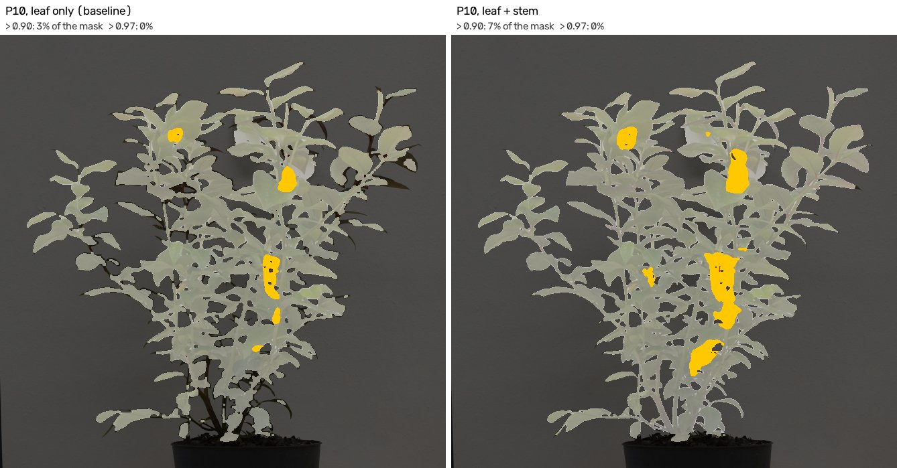
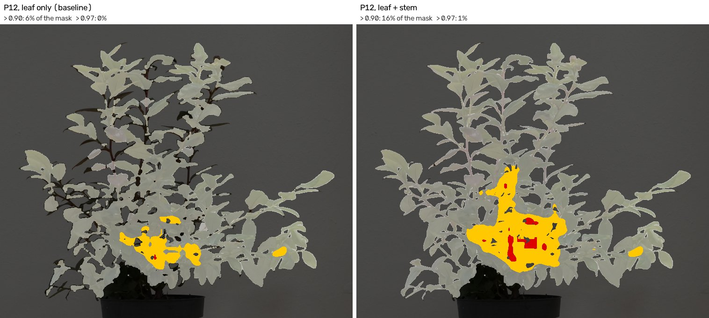
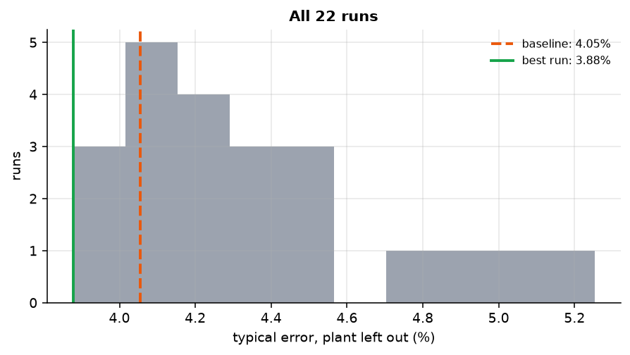
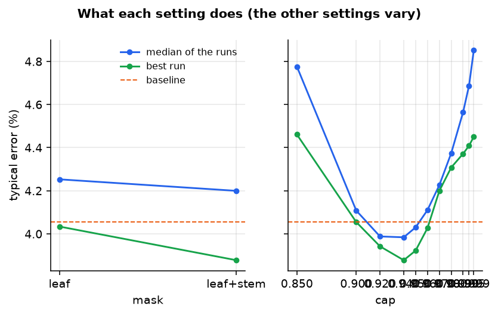
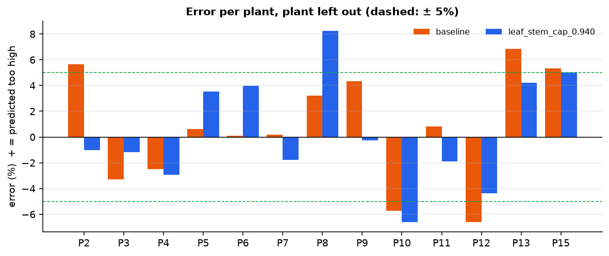
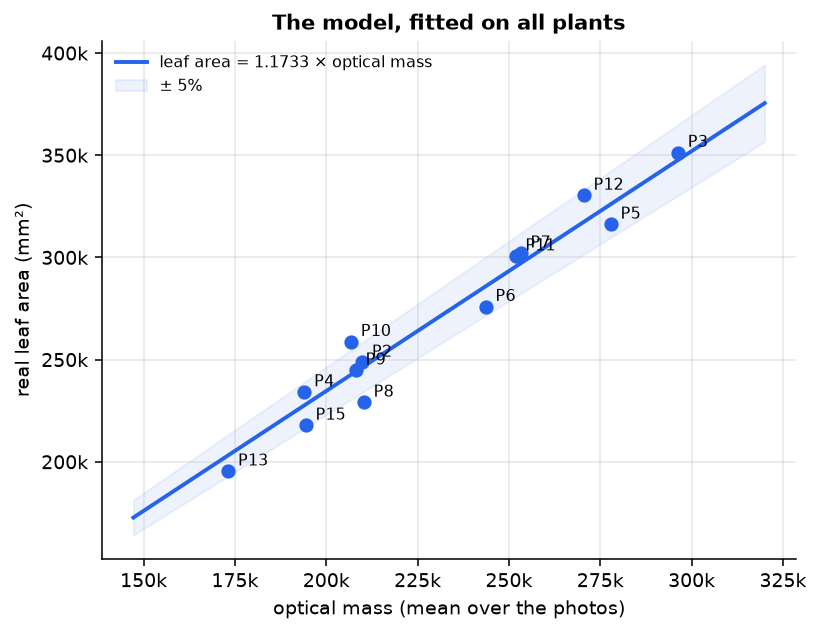
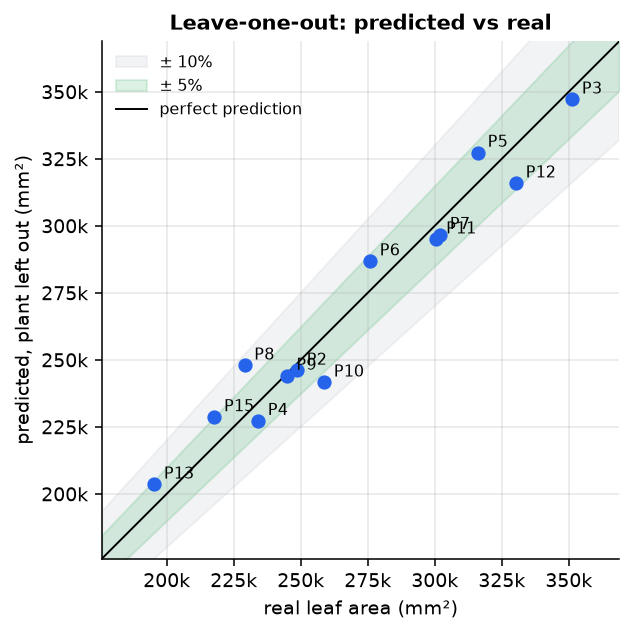
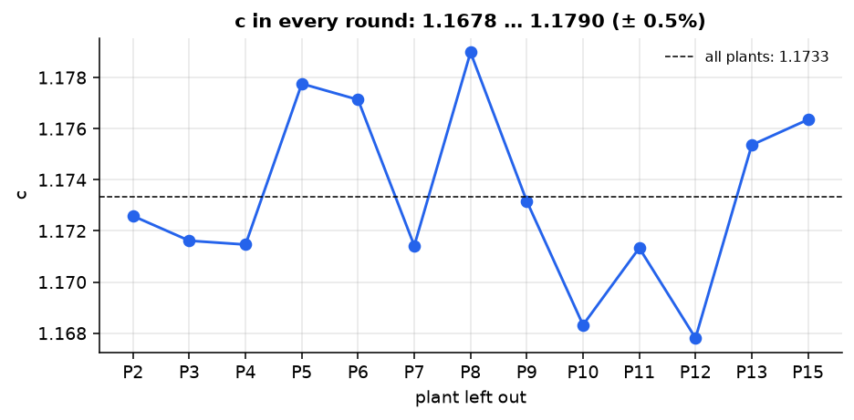
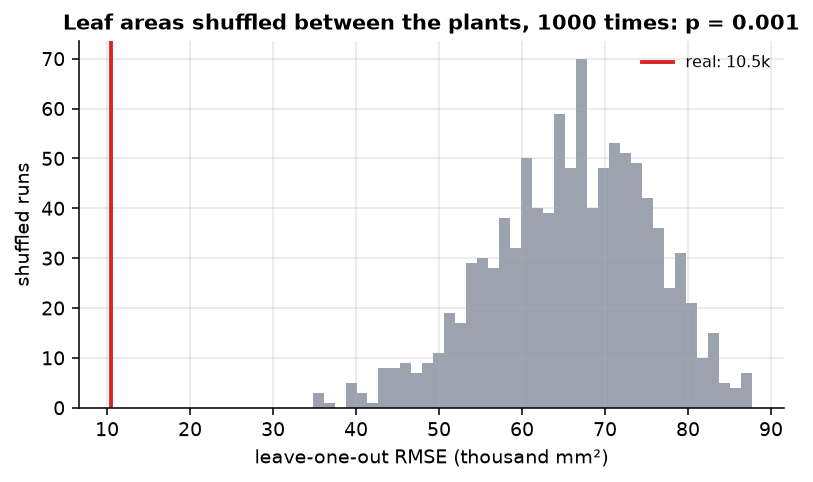

# Experiment 04_cap

22 runs + baseline · 13 plants (P2, P3, P4, P5, P6, P7, P8, P9, P10, P11, P12, P13, P15) · leaf area = c × optical mass, leave-one-out

**Contents**

1. [Summary](#summary) — the baseline, the best run and the honest score, and the verdict
2. [The method](#the-method) — what the experiment changes, its settings and how many runs it makes
3. [What the method looks like](#what-the-method-looks-like) — the method drawn on example photos
4. [All runs](#all-runs) — how the runs are spread, what each setting does, the best runs
5. [Per plant: baseline vs best run](#per-plant-baseline-vs-best-run) — how far off each plant is, the baseline next to the best run, leaf_stem_cap_0.940
6. [Best run in detail](#best-run-in-detail-leaf_stem_cap_0940) — its fit, every plant's prediction, whether one plant decides the model, and the shuffle test

How to read this page

**The model.** `leaf area = c × optical mass`: a straight line through zero, with c the one number learned from the plants. It is the model of the regression (`Regression/docs/single_feature_model.md`).

**Leave-one-out.** Every plant in turn is left out, c is learned from the others, and the left-out plant is predicted. Each plant is predicted by a model that never saw it.

**Typical error** = the RMSE of those predictions as a % of the average leaf area, the number the regression reports. **Mean error** = the average of the absolute errors in %. **R²**: 1 is perfect, 0 is no better than guessing the average plant.

**Baseline** = the current method, `T_64_0.9`: 64 px window, cap 0.9, leaf mask M1, mean over all side photos. Every experiment is compared with it on the same plants and leaf areas.

**Nested (honest) score.** With many runs, the best one is partly lucky: its settings happen to suit these plants. The nested score repeats the whole search once per plant: the best run is chosen on the other plants only, then predicts the left-out plant. Compare **that** number with the baseline.

**Noise.** With 14 plants, one plant can move the typical error by about a point. Differences below about 1 point are not a result.

## Summary

- **4.05%** baseline T_64_0.9
- **3.88%** best run: leaf_stem_cap_0.940 (optimistic)
- **4.95%** honest: run chosen without the plant (nested)
- **5 / 22** runs better than the baseline

**Verdict:** choosing the run on the other plants (nested) gives **4.95%**, against **4.05%** for the baseline (+0.90 points). That is within the ~1 point of noise: **no clear difference**.

Runs the nested search chose: leaf_stem_cap_0.940 (7×), leaf_cap_0.900 (2×), leaf_stem_cap_0.920 (2×), leaf_cap_0.920 (1×), leaf_stem_cap_0.960 (1×)

## The method

**Question:** is 0.90 the right cap, and does the answer change when the stems are counted in?

Every pixel gets −ln(1 − min(f, cap)) leaf layers, where f is the mask's share in the 64 px window around it. The cap stops a nearly solid window from counting for an unlimited number of layers. At 0.90 a window counts for at most 2.30 layers, but in a dense core leaves hide behind leaves deeper than that. A higher cap lets those windows count for more:

| cap | 0.85 | 0.90 | 0.95 | 0.97 | 0.98 | 0.99 | 0.995 | 0.999 |
|---|---|---|---|---|---|---|---|---|
| max layers | 1.90 | 2.30 | 3.00 | 3.51 | 3.91 | 4.61 | 5.30 | 6.91 |

**The method** is the baseline with the cap changed, on both masks:

1. **Mask:** leaf only (the baseline), or leaf + stem (experiment 02).
2. **Per pixel:** f = the mask's share in the 64 px window around it, layers = −ln(1 − min(f, cap)).
3. **Per photo:** the sum of the layers over all pixels; **per plant:** the mean over its side photos.

The cap only changes pixels whose window is fuller than the cap. Counting the stems fills the windows, so with leaf + stem the cap acts on more of the plant. A run's name is its mask and cap: `leaf_stem_cap_0.990`. `leaf_cap_0.900` is the baseline itself.

### The settings

What the settings in the run names and tables mean.

| setting | what it does | values tried |
|---|---|---|
| **mask** | which pixels count as plant: leaf only (the baseline), or leaf + stem (everything the segmentation sees as plant, without the pot; experiment 02) | leaf, leaf+stem |
| **cap** | highest mask share f a window may have when it is turned into layers, layers = -ln(1 - min(f, cap)). It limits how many layers a nearly solid window counts: 0.90 = 2.3, 0.99 = 4.6, 0.999 = 6.9 layers. | 0.85, 0.9, 0.92, 0.94, 0.95, 0.96, 0.97, 0.98, 0.99, 0.995, 0.999 (baseline 0.9) |

**Runs:** every combination of the settings, 2 mask × 11 cap = **22 runs**, plus the baseline.

## What the method looks like

*P10, an open plant, at kernel 64: the mask (grey), the pixels whose window is fuller than 0.90 (yellow), where the 0.90 cap acts, and fuller than 0.97 (red), where even a 0.97 cap would act. Only these pixels change when the cap is raised. On this open plant the cap acts on a few small clumps: 3% of the mask with leaf only, 7% with the stems.*

*P12, the densest plant, the same way. With the stems counted in, the gaps in the core fill up: the cap acts on 16% of the mask instead of 6%, and a few spots are even fuller than 0.97.*

## All runs

The typical error of every run. Runs left of the orange line beat the baseline; the green line is the best run (before the honest correction).

### What each setting does

One panel per setting. For each value of the setting, the runs with that value are taken together, whatever the other settings: blue is their median typical error, green the best of them. The orange line is the baseline. A flat line means the setting doesn't matter; a slope shows which values are better.

### Where the best 10% of the runs lie (2 runs, typical error ≤ 3.92%)

| setting | range in the best 10% | share of the best 10% per value | if it didn't matter |
|---|---|---|---|
| mask | leaf+stem | leaf: 0% · leaf+stem: 100% | 50% |
| cap | 0.94 – 0.95 | 0.85: 0% · 0.9: 0% · 0.92: 0% · 0.94: 50% · 0.95: 50% · 0.96: 0% · 0.97: 0% · 0.98: 0% · 0.99: 0% · 0.995: 0% · 0.999: 0% | 9% |

Green: the value is at least 1.5× as common among the best runs as in the grid; grey: at most half as common. A setting whose values all sit near the "didn't matter" share has no effect.

### The best runs

| run | mask | cap | c | typical error | mean error | R² | within 5% | vs baseline |
|---|---|---|---|---|---|---|---|---|
| baseline | leaf | 0.9 | 1.5042 | 4.05% | 3.48% | 0.942 | 8/13 | +0.00 |
| leaf_stem_cap_0.940 | leaf+stem | 0.94 | 1.1733 | 3.88% | 3.46% | 0.947 | 10/13 | -0.18 |
| leaf_stem_cap_0.950 | leaf+stem | 0.95 | 1.1635 | 3.92% | 3.52% | 0.946 | 10/13 | -0.13 |
| leaf_stem_cap_0.920 | leaf+stem | 0.92 | 1.1935 | 3.94% | 3.52% | 0.945 | 10/13 | -0.11 |
| leaf_stem_cap_0.960 | leaf+stem | 0.96 | 1.1538 | 4.03% | 3.59% | 0.943 | 10/13 | -0.03 |
| leaf_cap_0.920 | leaf | 0.92 | 1.4913 | 4.03% | 3.53% | 0.943 | 8/13 | -0.02 |
| leaf_cap_0.900 | leaf | 0.9 | 1.5042 | 4.05% | 3.48% | 0.942 | 8/13 | +0.00 |
| leaf_cap_0.940 | leaf | 0.94 | 1.4801 | 4.09% | 3.58% | 0.941 | 9/13 | +0.04 |
| leaf_cap_0.950 | leaf | 0.95 | 1.4752 | 4.14% | 3.61% | 0.940 | 9/13 | +0.08 |
| leaf_stem_cap_0.900 | leaf+stem | 0.9 | 1.2145 | 4.16% | 3.75% | 0.939 | 10/13 | +0.11 |
| leaf_cap_0.960 | leaf | 0.96 | 1.4709 | 4.19% | 3.64% | 0.938 | 9/13 | +0.14 |
| leaf_stem_cap_0.970 | leaf+stem | 0.97 | 1.1443 | 4.20% | 3.81% | 0.938 | 9/13 | +0.14 |
| leaf_cap_0.970 | leaf | 0.97 | 1.4671 | 4.25% | 3.67% | 0.936 | 9/13 | +0.20 |
| leaf_cap_0.980 | leaf | 0.98 | 1.4639 | 4.31% | 3.70% | 0.935 | 8/13 | +0.25 |
| leaf_cap_0.990 | leaf | 0.99 | 1.4612 | 4.37% | 3.73% | 0.933 | 8/13 | +0.32 |
| leaf_cap_0.995 | leaf | 0.995 | 1.4601 | 4.41% | 3.75% | 0.932 | 8/13 | +0.35 |
| leaf_stem_cap_0.980 | leaf+stem | 0.98 | 1.1347 | 4.44% | 4.06% | 0.931 | 9/13 | +0.39 |
| leaf_cap_0.999 | leaf | 0.999 | 1.4592 | 4.45% | 3.78% | 0.930 | 8/13 | +0.40 |
| leaf_cap_0.850 | leaf | 0.85 | 1.5442 | 4.46% | 3.88% | 0.930 | 9/13 | +0.41 |
| leaf_stem_cap_0.990 | leaf+stem | 0.99 | 1.1246 | 4.76% | 4.34% | 0.920 | 8/13 | +0.70 |
| leaf_stem_cap_0.995 | leaf+stem | 0.995 | 1.1188 | 4.97% | 4.49% | 0.913 | 7/13 | +0.91 |
| leaf_stem_cap_0.850 | leaf+stem | 0.85 | 1.2720 | 5.09% | 4.28% | 0.909 | 9/13 | +1.04 |
| leaf_stem_cap_0.999 | leaf+stem | 0.999 | 1.1119 | 5.25% | 4.73% | 0.903 | 7/13 | +1.20 |

## Per plant: baseline vs best run

The error of every plant when it is predicted by the model learned without it, for the baseline (orange) and the best run, leaf_stem_cap_0.940. Above 0: predicted too high; below: too low. Between the green dashed lines the plant is within 5%. A plant that is off the same way for both is missed by the optical mass itself, not by the setting.

## Best run in detail: leaf_stem_cap_0.940

settings: mask **leaf+stem** · cap **0.94**

- **3.9%** typical error
- **0.95** R²
- **10 / 13** plants within 5%
- **1.1733** c, fitted on all plants

### The fit and the predictions

Left: every plant's optical mass against its real leaf area, with the line `leaf area = c × optical mass` fitted on all plants. Right: each plant predicted by the model learned without it (leave-one-out), against its real leaf area. On the black line the prediction is perfect; inside the green band it is within 5%.

### Per plant

| plant | optical mass | real mm² | predicted mm² | error | baseline error |
|---|---|---|---|---|---|
| P2 | 209,826 | 248,603 | 246,039 | -1.0% | +5.7% |
| P3 | 296,289 | 351,253 | 347,137 | -1.2% | -3.3% |
| P4 | 194,002 | 234,098 | 227,266 | -2.9% | -2.5% |
| P5 | 277,894 | 316,107 | 327,292 | +3.5% | +0.6% |
| P6 | 243,638 | 275,843 | 286,794 | +4.0% | +0.1% |
| P7 | 253,228 | 301,997 | 296,636 | -1.8% | +0.2% |
| P8 | 210,284 | 229,026 | 247,921 | +8.2% | +3.2% |
| P9 | 208,091 | 244,749 | 244,124 | -0.3% | +4.3% |
| P10 | 206,793 | 258,726 | 241,601 | -6.6% | -5.7% |
| P11 | 251,822 | 300,609 | 294,967 | -1.9% | +0.8% |
| P12 | 270,481 | 330,299 | 315,870 | -4.4% | -6.6% |
| P13 | 173,169 | 195,339 | 203,536 | +4.2% | +6.9% |
| P15 | 194,388 | 217,768 | 228,669 | +5.0% | +5.3% |

### c in every round: does one plant decide the model?

Leave-one-out fits c 13 times, each time without one plant. Each point is the c fitted **without** the plant on the x-axis; the dashed line is c fitted on all plants. A flat line means no single plant drives the model. A point far from the line means that plant on its own pulls c up or down, and it is usually also predicted badly. Here c moves by ± 0.5%; the plant that moves it most is P8.

### Shuffle test: is the fit real or luck?

The leaf areas are shuffled randomly between the plants 1000 times, so they no longer belong to their photos, and the same leave-one-out test is run each time. Grey: the errors of the shuffled data. Red: the error of the real data. If red lies left of nearly all of grey, the optical mass really carries the leaf area. p is the share of shuffles that did as well as the real data (p < 0.05: not luck). It says the run is not noise, not that it beats the baseline. Here 0 of 1000 shuffles did as well (p = 0.001, so it is not luck).

