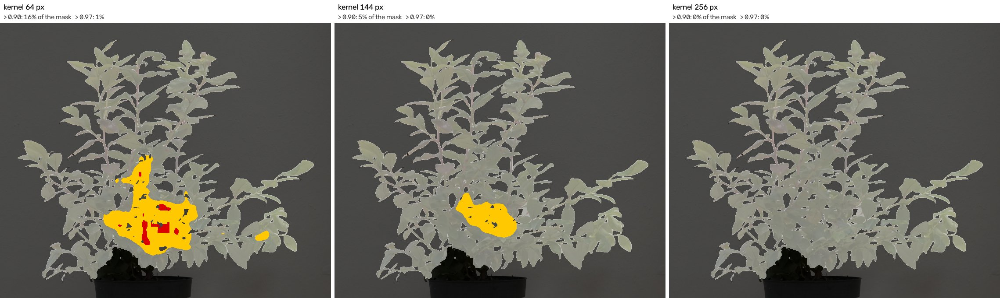

# 05 Kernel and cap

**Results:** [full report](results/report.md) · leaf mask only: [report](results_leaf_only/report.md)

**Question:** with the stems counted in, which window (kernel) and cap work best together?

A blueberry leaf is about 35 px across at 1/4 resolution, and many leaves are bigger. A 64 px window holds only a few
leaves, so one big leaf facing the camera can look like a dense spot, and a clump of leaves can fill it completely.
Experiment 04 found that at kernel 64 a high cap fails for exactly that reason: a full window over a single clump then
counts for many layers. A larger window is rarely full over a single clump, so a higher cap might work there.

## Method

The leaf + stem mask of experiment 03, with every kernel and every cap of experiment 04:

```
mask:       leaf + stem (everything the segmentation sees as plant, without the pot)
per pixel:  f = mask share in the kernel × kernel window,   layers = −ln(1 − min(f, cap))
per photo:  sum over all pixels;   per plant: mean over its side photos
```

Kernels 32 to 256 px in steps of 16 (15) × 11 caps from 0.85 to 0.999 = **165 runs**, plus the baseline (leaf only,
kernel 64, cap 0.90).

```bash
.venv/bin/python 05_kernel_cap/kernel_cap.py $PHOTOS          # about 1 min with cached masks
.venv/bin/python 00_evaluation/evaluate.py 05_kernel_cap/results/runs.csv
```

The cap only changes pixels whose window is fuller than the cap, and a larger window is full less often
(`results/capped_share.csv`, share of the mask whose window is fuller than 0.90):

| kernel | open plants (P2, P10) | dense plants (P6, P11, P12) |
|---|---|---|
| 48 | 8–9% | 25–34% |
| 96 | 0–2% | 12–21% |
| 144 | 0% | 7–13% |
| 192 | 0% | 2–5% |
| 256 | 0% | 0% |



P12, the densest plant: yellow is where the 0.90 cap acts, red where even a 0.97 cap would. At kernel 64 the cap acts
on 16% of the mask; at 144 only on the dense core (5%), and nothing reaches 0.97; at 256 no window is that full.

## Result

Tested on the current leaf areas (`common/real_leaf_area_mm2.csv`, from `01_leaf_measurement/results/monday.csv`): 13 plants, P1 left
out. Baseline (leaf only, 64, 0.90): **4.05%**.

Typical error of every run (the same grid is in the report, coloured):

| cap \ kernel | 32 | 64 | 96 | 112 | 128 | **144** | 160 | 176 | 192 | 256 |
|---|---|---|---|---|---|---|---|---|---|---|
| 0.85 | 5.93% | 5.09% | 4.74% | 4.68% | 4.63% | 4.60% | 4.56% | 4.53% | 4.51% | 4.84% |
| 0.90 | 4.92% | 4.16% | 4.03% | 4.02% | 4.02% | 4.02% | 4.03% | 4.06% | 4.14% | 4.81% |
| 0.94 | 4.25% | 3.88% | 3.83% | 3.80% | 3.77% | 3.76% | 3.80% | 3.90% | 4.04% | 4.81% |
| 0.96 | 4.15% | 4.03% | 3.88% | 3.79% | 3.72% | 3.71% | 3.77% | 3.87% | 4.02% | 4.81% |
| 0.97 | 4.24% | 4.20% | 3.93% | 3.80% | 3.71% | 3.70% | 3.76% | 3.87% | 4.02% | 4.81% |
| 0.99 | 5.11% | 4.76% | 4.06% | 3.84% | 3.72% | 3.70% | 3.75% | 3.87% | 4.02% | 4.81% |
| 0.999 | 7.17% | 5.25% | 4.13% | 3.85% | 3.72% | **3.70%** | 3.75% | 3.87% | 4.02% | 4.81% |

Best: kernel 144, cap 0.995, **3.70%**. Honest score (kernel and cap chosen without the plant it predicts, over all
165 runs): **4.32%**. 74 of 165 runs beat the baseline. The nested search picked kernel 144, cap 0.995 in 6 of 13
rounds, and otherwise always a neighbour: kernel 128–160 with a cap of 0.96–0.999 (once 64 at 0.96).

Error per plant (plant left out, + = predicted too high):

| | P2 | P3 | P4 | P5 | P6 | P7 | P8 | P9 | P10 | P11 | P12 | P13 | P15 |
|---|---|---|---|---|---|---|---|---|---|---|---|---|---|
| baseline (leaf, 64, 0.90) | +5.7 | −3.3 | −2.5 | +0.6 | +0.1 | +0.2 | +3.2 | +4.3 | −5.7 | +0.8 | −6.6 | +6.9 | +5.3 |
| leaf + stem, 64, 0.94 (best of 04) | −1.0 | −1.2 | −2.9 | +3.5 | +4.0 | −1.8 | +8.2 | −0.3 | −6.6 | −1.9 | −4.4 | +4.2 | +5.0 |
| leaf + stem, 144, 0.995 (best) | −0.4 | +0.4 | −3.9 | +3.7 | +3.5 | −2.8 | **+9.2** | −0.2 | −4.6 | −1.2 | −4.9 | +2.1 | +1.9 |

- **One smooth valley:** kernel 112–160 with a cap of 0.94 or more, all at 3.70–3.80%. A real effect looks like
  this; a lucky setting would stand alone. The best 10% of the runs all lie at kernel 128–160.
- **At kernel 144 the cap hardly matters above 0.96:** every cap from 0.97 to 0.999 gives 3.70%, because almost no
  144 px window is fuller than 0.97. So the best model is in effect **leaf + stem, kernel 144, no cap**.
- **From kernel 176 up, the cap stops mattering** (no window is full), and the error rises with the kernel: a very
  large window blurs the dense core into the open parts. At 256 every cap gives 4.81%.
- **Small kernels need a low cap:** at 32–64 px a high cap fails (up to 7.2%), because single clumps fill the window.
- **The honest score is 4.32%**, 0.27 points worse than the baseline: the best run is 0.35 points better, but with
  13 plants both differences are within the noise.
- **P8 stays the problem:** +9% with the best run. Its red twigs are counted as plant. Every other plant is within
  5% (12 of 13, against 8 for the baseline).

## Conclusion

With the stems counted in, the best model is **leaf + stem, kernel 128–160, cap 0.96 or higher (in effect no cap)**,
at 3.70%. It improves most plants (12 of 13 within 5%), but it doesn't beat the baseline beyond the noise, mainly
because of P8's red twigs. The next step is counting twigs differently from missed leaf (experiment 10), at kernel
144 with a high cap.

## Leaf only (the first version of this experiment)

Before the stems were counted in, this experiment tested the kernel alone, on the leaf mask at cap 0.90: kernels 32
to 256 px in steps of 8, 29 runs (`kernel_size.py`, `results_leaf_only/`, with its own report).

```bash
.venv/bin/python 05_kernel_cap/kernel_size.py $PHOTOS          # about 20 s with cached masks
.venv/bin/python 00_evaluation/evaluate.py 05_kernel_cap/results_leaf_only/runs.csv
```

On the current leaf areas: best 4.00% (kernel 136), honest 4.43%, against 4.05% for 64 px. All kernels from 72 to
152 px beat the baseline, but by at most 0.05 points: with the leaf mask alone the kernel size doesn't matter. It
only starts to matter together with the stems and a higher cap.
