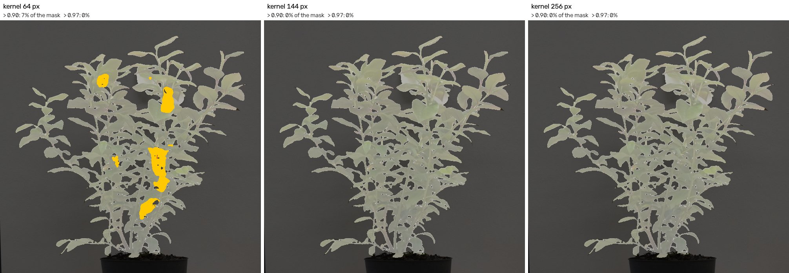
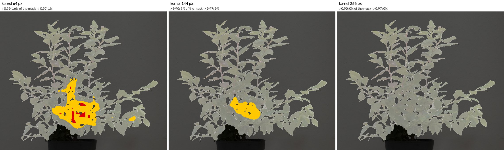
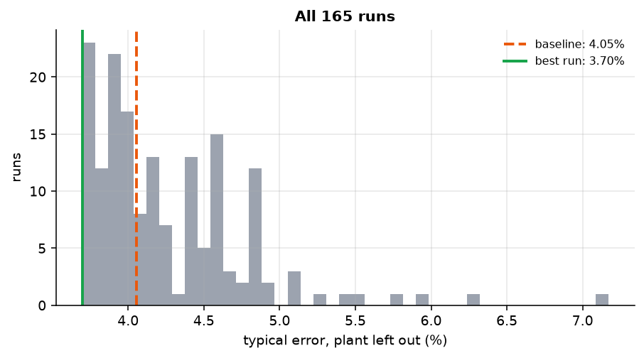
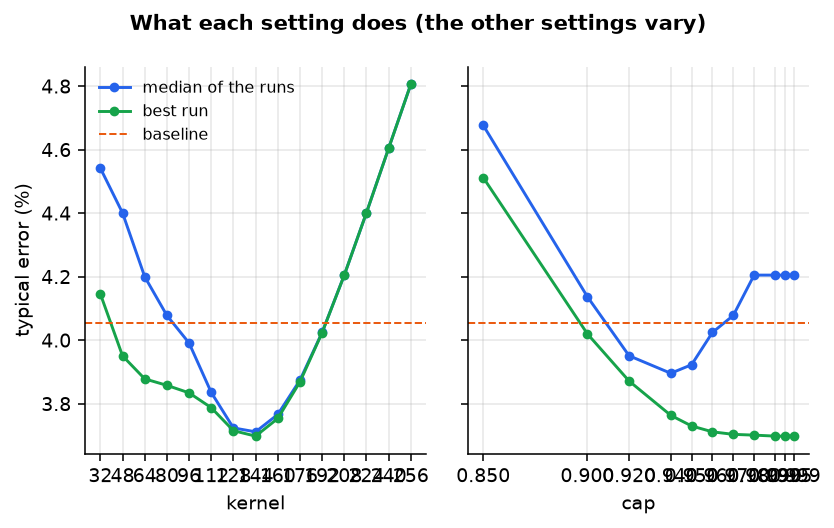
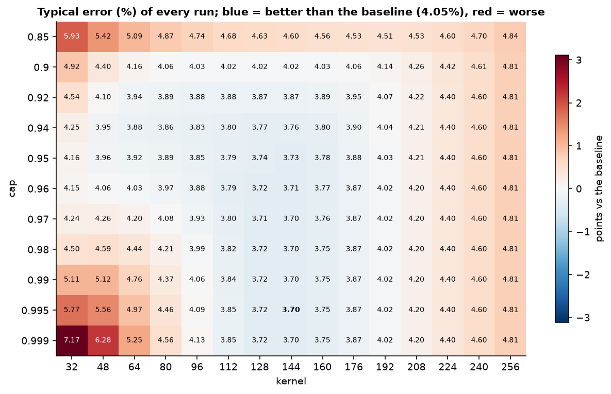
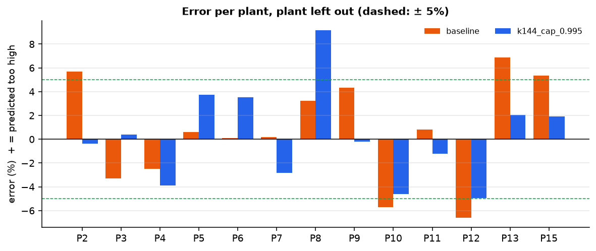
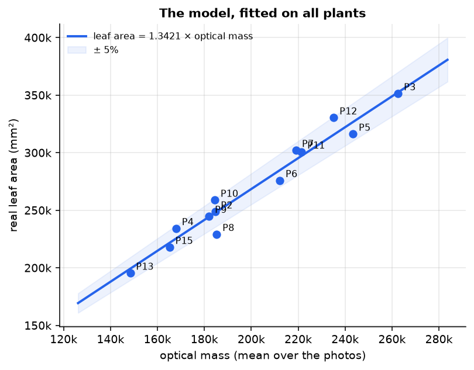
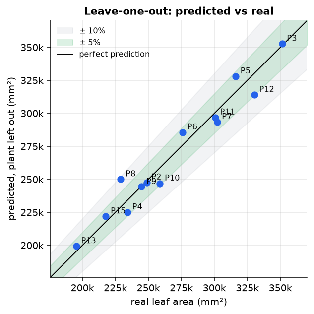
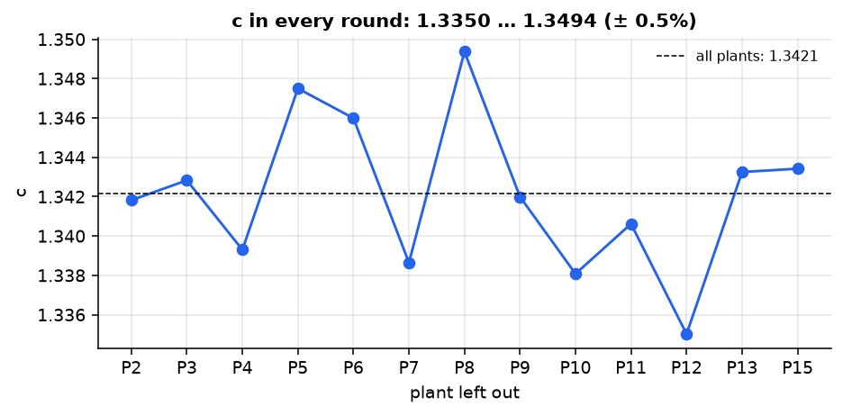
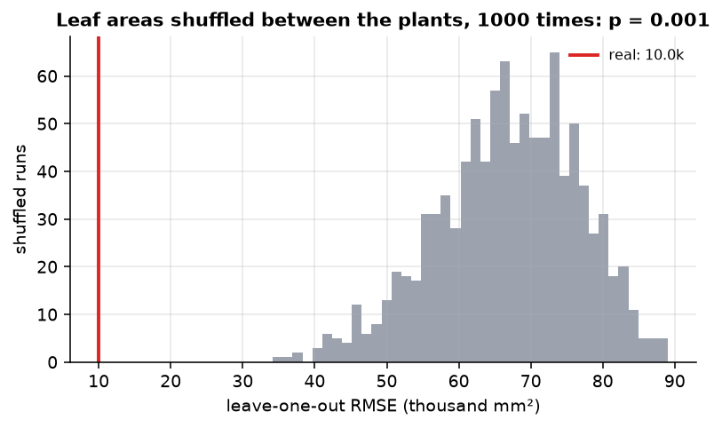

# Experiment 05_kernel_cap

165 runs + baseline · 13 plants (P2, P3, P4, P5, P6, P7, P8, P9, P10, P11, P12, P13, P15) · leaf area = c × optical mass, leave-one-out

**Contents**

1. [Summary](#summary) — the baseline, the best run and the honest score, and the verdict
2. [The method](#the-method) — what the experiment changes, its settings and how many runs it makes
3. [What the method looks like](#what-the-method-looks-like) — the method drawn on example photos
4. [All runs](#all-runs) — how the runs are spread, what each setting does, the best runs
5. [Per plant: baseline vs best run](#per-plant-baseline-vs-best-run) — how far off each plant is, the baseline next to the best run, k144_cap_0.995
6. [Best run in detail](#best-run-in-detail-k144_cap_0995) — its fit, every plant's prediction, whether one plant decides the model, and the shuffle test

How to read this page

**The model.** `leaf area = c × optical mass`: a straight line through zero, with c the one number learned from the plants. It is the model of the regression (`Regression/docs/single_feature_model.md`).

**Leave-one-out.** Every plant in turn is left out, c is learned from the others, and the left-out plant is predicted. Each plant is predicted by a model that never saw it.

**Typical error** = the RMSE of those predictions as a % of the average leaf area, the number the regression reports. **Mean error** = the average of the absolute errors in %. **R²**: 1 is perfect, 0 is no better than guessing the average plant.

**Baseline** = the current method, `T_64_0.9`: 64 px window, cap 0.9, leaf mask M1, mean over all side photos. Every experiment is compared with it on the same plants and leaf areas.

**Nested (honest) score.** With many runs, the best one is partly lucky: its settings happen to suit these plants. The nested score repeats the whole search once per plant: the best run is chosen on the other plants only, then predicts the left-out plant. Compare **that** number with the baseline.

**Noise.** With 14 plants, one plant can move the typical error by about a point. Differences below about 1 point are not a result.

## Summary

- **4.05%** baseline T_64_0.9
- **3.70%** best run: k144_cap_0.995 (optimistic)
- **4.32%** honest: run chosen without the plant (nested)
- **74 / 165** runs better than the baseline

**Verdict:** choosing the run on the other plants (nested) gives **4.32%**, against **4.05%** for the baseline (+0.26 points). That is within the ~1 point of noise: **no clear difference**.

Runs the nested search chose: k144_cap_0.995 (6×), k128_cap_0.960 (1×), k128_cap_0.990 (1×), k160_cap_0.980 (1×), k064_cap_0.960 (1×), k160_cap_0.999 (1×), k144_cap_0.990 (1×), k128_cap_0.970 (1×)

## The method

**Question:** with the stems counted in, which window (kernel) and cap work best together?

Experiment 03 found that at kernel 64 a high cap fails: a 64 px window is full over single clumps of leaves, which then count for many layers. A larger window is rarely full over a single clump, so a higher cap might work there. This experiment tests every kernel with every cap, on the leaf + stem mask of experiment 02.

1. **Mask:** leaf + stem, everything the segmentation sees as plant (without the pot).
2. **Per pixel:** f = the mask's share in the kernel × kernel window around it, layers = −ln(1 − min(f, cap)).
3. **Per photo:** the sum of the layers over all pixels; **per plant:** the mean over its side photos.

Sizes are in px at 1/4 of the photo resolution, where a leaf is about 35 px across. A run's name is its kernel and cap: `k144_cap_0.990`. The baseline is leaf only, kernel 64, cap 0.90.

### The settings

What the settings in the run names and tables mean.

| setting | what it does | values tried |
|---|---|---|
| **kernel** | k: side of the square window, in px at 1/4 photo resolution (a leaf is ~35 px across), in which the mask share around every pixel is measured. A small window sees a few leaves, a large one a whole part of the plant. | 32 to 256 px in steps of 16 (baseline 64) |
| **cap** | highest mask share f a window may have when it is turned into layers, layers = -ln(1 - min(f, cap)). It limits how many layers a nearly solid window counts: 0.90 = 2.3, 0.99 = 4.6, 0.999 = 6.9 layers. | 0.85, 0.9, 0.92, 0.94, 0.95, 0.96, 0.97, 0.98, 0.99, 0.995, 0.999 (baseline 0.9) |

**Runs:** every combination of the settings, 15 kernel × 11 cap = **165 runs**, plus the baseline.

## What the method looks like

*P10, an open plant, leaf + stem at kernel 64, 144 and 256: the mask (grey), the pixels whose window is fuller than 0.90 (yellow), where the 0.90 cap acts, and fuller than 0.97 (red). Only these pixels change when the cap is raised, and a larger window is full less often.*

*P12, the densest plant, the same way. At kernel 64 the cap acts on 16% of the mask and a few spots are fuller than 0.97; at 144 only the dense core (5%) reaches 0.90 and nothing reaches 0.97; at 256 no window is that full, so the cap no longer matters.*

## All runs

The typical error of every run. Runs left of the orange line beat the baseline; the green line is the best run (before the honest correction).

### What each setting does

One panel per setting. For each value of the setting, the runs with that value are taken together, whatever the other settings: blue is their median typical error, green the best of them. The orange line is the baseline. A flat line means the setting doesn't matter; a slope shows which values are better.

### Every run: kernel × cap

With two settings, every combination is one run, so this grid shows every run's own typical error, nothing averaged. Blue cells beat the baseline, red ones are worse; the best run is in bold. A real effect shows as a smooth region; a lone good cell among worse ones is likely luck.

### Where the best 10% of the runs lie (16 runs, typical error ≤ 3.75%)

| setting | range in the best 10% | share of the best 10% per value | if it didn't matter |
|---|---|---|---|
| kernel | 128 – 160 | 32: 0% · 48: 0% · 64: 0% · 80: 0% · 96: 0% · 112: 0% · 128: 44% · 144: 44% · 160: 12% · 176: 0% · 192: 0% · 208: 0% · 224: 0% · 240: 0% · 256: 0% | 7% |
| cap | 0.95 – 0.999 | 0.85: 0% · 0.9: 0% · 0.92: 0% · 0.94: 0% · 0.95: 12% · 0.96: 12% · 0.97: 12% · 0.98: 12% · 0.99: 19% · 0.995: 19% · 0.999: 12% | 9% |

Green: the value is at least 1.5× as common among the best runs as in the grid; grey: at most half as common. A setting whose values all sit near the "didn't matter" share has no effect.

### The best runs

| run | kernel | cap | c | typical error | mean error | R² | within 5% | vs baseline |
|---|---|---|---|---|---|---|---|---|
| baseline |   |   | 1.5042 | 4.05% | 3.48% | 0.942 | 8/13 | +0.00 |
| k144_cap_0.995 | 144 | 0.995 | 1.3421 | 3.70% | 2.99% | 0.952 | 12/13 | -0.36 |
| k144_cap_0.990 | 144 | 0.99 | 1.3422 | 3.70% | 2.99% | 0.952 | 12/13 | -0.36 |
| k144_cap_0.999 | 144 | 0.999 | 1.3420 | 3.70% | 3.00% | 0.952 | 12/13 | -0.36 |
| k144_cap_0.980 | 144 | 0.98 | 1.3426 | 3.70% | 2.98% | 0.952 | 12/13 | -0.35 |
| k144_cap_0.970 | 144 | 0.97 | 1.3431 | 3.70% | 2.97% | 0.952 | 12/13 | -0.35 |
| k144_cap_0.960 | 144 | 0.96 | 1.3439 | 3.71% | 2.97% | 0.952 | 11/13 | -0.34 |
| k128_cap_0.970 | 128 | 0.97 | 1.3094 | 3.71% | 3.08% | 0.951 | 11/13 | -0.34 |
| k128_cap_0.980 | 128 | 0.98 | 1.3082 | 3.72% | 3.09% | 0.951 | 11/13 | -0.34 |
| k128_cap_0.990 | 128 | 0.99 | 1.3075 | 3.72% | 3.10% | 0.951 | 11/13 | -0.34 |
| k128_cap_0.995 | 128 | 0.995 | 1.3073 | 3.72% | 3.11% | 0.951 | 11/13 | -0.33 |
| k128_cap_0.960 | 128 | 0.96 | 1.3111 | 3.72% | 3.09% | 0.951 | 11/13 | -0.33 |
| k128_cap_0.999 | 128 | 0.999 | 1.3071 | 3.72% | 3.13% | 0.951 | 11/13 | -0.33 |
| k144_cap_0.950 | 144 | 0.95 | 1.3451 | 3.73% | 2.98% | 0.951 | 11/13 | -0.33 |
| k128_cap_0.950 | 128 | 0.95 | 1.3133 | 3.74% | 3.10% | 0.951 | 11/13 | -0.31 |
| k160_cap_0.990 | 160 | 0.99 | 1.3747 | 3.75% | 3.01% | 0.950 | 11/13 | -0.30 |
| k160_cap_0.995 | 160 | 0.995 | 1.3746 | 3.75% | 3.01% | 0.950 | 11/13 | -0.30 |
| k160_cap_0.999 | 160 | 0.999 | 1.3746 | 3.75% | 3.01% | 0.950 | 11/13 | -0.30 |
| k160_cap_0.980 | 160 | 0.98 | 1.3748 | 3.75% | 3.01% | 0.950 | 11/13 | -0.30 |
| k160_cap_0.970 | 160 | 0.97 | 1.3750 | 3.76% | 3.01% | 0.950 | 11/13 | -0.30 |
| k144_cap_0.940 | 144 | 0.94 | 1.3468 | 3.76% | 3.01% | 0.950 | 11/13 | -0.29 |
| k160_cap_0.960 | 160 | 0.96 | 1.3754 | 3.77% | 3.02% | 0.950 | 11/13 | -0.29 |
| k128_cap_0.940 | 128 | 0.94 | 1.3160 | 3.77% | 3.11% | 0.950 | 11/13 | -0.28 |
| k160_cap_0.950 | 160 | 0.95 | 1.3760 | 3.78% | 3.03% | 0.950 | 11/13 | -0.28 |
| k112_cap_0.960 | 112 | 0.96 | 1.2767 | 3.79% | 3.24% | 0.950 | 11/13 | -0.27 |
| k112_cap_0.950 | 112 | 0.95 | 1.2802 | 3.79% | 3.23% | 0.950 | 11/13 | -0.27 |

Best 25 of 165 runs. All runs: summary.csv.

## Per plant: baseline vs best run

The error of every plant when it is predicted by the model learned without it, for the baseline (orange) and the best run, k144_cap_0.995. Above 0: predicted too high; below: too low. Between the green dashed lines the plant is within 5%. A plant that is off the same way for both is missed by the optical mass itself, not by the setting.

## Best run in detail: k144_cap_0.995

settings: kernel **144** · cap **0.995**

- **3.7%** typical error
- **0.95** R²
- **12 / 13** plants within 5%
- **1.3421** c, fitted on all plants

### The fit and the predictions

Left: every plant's optical mass against its real leaf area, with the line `leaf area = c × optical mass` fitted on all plants. Right: each plant predicted by the model learned without it (leave-one-out), against its real leaf area. On the black line the prediction is perfect; inside the green band it is within 5%.

### Per plant

| plant | optical mass | real mm² | predicted mm² | error | baseline error |
|---|---|---|---|---|---|
| P2 | 184,567 | 248,603 | 247,656 | -0.4% | +5.7% |
| P3 | 262,621 | 351,253 | 352,655 | +0.4% | -3.3% |
| P4 | 167,983 | 234,098 | 224,980 | -3.9% | -2.5% |
| P5 | 243,383 | 316,107 | 327,957 | +3.7% | +0.6% |
| P6 | 212,189 | 275,843 | 285,603 | +3.5% | +0.1% |
| P7 | 219,176 | 301,997 | 293,399 | -2.8% | +0.2% |
| P8 | 185,290 | 229,026 | 250,024 | +9.2% | +3.2% |
| P9 | 182,047 | 244,749 | 244,305 | -0.2% | +4.3% |
| P10 | 184,480 | 258,726 | 246,847 | -4.6% | -5.7% |
| P11 | 221,461 | 300,609 | 296,895 | -1.2% | +0.8% |
| P12 | 235,183 | 330,299 | 313,973 | -4.9% | -6.6% |
| P13 | 148,413 | 195,339 | 199,356 | +2.1% | +6.9% |
| P15 | 165,197 | 217,768 | 221,929 | +1.9% | +5.3% |

### c in every round: does one plant decide the model?

Leave-one-out fits c 13 times, each time without one plant. Each point is the c fitted **without** the plant on the x-axis; the dashed line is c fitted on all plants. A flat line means no single plant drives the model. A point far from the line means that plant on its own pulls c up or down, and it is usually also predicted badly. Here c moves by ± 0.5%; the plant that moves it most is P8.

### Shuffle test: is the fit real or luck?

The leaf areas are shuffled randomly between the plants 1000 times, so they no longer belong to their photos, and the same leave-one-out test is run each time. Grey: the errors of the shuffled data. Red: the error of the real data. If red lies left of nearly all of grey, the optical mass really carries the leaf area. p is the share of shuffles that did as well as the real data (p < 0.05: not luck). It says the run is not noise, not that it beats the baseline. Here 0 of 1000 shuffles did as well (p = 0.001, so it is not luck).

