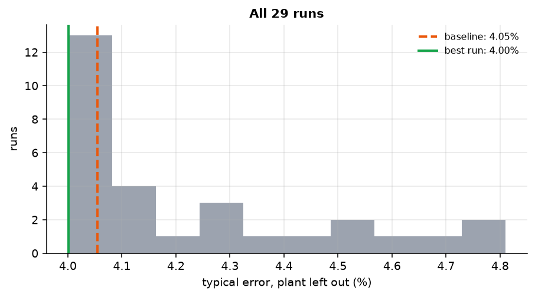
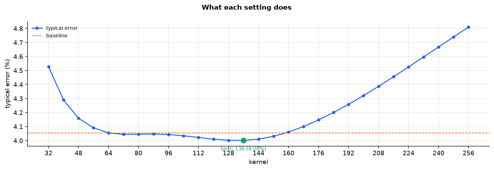
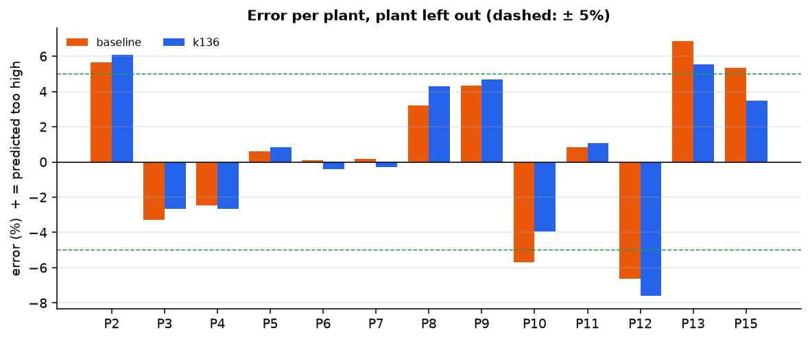
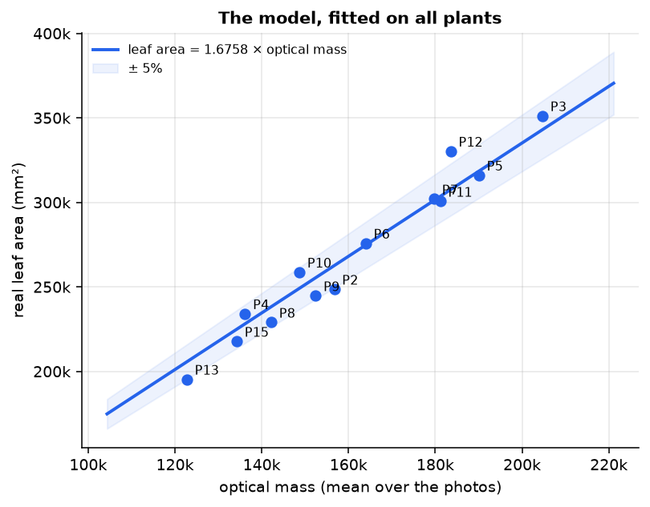
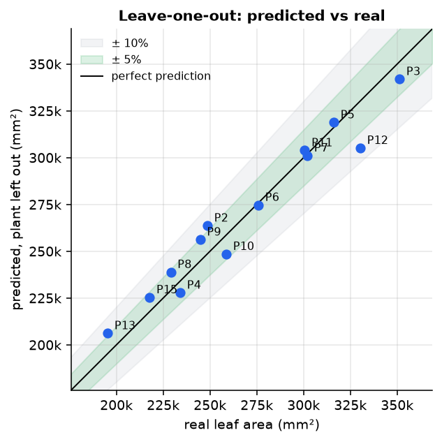
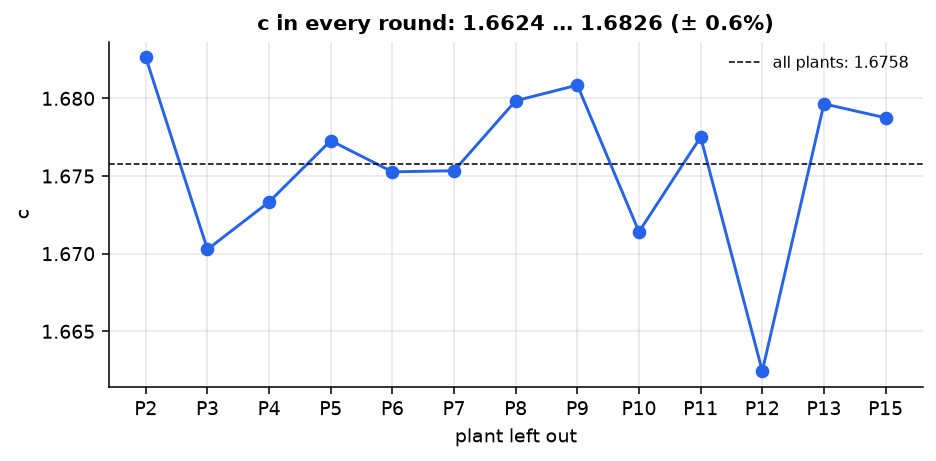
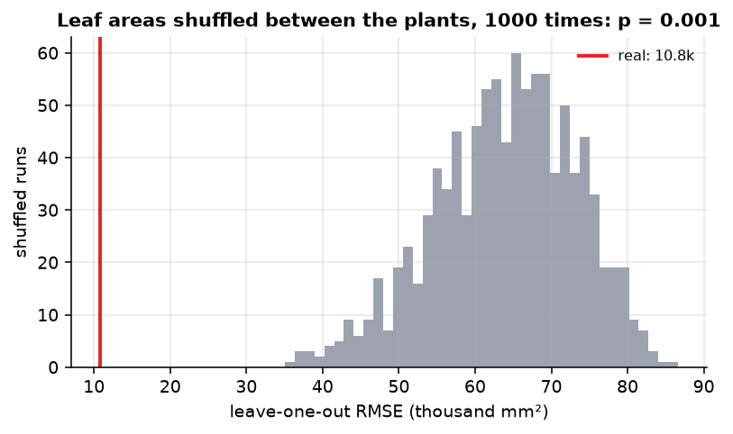

# Experiment 05_kernel_cap (leaf only)

29 runs + baseline · 13 plants (P2, P3, P4, P5, P6, P7, P8, P9, P10, P11, P12, P13, P15) · leaf area = c × optical mass, leave-one-out

**Contents**

1. [Summary](#summary) — the baseline, the best run and the honest score, and the verdict
2. [The method](#the-method) — what the experiment changes, its settings and how many runs it makes
3. [All runs](#all-runs) — how the runs are spread, what each setting does, the best runs
4. [Per plant: baseline vs best run](#per-plant-baseline-vs-best-run) — how far off each plant is, the baseline next to the best run, k136
5. [Best run in detail](#best-run-in-detail-k136) — its fit, every plant's prediction, whether one plant decides the model, and the shuffle test

How to read this page

**The model.** `leaf area = c × optical mass`: a straight line through zero, with c the one number learned from the plants. It is the model of the regression (`Regression/docs/single_feature_model.md`).

**Leave-one-out.** Every plant in turn is left out, c is learned from the others, and the left-out plant is predicted. Each plant is predicted by a model that never saw it.

**Typical error** = the RMSE of those predictions as a % of the average leaf area, the number the regression reports. **Mean error** = the average of the absolute errors in %. **R²**: 1 is perfect, 0 is no better than guessing the average plant.

**Baseline** = the current method, `T_64_0.9`: 64 px window, cap 0.9, leaf mask M1, mean over all side photos. Every experiment is compared with it on the same plants and leaf areas.

**Nested (honest) score.** With many runs, the best one is partly lucky: its settings happen to suit these plants. The nested score repeats the whole search once per plant: the best run is chosen on the other plants only, then predicts the left-out plant. Compare **that** number with the baseline.

**Noise.** With 14 plants, one plant can move the typical error by about a point. Differences below about 1 point are not a result.

## Summary

- **4.05%** baseline T_64_0.9
- **4.00%** best run: k136 (optimistic)
- **4.43%** honest: run chosen without the plant (nested)
- **11 / 29** runs better than the baseline

**Verdict:** choosing the run on the other plants (nested) gives **4.43%**, against **4.05%** for the baseline (+0.38 points). That is within the ~1 point of noise: **no clear difference**.

Runs the nested search chose: k136 (5×), k072 (3×), k144 (2×), k128 (1×), k152 (1×), k064 (1×)

## The method

**Question:** is 64 px the right window for the optical mass?

A blueberry leaf is about 35 px across at 1/4 resolution, and many leaves are bigger. A 64 px window holds only a few leaves, so one big leaf facing the camera can look like a dense spot. A bigger window sees more of the plant around each pixel.

**The method** is the baseline with only the window (kernel) size changed:

1. **Per pixel:** f = the leaf share in the kernel × kernel window around it.
2. **Per photo:** optical mass = the sum over all pixels of −ln(1 − min(f, 0.9)).
3. **Per plant:** the mean over its side photos.

A run's name is its kernel: `k144` is a 144 px window. `k064` is the baseline itself.

### The settings

What the settings in the run names and tables mean.

| setting | what it does | values tried |
|---|---|---|
| **kernel** | k: side of the square window, in px at 1/4 photo resolution (a leaf is ~35 px across), in which the leaf share around every pixel is measured. A small window sees a few leaves, a large one a whole part of the plant. | 32 to 256 px in steps of 8 (baseline 64) |

**Runs:** one run per kernel value, **29 runs**, plus the baseline.

## All runs

The typical error of every run. Runs left of the orange line beat the baseline; the green line is the best run (before the honest correction).

### What each setting does

One panel per setting. For each value of the setting, the runs with that value are taken together, whatever the other settings: blue is their median typical error, green the best of them. The orange line is the baseline. A flat line means the setting doesn't matter; a slope shows which values are better.

### Where the best 10% of the runs lie (2 runs, typical error ≤ 4.00%)

| setting | range in the best 10% | share of the best 10% per value | if it didn't matter |
|---|---|---|---|
| kernel | 128 – 136 | 32: 0% · 40: 0% · 48: 0% · 56: 0% · 64: 0% · 72: 0% · 80: 0% · 88: 0% · 96: 0% · 104: 0% · 112: 0% · 120: 0% · 128: 50% · 136: 50% · 144: 0% · 152: 0% · 160: 0% · 168: 0% · 176: 0% · 184: 0% · 192: 0% · 200: 0% · 208: 0% · 216: 0% · 224: 0% · 232: 0% · 240: 0% · 248: 0% · 256: 0% | 3% |

Green: the value is at least 1.5× as common among the best runs as in the grid; grey: at most half as common. A setting whose values all sit near the "didn't matter" share has no effect.

### The best runs

| run | kernel | c | typical error | mean error | R² | within 5% | vs baseline |
|---|---|---|---|---|---|---|---|
| baseline |   | 1.5042 | 4.05% | 3.48% | 0.942 | 8/13 | +0.00 |
| k136 | 136 | 1.6758 | 4.00% | 3.35% | 0.944 | 10/13 | -0.05 |
| k128 | 128 | 1.6599 | 4.00% | 3.37% | 0.944 | 10/13 | -0.05 |
| k120 | 120 | 1.6435 | 4.01% | 3.39% | 0.943 | 10/13 | -0.05 |
| k144 | 144 | 1.6913 | 4.01% | 3.34% | 0.943 | 10/13 | -0.04 |
| k112 | 112 | 1.6266 | 4.02% | 3.41% | 0.943 | 10/13 | -0.03 |
| k152 | 152 | 1.7065 | 4.03% | 3.33% | 0.943 | 10/13 | -0.02 |
| k104 | 104 | 1.6090 | 4.03% | 3.43% | 0.943 | 10/13 | -0.02 |
| k096 | 96 | 1.5907 | 4.04% | 3.45% | 0.942 | 9/13 | -0.01 |
| k072 | 72 | 1.5286 | 4.04% | 3.46% | 0.942 | 8/13 | -0.01 |
| k080 | 80 | 1.5508 | 4.05% | 3.46% | 0.942 | 8/13 | -0.01 |
| k088 | 88 | 1.5714 | 4.05% | 3.46% | 0.942 | 8/13 | -0.01 |
| k064 | 64 | 1.5042 | 4.05% | 3.48% | 0.942 | 8/13 | +0.00 |
| k160 | 160 | 1.7214 | 4.06% | 3.33% | 0.942 | 10/13 | +0.01 |
| k056 | 56 | 1.4771 | 4.09% | 3.50% | 0.941 | 8/13 | +0.04 |
| k168 | 168 | 1.7358 | 4.10% | 3.33% | 0.941 | 9/13 | +0.05 |
| k176 | 176 | 1.7500 | 4.15% | 3.35% | 0.939 | 8/13 | +0.09 |
| k048 | 48 | 1.4459 | 4.16% | 3.55% | 0.939 | 8/13 | +0.10 |
| k184 | 184 | 1.7638 | 4.20% | 3.40% | 0.938 | 8/13 | +0.15 |
| k192 | 192 | 1.7774 | 4.26% | 3.46% | 0.936 | 8/13 | +0.20 |
| k040 | 40 | 1.4088 | 4.29% | 3.77% | 0.935 | 8/13 | +0.24 |
| k200 | 200 | 1.7907 | 4.32% | 3.52% | 0.934 | 8/13 | +0.27 |
| k208 | 208 | 1.8037 | 4.39% | 3.59% | 0.932 | 8/13 | +0.33 |
| k216 | 216 | 1.8164 | 4.46% | 3.66% | 0.930 | 8/13 | +0.40 |
| k224 | 224 | 1.8289 | 4.53% | 3.72% | 0.928 | 8/13 | +0.47 |
| k032 | 32 | 1.3638 | 4.53% | 4.09% | 0.928 | 9/13 | +0.47 |

Best 25 of 29 runs. All runs: summary.csv.

## Per plant: baseline vs best run

The error of every plant when it is predicted by the model learned without it, for the baseline (orange) and the best run, k136. Above 0: predicted too high; below: too low. Between the green dashed lines the plant is within 5%. A plant that is off the same way for both is missed by the optical mass itself, not by the setting.

## Best run in detail: k136

settings: kernel **136**

- **4.0%** typical error
- **0.94** R²
- **10 / 13** plants within 5%
- **1.6758** c, fitted on all plants

### The fit and the predictions

Left: every plant's optical mass against its real leaf area, with the line `leaf area = c × optical mass` fitted on all plants. Right: each plant predicted by the model learned without it (leave-one-out), against its real leaf area. On the black line the prediction is perfect; inside the green band it is within 5%.

### Per plant

| plant | optical mass | real mm² | predicted mm² | error | baseline error |
|---|---|---|---|---|---|
| P2 | 156,707 | 248,603 | 263,681 | +6.1% | +5.7% |
| P3 | 204,720 | 351,253 | 341,939 | -2.7% | -3.3% |
| P4 | 136,167 | 234,098 | 227,853 | -2.7% | -2.5% |
| P5 | 190,069 | 316,107 | 318,799 | +0.9% | +0.6% |
| P6 | 163,992 | 275,843 | 274,730 | -0.4% | +0.1% |
| P7 | 179,737 | 301,997 | 301,120 | -0.3% | +0.2% |
| P8 | 142,197 | 229,026 | 238,869 | +4.3% | +3.2% |
| P9 | 152,427 | 244,749 | 256,207 | +4.7% | +4.3% |
| P10 | 148,694 | 258,726 | 248,529 | -3.9% | -5.7% |
| P11 | 181,147 | 300,609 | 303,875 | +1.1% | +0.8% |
| P12 | 183,563 | 330,299 | 305,162 | -7.6% | -6.6% |
| P13 | 122,750 | 195,339 | 206,178 | +5.5% | +6.9% |
| P15 | 134,246 | 217,768 | 225,366 | +3.5% | +5.3% |

### c in every round: does one plant decide the model?

Leave-one-out fits c 13 times, each time without one plant. Each point is the c fitted **without** the plant on the x-axis; the dashed line is c fitted on all plants. A flat line means no single plant drives the model. A point far from the line means that plant on its own pulls c up or down, and it is usually also predicted badly. Here c moves by ± 0.6%; the plant that moves it most is P12.

### Shuffle test: is the fit real or luck?

The leaf areas are shuffled randomly between the plants 1000 times, so they no longer belong to their photos, and the same leave-one-out test is run each time. Grey: the errors of the shuffled data. Red: the error of the real data. If red lies left of nearly all of grey, the optical mass really carries the leaf area. p is the share of shuffles that did as well as the real data (p < 0.05: not luck). It says the run is not noise, not that it beats the baseline. Here 0 of 1000 shuffles did as well (p = 0.001, so it is not luck).

