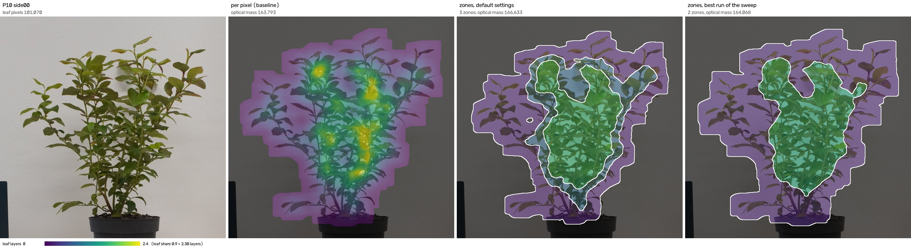
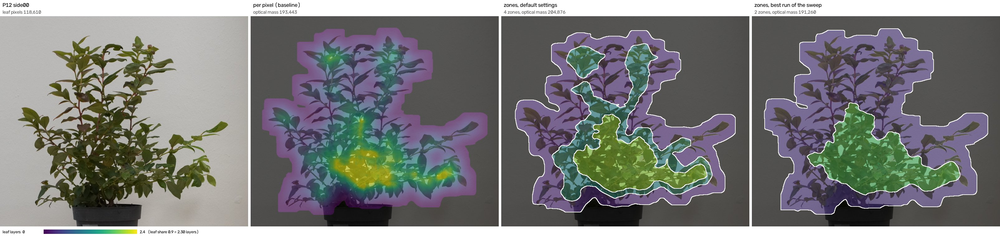

# 06 Density zones

**Results:** [full report](results/report.md) · every run: [`summary.csv`](results/summary.csv) · the best 10%: [`best_10pct.csv`](results/best_10pct.csv)

**Question:** is the optical mass better if the leaf layers are measured per zone of similar density instead of per
pixel?

A bush has regions: an airy edge, a medium part, a dense core. The baseline gives every pixel its own layers, from
the leaf share in the 64 px window around it. The idea here is to find those regions first, measure each one's
density on the mask itself, and give all its pixels the region's layers.

## Method

Each photo is cut into zones (`common/zones.py`):

1. **Density map:** the leaf share in a *window* around every pixel. It is used only to draw the zones.
2. **Plant area:** where that density is at least *edge*, plus every leaf pixel. It includes the gaps between
   leaves, so a zone can have a leaf share below 1.
3. **Levels:** the densities of the leaf pixels are grouped into *levels* groups (k-means). Pieces smaller than
   *min zone* are merged into the zone around them.
4. **Zones:** every connected piece of one level is a zone.

Then, per zone and photo:

```
f       = leaf pixels / zone pixels          (counted on the mask, not the window)
layers  = −ln(1 − min(f, cap))
value   = zone pixels × layers
optical mass of the photo = sum of the zone values;   of the plant = mean over its side photos
```

An airy zone counts about as its leaf pixels (layers ≈ f when f is small). Only dense zones are scaled up.

### What it looks like

One photo four ways, coloured by leaf layers (purple 0, yellow 2.3 = the cap): the photo, the per-pixel method
(the baseline), the zones with the default settings, and the zones of the best run of the sweep.



P10, an open plant. Per pixel, only small clusters of overlapping leaves reach many layers; the open shoots stay
low. The default zones turn this into nested bands (airy edge, medium, core). The best run has only 2 levels, an airy
edge and one core, and its optical mass is almost the same as per pixel.



P12, the densest plant. Per pixel and with the default zones the core reaches the cap. A single photo can't show how
deep it goes, so P12 is predicted too low by every method. The best run's single core stays below the cap and ends
up close to per pixel, so it doesn't fix that either.

P5 is in `results/pictures/` too, and all three are in the report.

### Try it yourself: the window

```bash
.venv/bin/python 06_density_zones/gui.py [PATH/TO/P05]
```

Open the folder of one plant and move the sliders. For every photo it shows the zones next to the per-pixel method,
with the optical mass of both, a table of the zones (click one to outline it), and the plant's mean. **Default** and
**Best run** set the sliders to those settings. The first time a plant is opened its photos are segmented (about
5 s); after that a new setting takes about 2 s, and changing only the cap is instant. The window is for looking, not
for the experiment: the runs are made by `density_zones.py`.

### The settings

Five settings control the zones and their layers. The first four decide where the zones are; the cap only
decides how many layers a zone counts. Sizes are in px at 1/4 of the photo resolution, where a leaf is about 35 px
across and about 1000 px in area.

- **window:** the side of the square window in which the leaf share around every pixel is measured (step 1). This
  density map only draws the zones. A small window follows single leaves and makes many small zones; a large one
  looks past single leaves and draws smooth rings around the dense core.
- **levels:** how many density groups the plant is split into (step 3), from airy to dense. 1 means one density
  for the whole plant; 5 gives five bands.
- **min zone:** the smallest zone allowed, in px (step 3). Smaller pieces are merged into the zone around them,
  so the zones don't fall apart into specks.
- **edge:** the lowest density that still counts as plant (step 2). Around the leaves, pixels with a density of at
  least *edge* belong to the plant area, with the gaps between the leaves; below it is background. A lower edge
  makes the outer zones reach further out, with more gaps in them, so their leaf share f is lower.
- **cap:** the highest leaf share f a zone may have when it is turned into layers, `layers = −ln(1 − min(f, cap))`.
  It limits how much a nearly solid zone can count: 0.85 gives at most 1.9 layers, 0.90 gives 2.3, 0.95 gives 3.0,
  0.98 gives 3.9. It is the only setting that doesn't change the zones themselves.

**Run names** list the five settings in this order: `w192_l4_m2000_e0.02_c0.85` is window 192, levels 4,
min zone 2000, edge 0.02, cap 0.85.

**The sweep:** every combination of the five settings, 1080 runs:

| setting | values | default |
|---|---|---|
| window | 32, 48, 64, 96, 128, 192 px | 64 |
| levels | 1, 2, 3, 4, 5 | 3 |
| min zone | 2000, 4000, 8000 px | 4000 (a leaf is ~1000 px) |
| edge | 0.02, 0.05, 0.10 | 0.05 |
| cap | 0.85, 0.90, 0.95, 0.98 | 0.90 |

```bash
.venv/bin/python 06_density_zones/density_zones.py $PHOTOS            # all 1080 runs, about 40 min on 16 cores
.venv/bin/python 06_density_zones/density_zones.py $PHOTOS --quick    # default settings only, about 15 s
.venv/bin/python 06_density_zones/density_zones.py $PHOTOS --pictures-only   # only results/pictures/, a few seconds
.venv/bin/python 00_evaluation/evaluate.py 06_density_zones/results/runs.csv
```

`results/runs.csv` comes from the first run of this sweep, made with the earlier version of this code before it was
reorganised. The method didn't change: for the default settings and the baseline, the reorganised code gives the
same optical mass for every plant.

## Result

Tested on the current leaf areas (`common/real_leaf_area_mm2.csv`, from `01_leaf_measurement/results/monday.csv`): 13 plants, P1 left
out. The optical masses in `results/runs.csv` don't depend on the leaf areas, so only the evaluation was rerun.

| | typical error |
|---|---|
| baseline `T_64_0.9` | 4.05% |
| zones, default settings (`w64_l3_m4000_e0.05_c0.90`) | 4.29% |
| best run, `w64_l2_m8000_e0.02_c0.85` (optimistic) | 3.86% |
| **honest: settings chosen without the plant (nested)** | **4.48%** |
| worst run | 6.26% |

- **Only 7 of 1080 runs beat the baseline,** by at most 0.20 points.
- **Tuning makes it slightly worse once it is counted honestly:** 4.48% against 4.05%, within the ~1 point of noise.
  The nested search picked the best run in 12 of 13 rounds and `w192_l2_m8000_e0.02_c0.85` once.

**Where the best 10% of the runs lie** (108 runs, typical error ≤ 4.26%). If a setting didn't matter, each of its
values would get its share of the grid:

| setting | best 10% | share per value (if it didn't matter) |
|---|---|---|
| window | 64 or 192 | 32: 6% · 48: 10% · **64: 31%** · 96: 9% · 128: 2% · **192: 41%** (17%) |
| levels | 2–5, never 1 | **1: 0%** · 2: 30% · 3: 16% · 4: 20% · 5: 34% (20%) |
| cap | 0.85–0.90 | **0.85: 41%** · **0.90: 49%** · 0.95: 6% · 0.98: 4% (25%) |
| min zone | little effect | 2000: 29% · 4000: 29% · 8000: 43% (33%) |
| edge | no effect | 0.02: 32% · 0.05: 32% · 0.10: 36% (33%) |

- **One level is clearly worst.** One density for the whole plant is the whole-plant averaging problem the
  regression already found. Any number of levels from 2 to 5 does about equally well.
- **Window 64 or 192.** 64 is the baseline's own window; 192 looks past a single big leaf, as in experiment 05. The
  windows in between are rarely among the best, which with 13 plants is more likely noise than a real effect.
- **A cap of 0.85–0.90 beats 0.95–0.98.** A high cap lets a few nearly solid zones count for a lot of layers.
- **Min zone and edge hardly matter.**

The plants that are missed are the same for the zones as for the baseline: P10 −5 to −8%, P12 −5 to −8%, P13 +6 to
+7%, P2 and P15 +5 to +7%.

## Conclusion

Zones don't improve the optical mass. With many levels and a large window they approach the per-pixel baseline,
which is the limit of the same idea: the baseline already gives every pixel its own local density. Merging pixels
into zones can only reproduce that number or lose detail, so the error is not in how the density is averaged.
