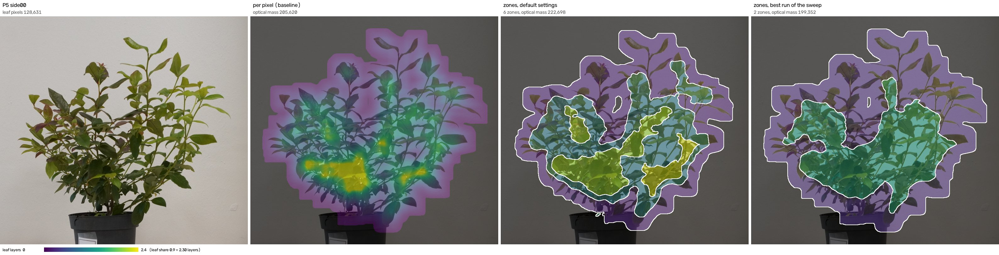
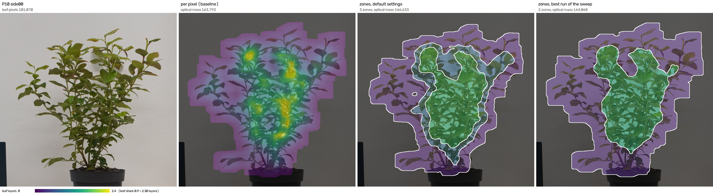
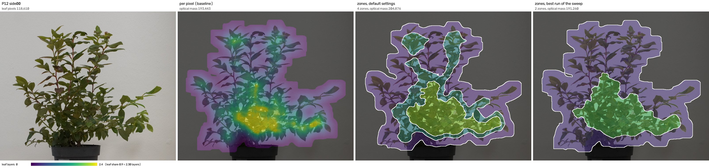
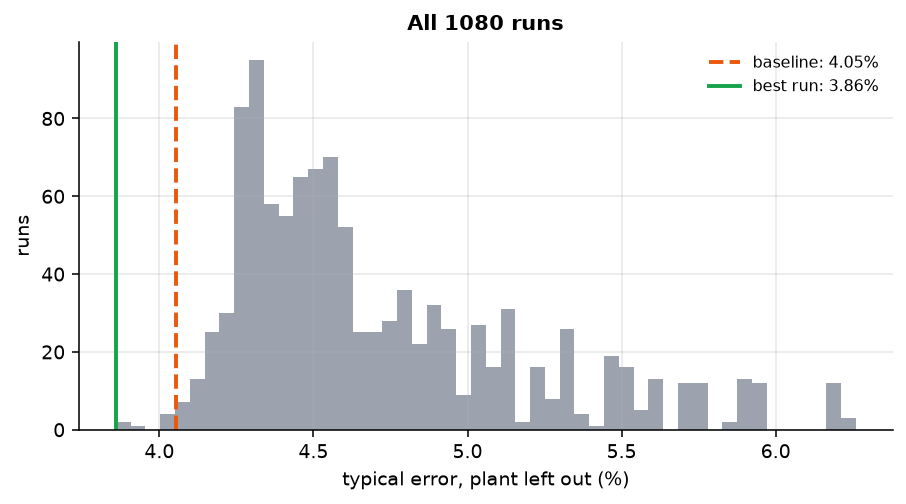
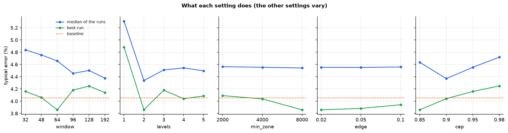
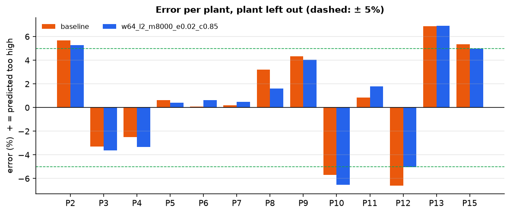
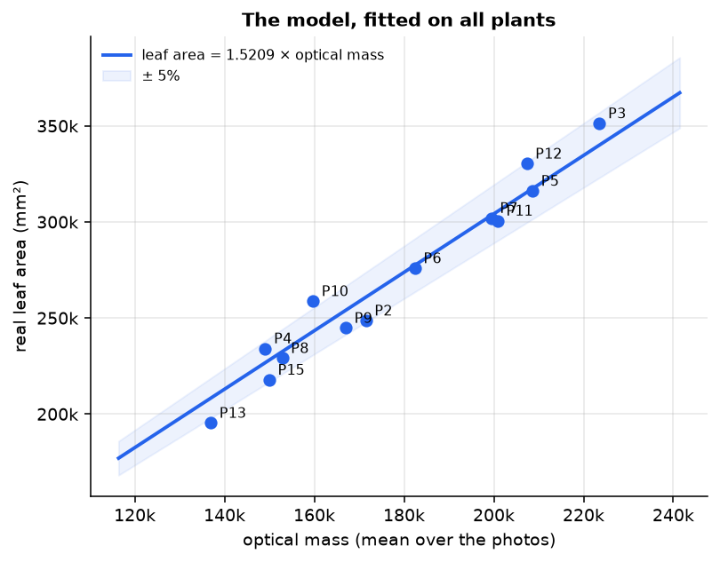
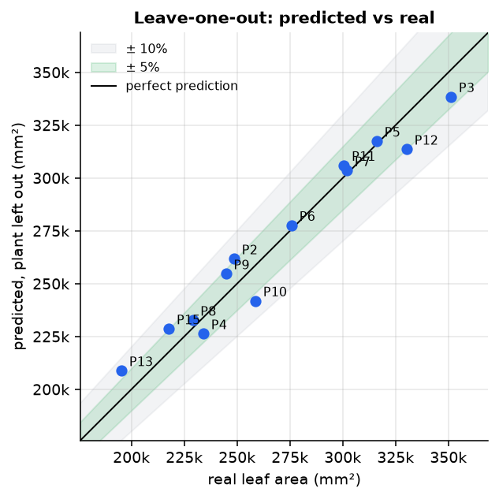
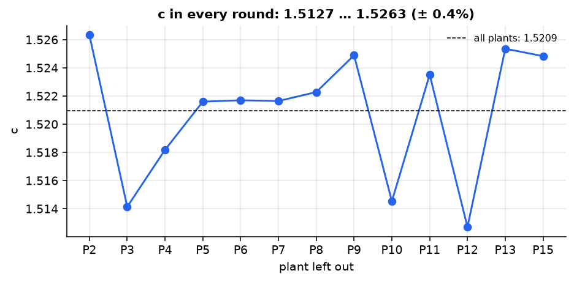
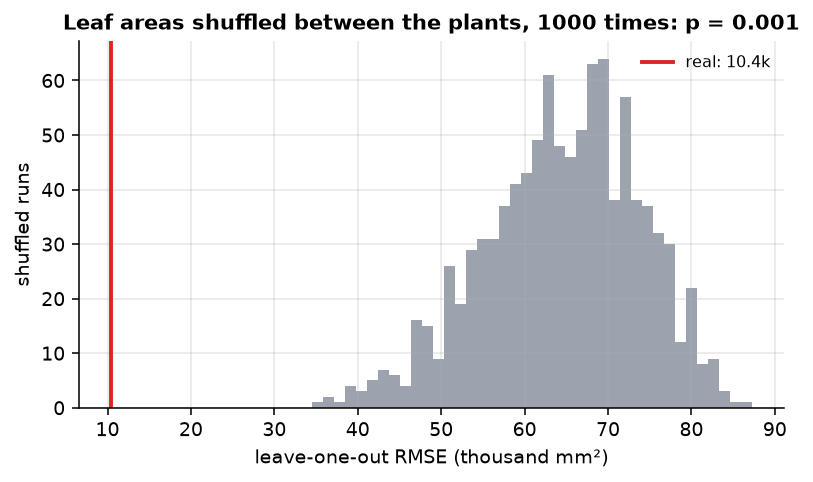

# Experiment 06_density_zones

1080 runs + baseline · 13 plants (P2, P3, P4, P5, P6, P7, P8, P9, P10, P11, P12, P13, P15) · leaf area = c × optical mass, leave-one-out

**Contents**

1. [Summary](#summary) — the baseline, the best run and the honest score, and the verdict
2. [The method](#the-method) — what the experiment changes, its settings and how many runs it makes
3. [What the method looks like](#what-the-method-looks-like) — the method drawn on example photos
4. [All runs](#all-runs) — how the runs are spread, what each setting does, the best runs
5. [Per plant: baseline vs best run](#per-plant-baseline-vs-best-run) — how far off each plant is, the baseline next to the best run, w64_l2_m8000_e0.02_c0.85
6. [Best run in detail](#best-run-in-detail-w64_l2_m8000_e002_c085) — its fit, every plant's prediction, whether one plant decides the model, and the shuffle test

How to read this page

**The model.** `leaf area = c × optical mass`: a straight line through zero, with c the one number learned from the plants. It is the model of the regression (`Regression/docs/single_feature_model.md`).

**Leave-one-out.** Every plant in turn is left out, c is learned from the others, and the left-out plant is predicted. Each plant is predicted by a model that never saw it.

**Typical error** = the RMSE of those predictions as a % of the average leaf area, the number the regression reports. **Mean error** = the average of the absolute errors in %. **R²**: 1 is perfect, 0 is no better than guessing the average plant.

**Baseline** = the current method, `T_64_0.9`: 64 px window, cap 0.9, leaf mask M1, mean over all side photos. Every experiment is compared with it on the same plants and leaf areas.

**Nested (honest) score.** With many runs, the best one is partly lucky: its settings happen to suit these plants. The nested score repeats the whole search once per plant: the best run is chosen on the other plants only, then predicts the left-out plant. Compare **that** number with the baseline.

**Noise.** With 14 plants, one plant can move the typical error by about a point. Differences below about 1 point are not a result.

## Summary

- **4.05%** baseline T_64_0.9
- **3.86%** best run: w64_l2_m8000_e0.02_c0.85 (optimistic)
- **4.48%** honest: run chosen without the plant (nested)
- **7 / 1080** runs better than the baseline

**Verdict:** choosing the run on the other plants (nested) gives **4.48%**, against **4.05%** for the baseline (+0.43 points). That is within the ~1 point of noise: **no clear difference**.

Runs the nested search chose: w64_l2_m8000_e0.02_c0.85 (12×), w192_l2_m8000_e0.02_c0.85 (1×)

## The method

**Question:** is the optical mass better if the leaf layers are measured per zone of similar density instead of per pixel?

A bush has regions: an airy edge, a medium part, a dense core. The baseline gives every pixel its own number of leaf layers, from the leaf share in the 64 px window around it. Here those regions are found first, each one's density is measured on the mask itself, and all its pixels get the region's layers.

**How each photo is cut into zones:**

1. **Density map:** the leaf share in a *window* around every pixel. It is used only to draw the zones.
2. **Plant area:** where that density is at least *edge*, plus every leaf pixel. It includes the gaps between the leaves, so a zone can have a leaf share below 1.
3. **Levels:** the densities of the leaf pixels are grouped into *levels* groups, from airy to dense. Pieces smaller than *min zone* are merged into the zone around them.
4. **Zones:** every connected piece of one level is a zone.

**Then, per zone:** f = leaf pixels / zone pixels, layers = −ln(1 − min(f, *cap*)), and the zone counts zone pixels × layers. The optical mass of a photo is the sum over its zones; of a plant, the mean over its side photos. An airy zone counts about as its leaf pixels; only dense zones are scaled up.

Sizes are in px at 1/4 of the photo resolution, where a leaf is about 35 px across and about 1000 px in area. A run's name lists its settings: `w192_l4_m2000_e0.02_c0.85` is window 192, levels 4, min zone 2000, edge 0.02, cap 0.85.

### The settings

What the settings in the run names and tables mean.

| setting | what it does | values tried |
|---|---|---|
| **window** | w: side of the square window, in px at 1/4 photo resolution (a leaf is ~35 px across), in which the leaf share around every pixel is measured. This density map only draws the zones: a small window follows single leaves, a large one draws smooth rings around the dense core. | 32, 48, 64, 96, 128, 192 (default 64) |
| **levels** | l: how many density groups (airy ... dense) the plant is split into, by k-means on the density of its leaf pixels. 1 = one density for the whole plant. | 1, 2, 3, 4, 5 (default 3) |
| **min_zone** | m: smallest zone, in px (a leaf is ~1000 px). Smaller pieces are merged into the zone around them, so the zones don't fall apart into specks. | 2000, 4000, 8000 (default 4000) |
| **edge** | e: lowest density that still counts as plant. Where the density map is at least this, the pixels belong to the plant area (leaves plus the gaps between them); below it is background. A lower edge makes the outer zones reach further out, with more gaps, so their leaf share is lower. | 0.02, 0.05, 0.1 (default 0.05) |
| **cap** | c: highest leaf share f a zone may have when it is turned into layers, layers = -ln(1 - min(f, cap)). It limits how many layers a nearly solid zone counts: 0.85 = 1.9, 0.90 = 2.3, 0.95 = 3.0, 0.98 = 3.9 layers. The only setting that doesn't change the zones themselves. | 0.85, 0.9, 0.95, 0.98 (default 0.9) |

**Runs:** every combination of the settings, 6 window × 5 levels × 3 min_zone × 3 edge × 4 cap = **1080 runs**, plus the baseline.

## What the method looks like

*P5, a medium plant. The default zones find the same dense patches as the per-pixel method and make them whole zones at the cap (yellow), so the zones count more than per pixel (222,698 against 205,620). The best run's 2 levels and 0.85 cap give one core with fewer layers: no zone reaches the cap and the optical mass (199,352) is a little below per pixel.*

*P10, an open plant. Per pixel, only small clusters of overlapping leaves reach many layers (yellow); the open shoots stay low. The default zones turn this into nested bands (airy edge, medium, core). The best run has only 2 levels: an airy edge and one core. Its optical mass (164,068) is almost the same as per pixel (163,793).*

*P12, the densest plant. Per pixel and with the default zones the core reaches the cap (yellow): a single photo cannot show how deep it goes, so P12 is predicted too low by every method. The best run's single core stays below the cap and ends up close to per pixel (191,260 against 193,443), so it doesn't fix that either.*

## All runs

The typical error of every run. Runs left of the orange line beat the baseline; the green line is the best run (before the honest correction).

### What each setting does

One panel per setting. For each value of the setting, the runs with that value are taken together, whatever the other settings: blue is their median typical error, green the best of them. The orange line is the baseline. A flat line means the setting doesn't matter; a slope shows which values are better.

### Where the best 10% of the runs lie (108 runs, typical error ≤ 4.26%)

| setting | range in the best 10% | share of the best 10% per value | if it didn't matter |
|---|---|---|---|
| window | 32 – 192 | 32: 6% · 48: 10% · 64: 31% · 96: 9% · 128: 2% · 192: 41% | 17% |
| levels | 2 – 5 | 1: 0% · 2: 30% · 3: 16% · 4: 20% · 5: 34% | 20% |
| min_zone | 2000 – 8000 | 2000: 29% · 4000: 29% · 8000: 43% | 33% |
| edge | 0.02 – 0.1 | 0.02: 31% · 0.05: 32% · 0.1: 36% | 33% |
| cap | 0.85 – 0.98 | 0.85: 41% · 0.9: 49% · 0.95: 6% · 0.98: 4% | 25% |

Green: the value is at least 1.5× as common among the best runs as in the grid; grey: at most half as common. A setting whose values all sit near the "didn't matter" share has no effect.

### The best runs

| run | window | levels | min_zone | edge | cap | c | typical error | mean error | R² | within 5% | vs baseline |
|---|---|---|---|---|---|---|---|---|---|---|---|
| baseline |   |   |   |   |   | 1.5042 | 4.05% | 3.48% | 0.942 | 8/13 | +0.00 |
| w64_l2_m8000_e0.02_c0.85 | 64 | 2 | 8000 | 0.02 | 0.85 | 1.5209 | 3.86% | 3.44% | 0.948 | 9/13 | -0.20 |
| w64_l2_m8000_e0.05_c0.85 | 64 | 2 | 8000 | 0.05 | 0.85 | 1.5120 | 3.88% | 3.46% | 0.947 | 8/13 | -0.17 |
| w64_l2_m8000_e0.10_c0.85 | 64 | 2 | 8000 | 0.1 | 0.85 | 1.4978 | 3.94% | 3.50% | 0.945 | 8/13 | -0.11 |
| w64_l2_m4000_e0.02_c0.85 | 64 | 2 | 4000 | 0.02 | 0.85 | 1.5109 | 4.04% | 3.54% | 0.943 | 9/13 | -0.02 |
| w64_l4_m8000_e0.02_c0.90 | 64 | 4 | 8000 | 0.02 | 0.9 | 1.4348 | 4.04% | 3.54% | 0.943 | 9/13 | -0.01 |
| w64_l4_m8000_e0.05_c0.90 | 64 | 4 | 8000 | 0.05 | 0.9 | 1.4325 | 4.05% | 3.55% | 0.942 | 9/13 | -0.01 |
| w64_l2_m4000_e0.05_c0.85 | 64 | 2 | 4000 | 0.05 | 0.85 | 1.5025 | 4.05% | 3.55% | 0.942 | 9/13 | -0.00 |
| w48_l4_m8000_e0.02_c0.90 | 48 | 4 | 8000 | 0.02 | 0.9 | 1.3905 | 4.06% | 3.53% | 0.942 | 7/13 | +0.01 |
| w64_l4_m8000_e0.10_c0.90 | 64 | 4 | 8000 | 0.1 | 0.9 | 1.4285 | 4.06% | 3.56% | 0.942 | 9/13 | +0.01 |
| w48_l4_m8000_e0.05_c0.90 | 48 | 4 | 8000 | 0.05 | 0.9 | 1.3884 | 4.08% | 3.54% | 0.941 | 7/13 | +0.02 |
| w48_l5_m8000_e0.02_c0.90 | 48 | 5 | 8000 | 0.02 | 0.9 | 1.3884 | 4.08% | 3.62% | 0.941 | 8/13 | +0.03 |
| w64_l2_m2000_e0.02_c0.85 | 64 | 2 | 2000 | 0.02 | 0.85 | 1.5037 | 4.09% | 3.59% | 0.941 | 9/13 | +0.04 |
| w48_l5_m8000_e0.05_c0.90 | 48 | 5 | 8000 | 0.05 | 0.9 | 1.3869 | 4.09% | 3.63% | 0.941 | 8/13 | +0.04 |
| w64_l2_m4000_e0.10_c0.85 | 64 | 2 | 4000 | 0.1 | 0.85 | 1.4891 | 4.09% | 3.58% | 0.941 | 8/13 | +0.04 |
| w64_l2_m2000_e0.05_c0.85 | 64 | 2 | 2000 | 0.05 | 0.85 | 1.4956 | 4.10% | 3.60% | 0.941 | 9/13 | +0.05 |
| w48_l5_m8000_e0.10_c0.90 | 48 | 5 | 8000 | 0.1 | 0.9 | 1.3843 | 4.11% | 3.63% | 0.941 | 8/13 | +0.05 |
| w48_l4_m8000_e0.10_c0.90 | 48 | 4 | 8000 | 0.1 | 0.9 | 1.3844 | 4.11% | 3.58% | 0.941 | 7/13 | +0.05 |
| w64_l5_m8000_e0.02_c0.90 | 64 | 5 | 8000 | 0.02 | 0.9 | 1.4329 | 4.12% | 3.59% | 0.940 | 8/13 | +0.06 |
| w64_l5_m8000_e0.05_c0.90 | 64 | 5 | 8000 | 0.05 | 0.9 | 1.4314 | 4.12% | 3.59% | 0.940 | 8/13 | +0.06 |
| w64_l5_m4000_e0.02_c0.90 | 64 | 5 | 4000 | 0.02 | 0.9 | 1.4250 | 4.12% | 3.57% | 0.940 | 8/13 | +0.07 |
| w64_l5_m4000_e0.05_c0.90 | 64 | 5 | 4000 | 0.05 | 0.9 | 1.4236 | 4.13% | 3.57% | 0.940 | 8/13 | +0.07 |
| w64_l5_m8000_e0.10_c0.90 | 64 | 5 | 8000 | 0.1 | 0.9 | 1.4286 | 4.13% | 3.60% | 0.940 | 8/13 | +0.08 |
| w64_l5_m4000_e0.10_c0.90 | 64 | 5 | 4000 | 0.1 | 0.9 | 1.4211 | 4.14% | 3.57% | 0.940 | 8/13 | +0.08 |
| w64_l2_m2000_e0.10_c0.85 | 64 | 2 | 2000 | 0.1 | 0.85 | 1.4827 | 4.14% | 3.64% | 0.940 | 8/13 | +0.08 |
| w192_l4_m2000_e0.02_c0.85 | 192 | 4 | 2000 | 0.02 | 0.85 | 1.6255 | 4.14% | 3.39% | 0.940 | 10/13 | +0.09 |

Best 25 of 1080 runs. All runs: summary.csv.

## Per plant: baseline vs best run

The error of every plant when it is predicted by the model learned without it, for the baseline (orange) and the best run, w64_l2_m8000_e0.02_c0.85. Above 0: predicted too high; below: too low. Between the green dashed lines the plant is within 5%. A plant that is off the same way for both is missed by the optical mass itself, not by the setting.

## Best run in detail: w64_l2_m8000_e0.02_c0.85

settings: window **64** · levels **2** · min_zone **8000** · edge **0.02** · cap **0.85**

- **3.9%** typical error
- **0.95** R²
- **9 / 13** plants within 5%
- **1.5209** c, fitted on all plants

### The fit and the predictions

Left: every plant's optical mass against its real leaf area, with the line `leaf area = c × optical mass` fitted on all plants. Right: each plant predicted by the model learned without it (leave-one-out), against its real leaf area. On the black line the prediction is perfect; inside the green band it is within 5%.

### Per plant

| plant | optical mass | real mm² | predicted mm² | error | baseline error |
|---|---|---|---|---|---|
| P2 | 171,488 | 248,603 | 261,746 | +5.3% | +5.7% |
| P3 | 223,542 | 351,253 | 338,472 | -3.6% | -3.3% |
| P4 | 149,070 | 234,098 | 226,314 | -3.3% | -2.5% |
| P5 | 208,609 | 316,107 | 317,419 | +0.4% | +0.6% |
| P6 | 182,406 | 275,843 | 277,566 | +0.6% | +0.1% |
| P7 | 199,432 | 301,997 | 303,464 | +0.5% | +0.2% |
| P8 | 152,850 | 229,026 | 232,680 | +1.6% | +3.2% |
| P9 | 166,996 | 244,749 | 254,651 | +4.0% | +4.3% |
| P10 | 159,700 | 258,726 | 241,870 | -6.5% | -5.7% |
| P11 | 200,831 | 300,609 | 305,968 | +1.8% | +0.8% |
| P12 | 207,322 | 330,299 | 313,616 | -5.1% | -6.6% |
| P13 | 136,917 | 195,339 | 208,847 | +6.9% | +6.9% |
| P15 | 149,940 | 217,768 | 228,633 | +5.0% | +5.3% |

### c in every round: does one plant decide the model?

Leave-one-out fits c 13 times, each time without one plant. Each point is the c fitted **without** the plant on the x-axis; the dashed line is c fitted on all plants. A flat line means no single plant drives the model. A point far from the line means that plant on its own pulls c up or down, and it is usually also predicted badly. Here c moves by ± 0.4%; the plant that moves it most is P12.

### Shuffle test: is the fit real or luck?

The leaf areas are shuffled randomly between the plants 1000 times, so they no longer belong to their photos, and the same leave-one-out test is run each time. Grey: the errors of the shuffled data. Red: the error of the real data. If red lies left of nearly all of grey, the optical mass really carries the leaf area. p is the share of shuffles that did as well as the real data (p < 0.05: not luck). It says the run is not noise, not that it beats the baseline. Here 0 of 1000 shuffles did as well (p = 0.001, so it is not luck).

