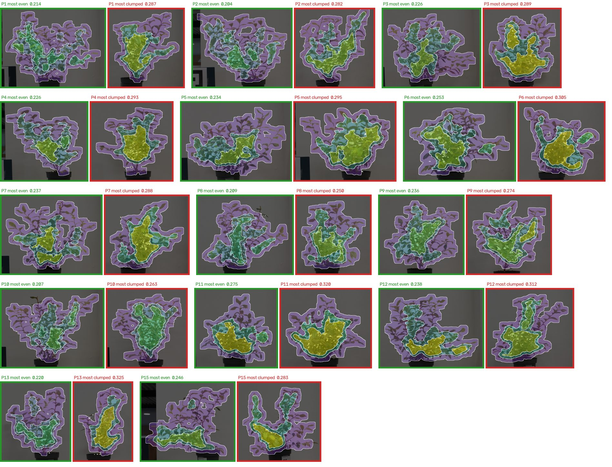

# 07 Photo selection

**Results:** [full report](results/report.md)

> **Run earlier, on the first hand-measured leaf areas** (14 plants with P1, baseline 5.7%) and the masks before
> the pot fix (09). Its numbers can only be compared with each other.

**Question:** can one or two well-chosen photos replace the mean of all 18?

Looking at the photos, some show the leaves evenly spread over the whole plant shape. Others show a dense clump in
the middle with a few shoots sticking out. Maybe the most even photo, the most clumped one, or the two together
describe the plant better than the average view.

## Method

**Clumping score per photo.** Each photo is cut into density zones (`common/zones.py`, default settings: window 64,
3 levels). The score is how much the leaf share differs between the zones, weighted by their area:

```
clumping = sqrt( Σ area_zone × (f_zone − f_plant)² / Σ area_zone )      f = leaf share
```

A low score means most of the plant is one zone of one density (even). A high score means a dense zone next to airy
ones (clumped). Lone specks are left out.

**Runs.** The optical mass is the baseline's (`T_64_0.9`) throughout. Only the photos it's taken from change:

| run | photos per plant |
|---|---|
| baseline | all side photos (the usual way) |
| even | the most even photo |
| clumped | the most clumped photo |
| pair | the mean of those two |

**Yardstick.** The same test with k randomly chosen photos per plant, 2000 draws each. A chosen photo is only useful
if it beats a random one.

```bash
.venv/bin/python 07_photo_selection/photo_selection.py $PHOTOS     # about 25 s with cached masks
.venv/bin/python 00_evaluation/evaluate.py 07_photo_selection/results/runs.csv
```

Check the choice by eye in `results/pictures/` (also in the report): `00_chosen.jpg` has the most even and the most
clumped photo of every plant, and `P<n>.jpg` all photos of one plant sorted from even to clumped, the two chosen
ones framed. `results/photo_scores.csv` has the score of every photo.



## Result

| photos used | typical error |
|---|---|
| most even photo | 11.3% |
| most clumped photo | 9.4% |
| pair (mean of the two) | 9.4% |
| **all 18 (baseline)** | **5.7%** |
| 1 random photo (median of 2000 draws) | 8.8% |
| 2 random photos | 7.4% |
| 4 random photos | 6.5% |
| 9 random photos | 6.0% |

- **The mean of all photos is clearly best.** The error falls with every photo added: each photo sees the plant from
  another side, and the mean averages the differences out.
- **The chosen photos are worse than random ones.** The even photo (11.3%) is near the worst 5% of single random
  photos (5–95% range: 6.0–12.4%). The pair (9.4%) is worse than 2 random photos (7.4%).
- **What the score picks** (see the pictures): the most even photo is usually the **wide** side of the plant, where
  the shoots are spread out (wider than the plant's average view in 11 of 14 plants). The most clumped photo is the
  **narrow** side in all 14 plants, where the shoots line up behind each other into a dense core.
- **The clumped photo is a fair view.** It shows fewer leaf pixels than average (down to 0.81× for P13), but its
  optical mass stays close to the plant mean (0.91–1.08×): the extra layers of its dense core make up for the
  leaves hidden behind each other. That's what the optical mass is for. Still, it is one view, so it does about as
  well as one random photo (9.4% against 8.8%).
- **The even photo is not.** Spread-out shoots overlap little, so it gets few extra layers, and how much it misses
  differs from plant to plant: its optical mass is 0.81× the plant mean for P13 and 1.05× for P6. One c can't
  correct for that, which is why it is the worst choice (11.3%, P3 −23%).
- **The score itself works:** even photos have no big dense core, clumped ones do. But how even one view looks
  doesn't tell how much leaf the plant has.

## Conclusion

Use the mean of all side photos. If fewer photos are needed in the field, take them evenly spread around the plant
(Mosa's EDA: 3 photos 120° apart are within ~2% of the 18-photo mean), not chosen by how they look.
