# Experiment 07_photo_selection

3 runs + baseline · 14 plants (P1, P2, P3, P4, P5, P6, P7, P8, P9, P10, P11, P12, P13, P15) · leaf area = c × optical mass, leave-one-out

How to read this page

**The model.** `leaf area = c × optical mass`: a straight line through zero, with c the one number learned from the plants. It is the model of the regression (`Regression/docs/single_feature_model.md`).

**Leave-one-out.** Every plant in turn is left out, c is learned from the others, and the left-out plant is predicted. Each plant is predicted by a model that never saw it.

**Typical error** = the RMSE of those predictions as a % of the average leaf area, the number the regression reports. **Mean error** = the average of the absolute errors in %. **R²**: 1 is perfect, 0 is no better than guessing the average plant.

**Baseline** = the current method, `T_64_0.9`: 64 px window, cap 0.9, leaf mask M1, mean over all side photos. Every experiment is compared with it on the same plants and leaf areas.

**Nested (honest) score.** With many runs, the best one is partly lucky: its settings happen to suit these plants. The nested score repeats the whole search once per plant: the best run is chosen on the other plants only, then predicts the left-out plant. Compare **that** number with the baseline.

**Noise.** With 14 plants, one plant can move the typical error by about a point. Differences below about 1 point are not a result.

- **5.74%** baseline T_64_0.9
- **9.37%** best run: clumped (optimistic)
- **10.81%** honest: run chosen without the plant (nested)
- **0 / 3** runs better than the baseline

**Verdict:** choosing the run on the other plants (nested) gives **10.81%**, against **5.74%** for the baseline (+5.07 points). That is **worse** by more than the ~1 point of noise.

Runs the nested search chose: clumped (10×), pair (4×)

## What the method looks like

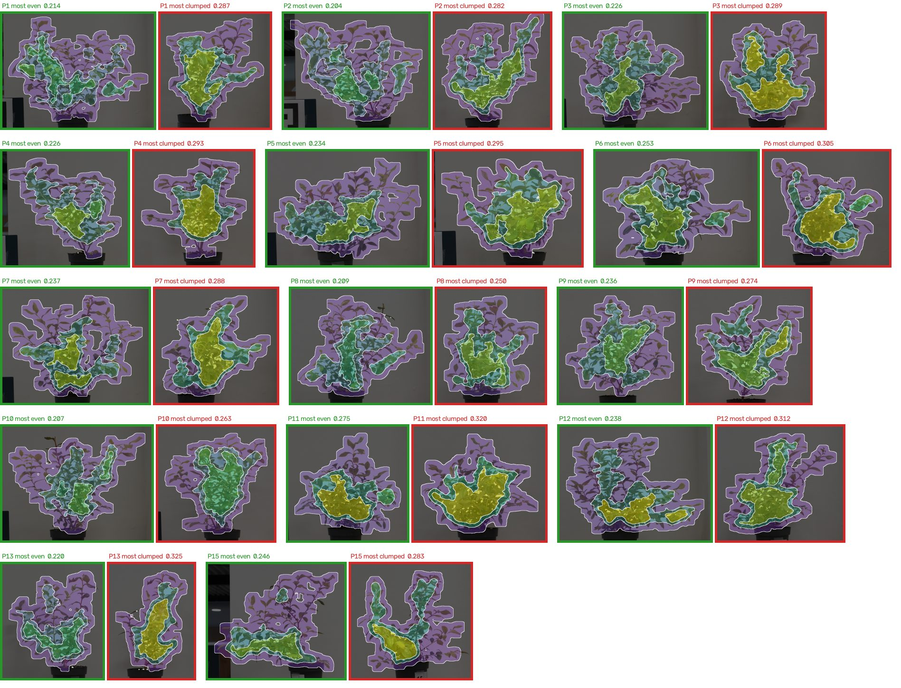

*The most even (green) and the most clumped (red) photo of every plant. The zones are coloured by their leaf layers (purple 0, yellow 2.3); the number is the clumping score. The most even photo is usually the wide side of the plant, where the shoots are spread out; the most clumped one is the narrow side, where they line up behind each other into a dense core.*

All photos of every plant, sorted from even to clumped (14)

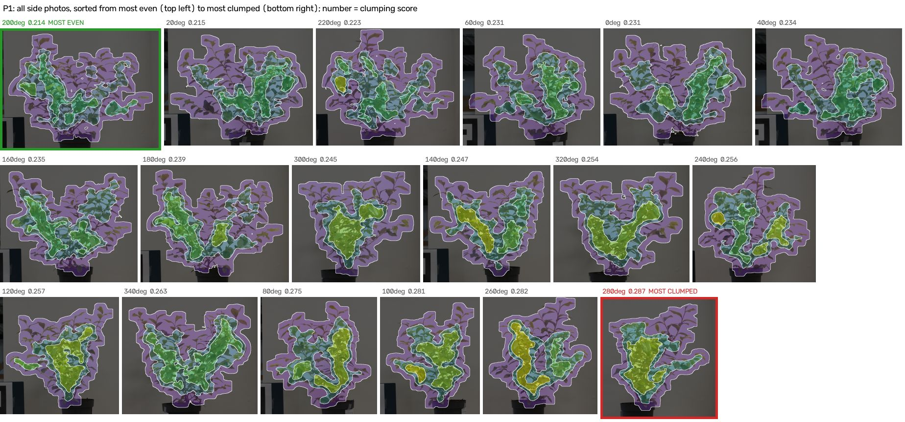

*P1: all 18 side photos sorted from even to clumped.*

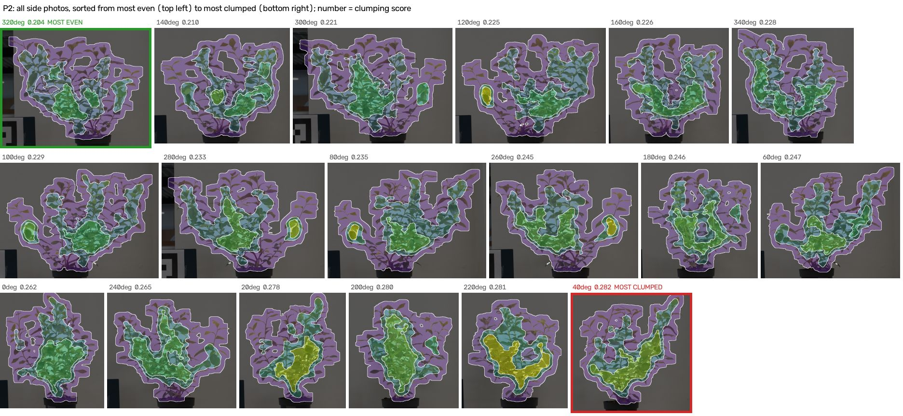

*P2: all 18 side photos sorted from even to clumped.*

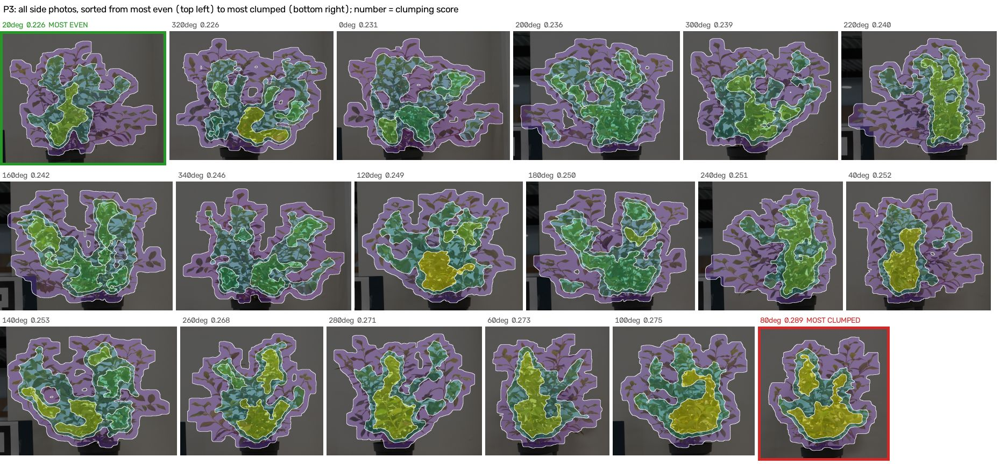

*P3: all 18 side photos sorted from even to clumped.*

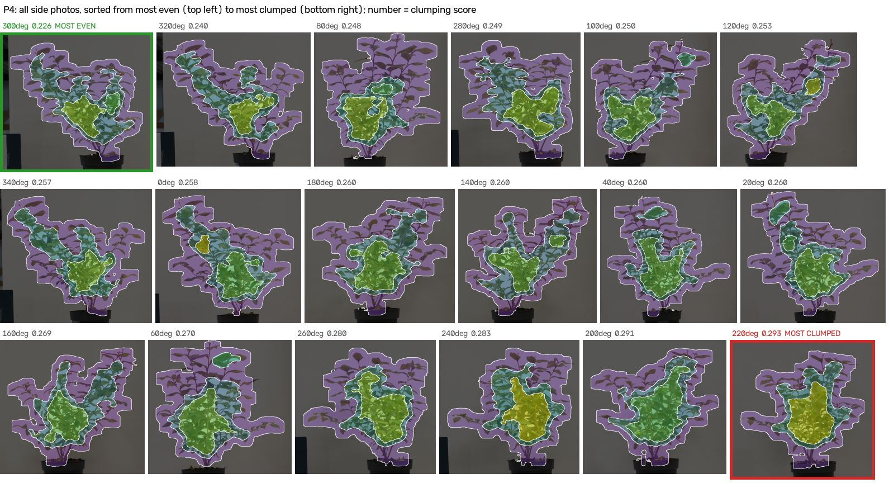

*P4: all 18 side photos sorted from even to clumped.*

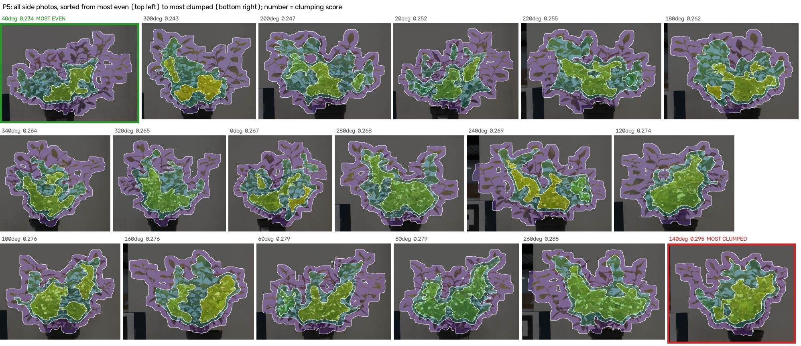

*P5: all 18 side photos sorted from even to clumped.*

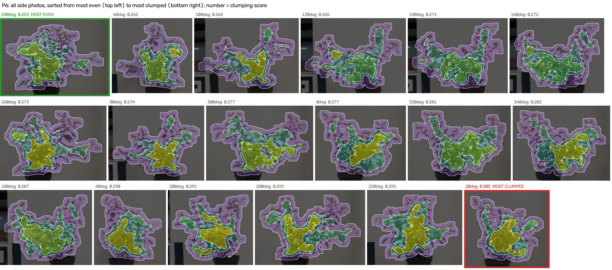

*P6: all 18 side photos sorted from even to clumped.*

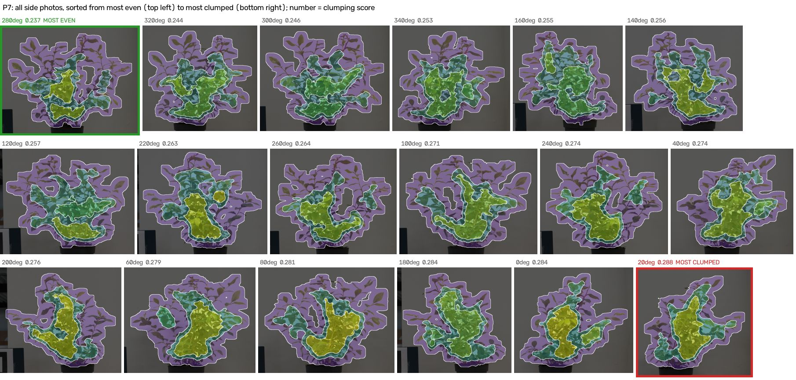

*P7: all 18 side photos sorted from even to clumped.*

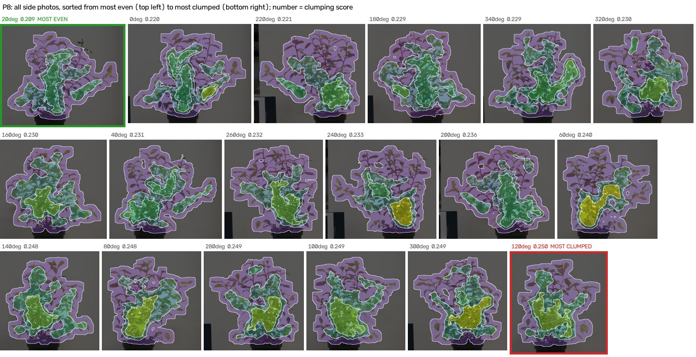

*P8: all 18 side photos sorted from even to clumped.*

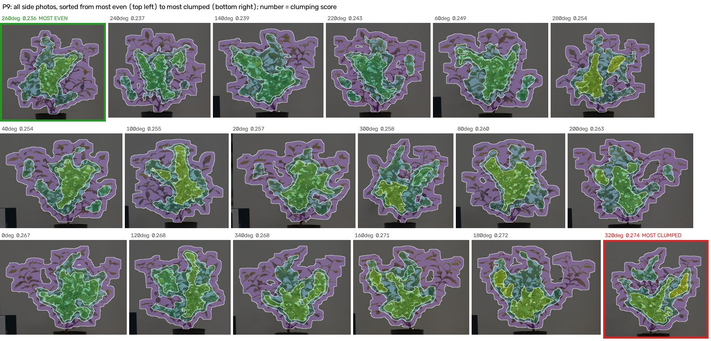

*P9: all 18 side photos sorted from even to clumped.*

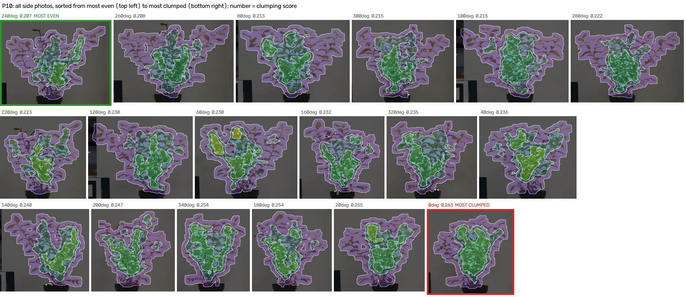

*P10: all 18 side photos sorted from even to clumped.*

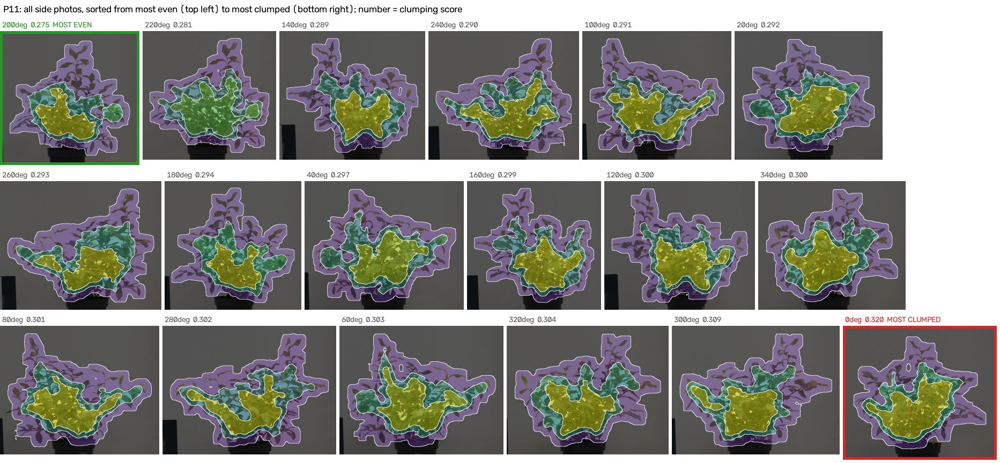

*P11: all 18 side photos sorted from even to clumped.*

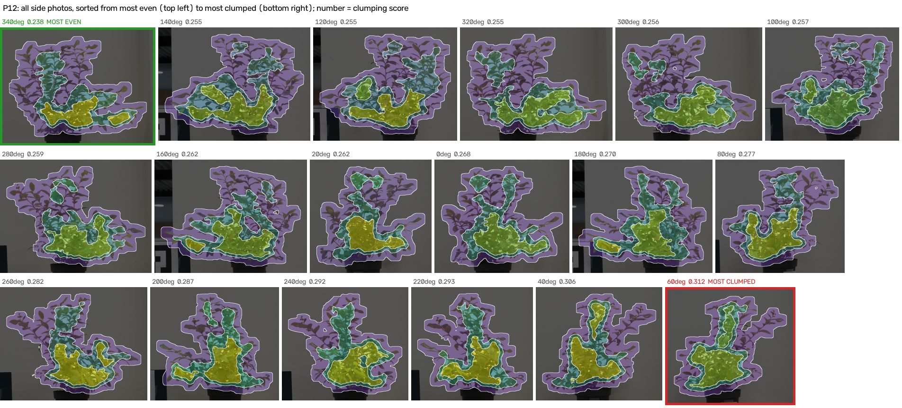

*P12: all 18 side photos sorted from even to clumped.*

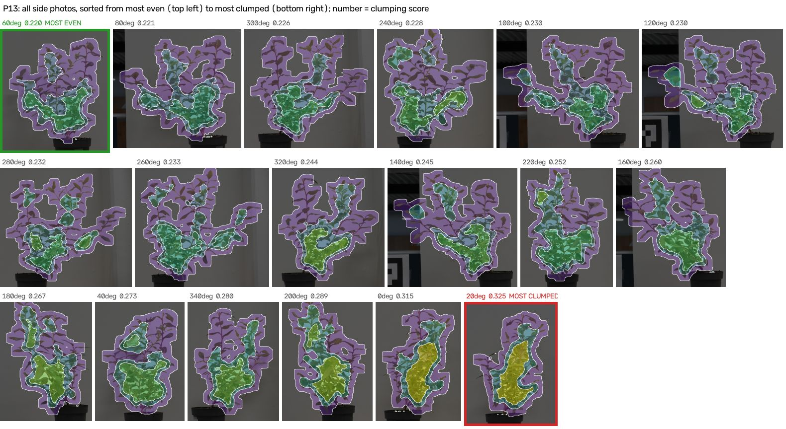

*P13: all 18 side photos sorted from even to clumped.*

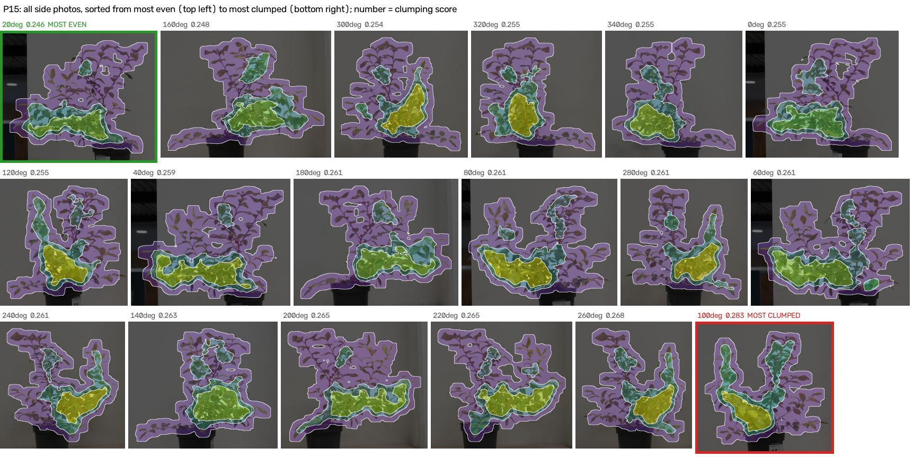

*P15: all 18 side photos sorted from even to clumped.*

## All runs

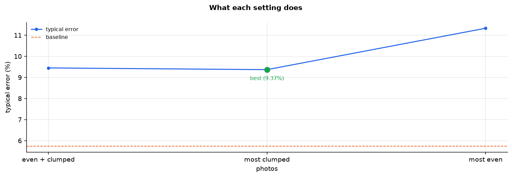

| run | photos | c | typical error | mean error | R² | within 5% | vs baseline |
|---|---|---|---|---|---|---|---|
| baseline | all | 1.5523 | 5.74% | 4.39% | 0.887 | 8/14 | +0.00 |
| clumped | most clumped | 1.5702 | 9.37% | 7.32% | 0.698 | 7/14 | +3.63 |
| pair | even + clumped | 1.5888 | 9.45% | 6.69% | 0.692 | 6/14 | +3.71 |
| even | most even | 1.6026 | 11.33% | 7.55% | 0.558 | 6/14 | +5.59 |

## Per plant

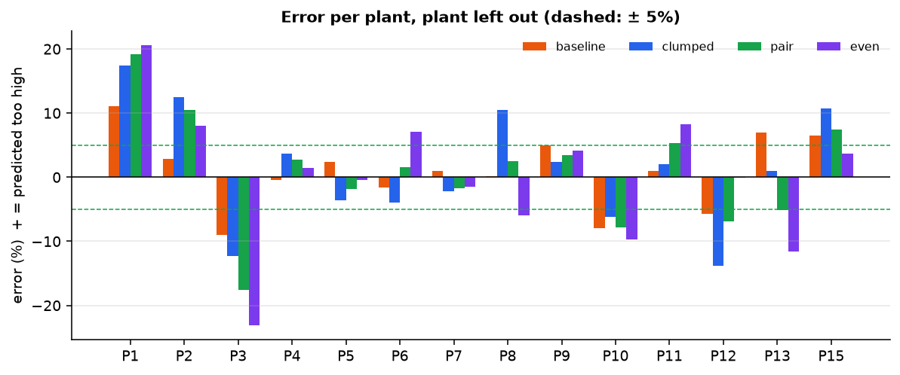

## Run: baseline

settings: photos **all**

- **5.7%** typical error
- **0.89** R²
- **8 / 14** plants within 5%
- **1.5523** c, fitted on all plants

With the leaf areas shuffled between the plants, 0 of 1000 runs did as well (p = 0.001, so it is not luck).

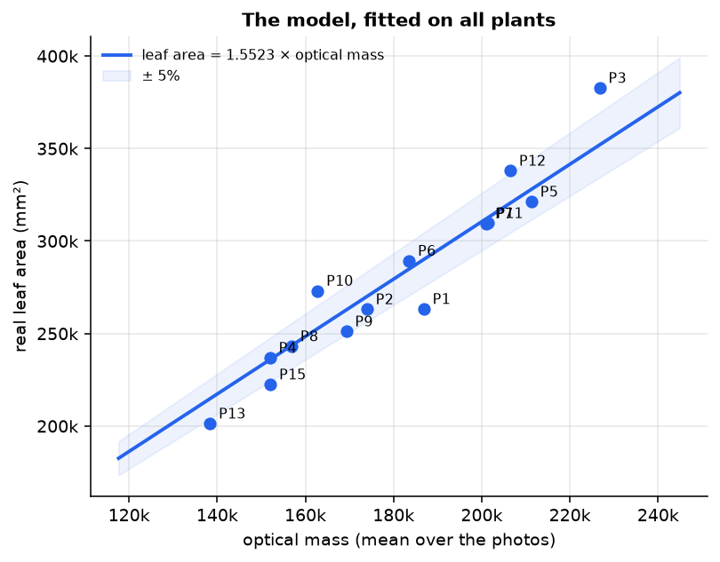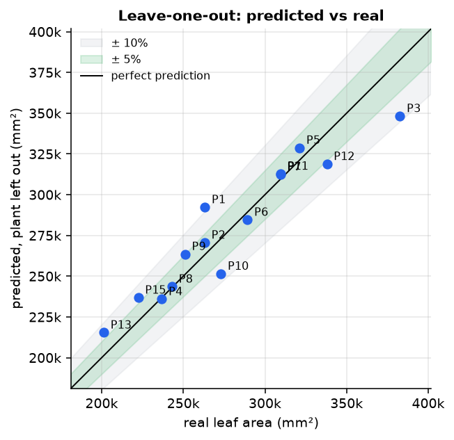

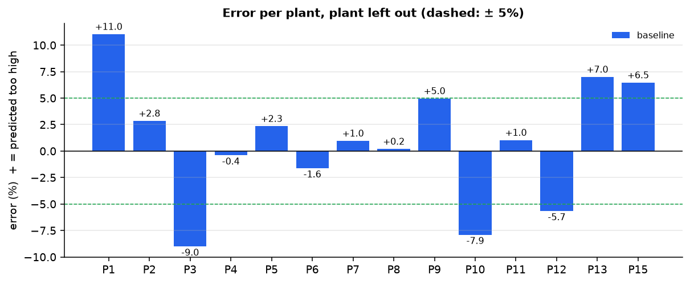

### Per plant

| plant | optical mass | real mm² | predicted mm² | error |
|---|---|---|---|---|
| P1 | 186,877 | 263,234 | 292,285 | +11.0% |
| P2 | 173,982 | 263,076 | 270,568 | +2.8% |
| P3 | 226,759 | 382,684 | 348,180 | -9.0% |
| P4 | 151,977 | 236,839 | 235,871 | -0.4% |
| P5 | 211,302 | 321,205 | 328,738 | +2.3% |
| P6 | 183,546 | 289,292 | 284,583 | -1.6% |
| P7 | 201,092 | 309,445 | 312,422 | +1.0% |
| P8 | 156,880 | 243,083 | 243,556 | +0.2% |
| P9 | 169,281 | 251,089 | 263,552 | +5.0% |
| P10 | 162,788 | 273,065 | 251,468 | -7.9% |
| P11 | 201,345 | 309,630 | 312,836 | +1.0% |
| P12 | 206,502 | 337,968 | 318,797 | -5.7% |
| P13 | 138,375 | 201,301 | 215,386 | +7.0% |
| P15 | 152,085 | 222,433 | 236,805 | +6.5% |

### Other models, tested the same way

| model | fitted on all plants | R² | typical error | mean error | worst plant |
|---|---|---|---|---|---|
| c × optical mass | c = 1.5523 | 0.887 | 5.7% | 4.4% | 11.0% |
| a + b × optical mass | a = -43k, b = 1.787 | 0.889 | 5.7% | 4.5% | 11.3% |
| a × optical mass^b | a = 0.286, b = 1.139 | 0.893 | 5.6% | 4.5% | 11.1% |
| average plant (no photo) | 279k mm² | -0.160 | 18.3% | 15.6% | 41.5% |
| pick the best model, then predict (nested) | c × optical mass 4×, a × optical mass^b 10× | 0.868 | 6.2% | 5.2% | 11.1% |

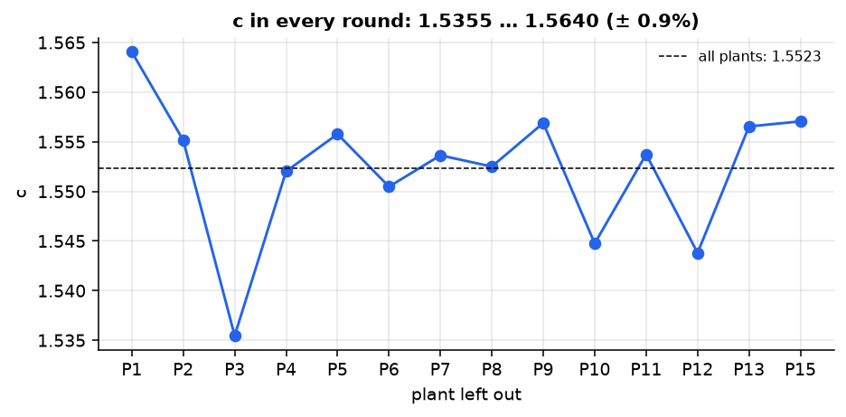 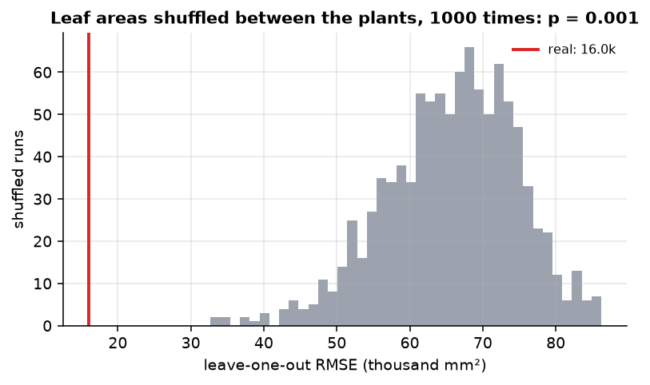

## Run: clumped

settings: photos **most clumped**

- **9.4%** typical error
- **0.70** R²
- **7 / 14** plants within 5%
- **1.5702** c, fitted on all plants

With the leaf areas shuffled between the plants, 0 of 1000 runs did as well (p = 0.001, so it is not luck).

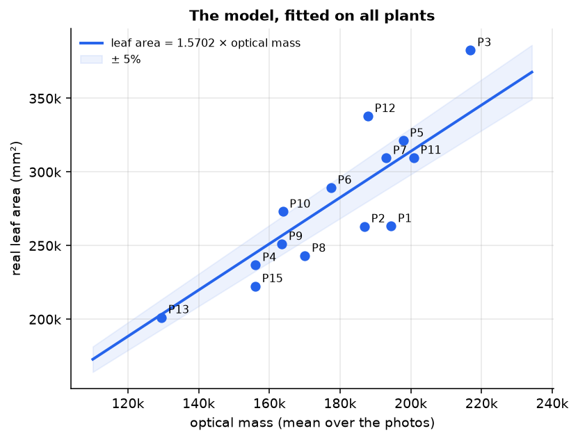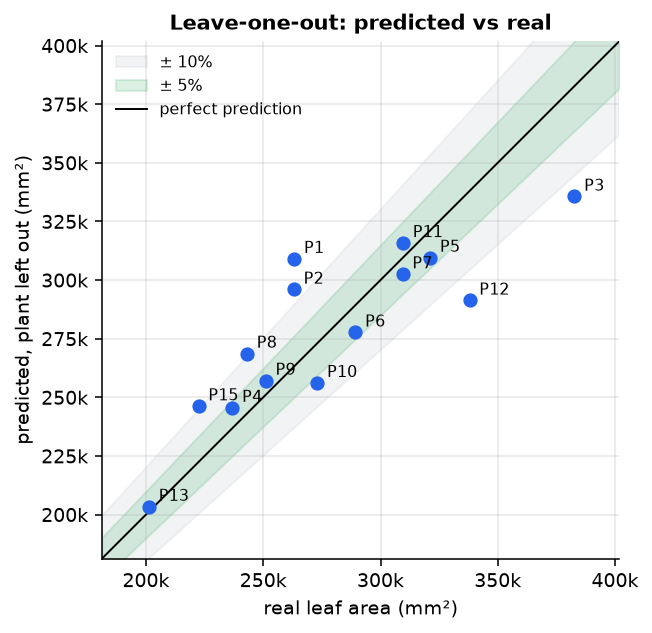

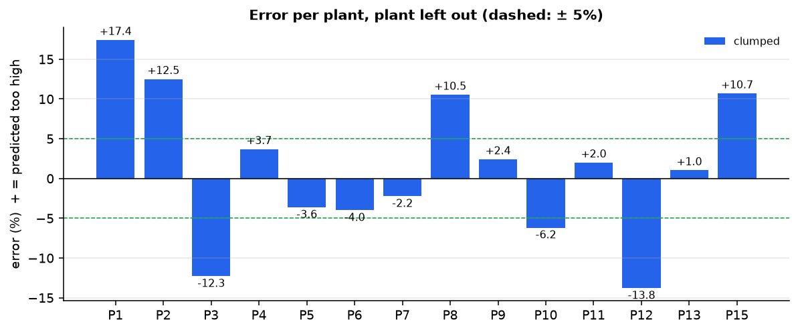

### Per plant

| plant | optical mass | real mm² | predicted mm² | error | baseline error |
|---|---|---|---|---|---|
| P1 | 194,414 | 263,234 | 309,104 | +17.4% | +11.0% |
| P2 | 186,886 | 263,076 | 295,989 | +12.5% | +2.8% |
| P3 | 216,884 | 382,684 | 335,637 | -12.3% | -9.0% |
| P4 | 156,103 | 236,839 | 245,579 | +3.7% | -0.4% |
| P5 | 197,810 | 321,205 | 309,586 | -3.6% | +2.3% |
| P6 | 177,386 | 289,292 | 277,717 | -4.0% | -1.6% |
| P7 | 193,037 | 309,445 | 302,528 | -2.2% | +1.0% |
| P8 | 170,070 | 243,083 | 268,679 | +10.5% | +0.2% |
| P9 | 163,541 | 251,089 | 257,145 | +2.4% | +5.0% |
| P10 | 163,794 | 273,065 | 256,178 | -6.2% | -7.9% |
| P11 | 200,805 | 309,630 | 315,853 | +2.0% | +1.0% |
| P12 | 187,867 | 337,968 | 291,333 | -13.8% | -5.7% |
| P13 | 129,477 | 201,301 | 203,377 | +1.0% | +7.0% |
| P15 | 156,004 | 222,433 | 246,235 | +10.7% | +6.5% |

### Other models, tested the same way

| model | fitted on all plants | R² | typical error | mean error | worst plant |
|---|---|---|---|---|---|
| c × optical mass | c = 1.5702 | 0.698 | 9.4% | 7.3% | 17.4% |
| a + b × optical mass | a = -55k, b = 1.874 | 0.679 | 9.7% | 7.7% | 19.7% |
| a × optical mass^b | a = 0.252, b = 1.151 | 0.689 | 9.5% | 7.5% | 19.1% |
| average plant (no photo) | 279k mm² | -0.160 | 18.3% | 15.6% | 41.5% |
| pick the best model, then predict (nested) | c × optical mass 12×, a × optical mass^b 2× | 0.676 | 9.7% | 7.9% | 19.1% |

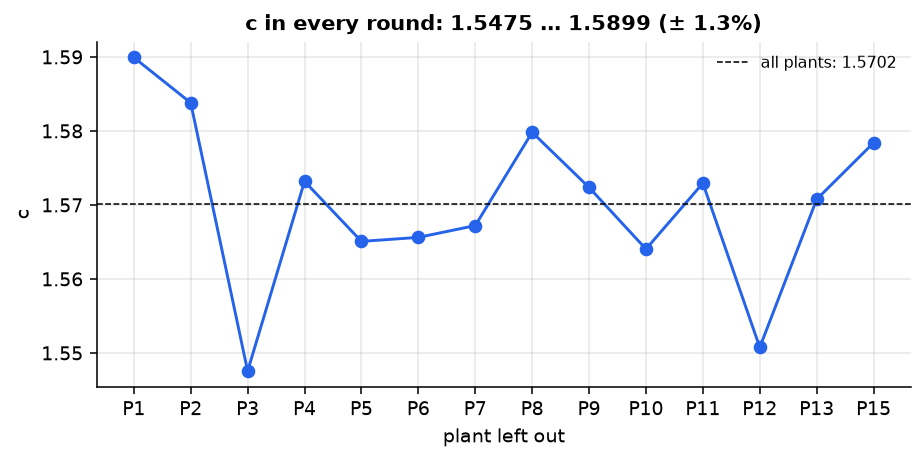 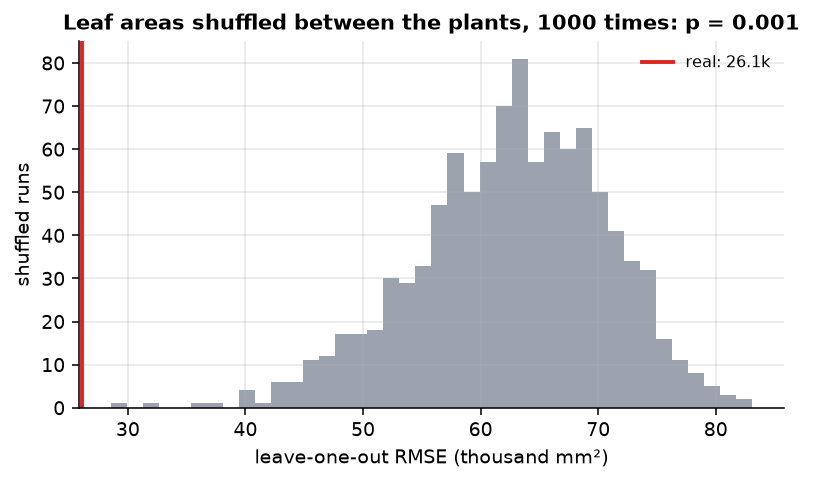
