# 08 Problem plants: the baseline against the best run of 05

**Results:** this page is the analysis; the reports it is based on: [baseline](../00_evaluation/baseline/report.md) · [best run of 05](../05_kernel_cap/results/report.md)

Which plants each model gets wrong, and what the photos of those plants show. Two models:

- **Baseline** `T_64_0.9`: leaf mask (stems left out), kernel 64, cap 0.90. Typical error **4.05%**.
- **Best run of 05** `k144_cap_0.995`: leaf + stem mask, kernel 144, cap 0.995 (in effect no cap). Typical error
  **3.70%**, but its honest score is **4.32%**: it was picked from 165 runs on these same plants.

Current leaf areas (`common/real_leaf_area_mm2.csv`, from `01_leaf_measurement/results/monday.csv`), 13 plants, P1 left out. Full
reports: [`../00_evaluation/baseline/report.md`](../00_evaluation/baseline/report.md) and
[`../05_kernel_cap/results/report.md`](../05_kernel_cap/results/report.md).

## Quick reference

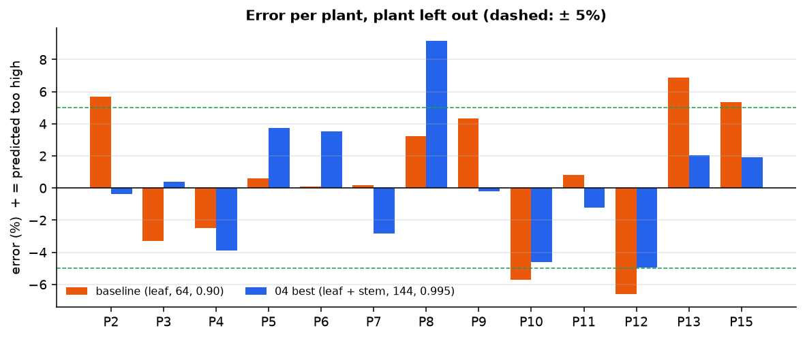

| | baseline | 05 best |
|---|---|---|
| typical error (RMSE) | 4.05% | 3.70% (honest 4.32%) |
| mean error | 3.5% | 3.0% |
| plants within 5% | 8 of 13 | 12 of 13 |
| outside 5% | P13 +6.9, P12 −6.6, P2 +5.7, P10 −5.7, P15 +5.3 | P8 +9.2 |
| worst plant's share of the squared error | P13: 21% | P8: 45% |

**c in every round.** Each point is c fitted **without** the plant on the x-axis; flat means no single plant decides
the model. Both move by only ± 0.5%. In the baseline **P12** moves c most (it is large and far below the line); in 05
**P8** (far above the line) and **P12** (below it) move it about equally, then P5 and P6.

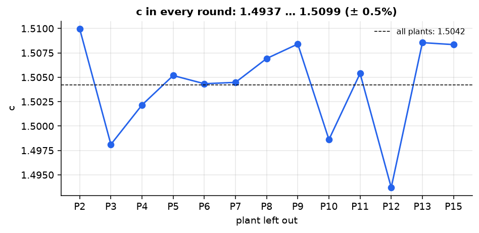

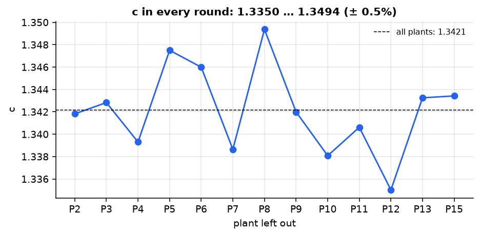

Per plant, as means over the 18 side photos. "Window full" is the share of the counted pixels whose window is fuller
than 0.90: where the plant looks solid at that kernel.

| plant | baseline | 05 best | stem pixels, % of leaf | window full, baseline (leaf, 64) | window full, 05 (leaf + stem, 144) |
|---|---|---|---|---|---|
| P2 | **+5.7** | −0.4 | 13% | 3% | 0.3% |
| P3 | −3.3 | +0.4 | 15% | 6% | 5% |
| P4 | −2.5 | −3.9 | 16% | 7% | 2% |
| P5 | +0.6 | +3.7 | 15% | 6% | 6% |
| P6 | +0.1 | +3.5 | 17% | 10% | 8% |
| P7 | +0.2 | −2.8 | 13% | 8% | 4% |
| P8 | +3.2 | **+9.2** | 20% | 4% | 1% |
| P9 | +4.3 | −0.2 | 13% | 4% | 0.2% |
| P10 | **−5.7** | −4.6 | 17% | 1% | 0% |
| P11 | +0.8 | −1.2 | 12% | 18% | 13% |
| P12 | **−6.6** | −4.9 | 16% | 11% | 7% |
| P13 | **+6.9** | +2.1 | 15% | 4% | 0.4% |
| P15 | **+5.3** | +1.9 | 18% | 10% | 2% |

(Sources: `03_stems_as_leaf/results/stem_share.csv`, `04_cap/results/capped_share.csv`,
`05_kernel_cap/results/capped_share.csv`.)

## The baseline: what goes wrong

Each picture: the photo (side 0°), the leaf mask (green) with what the baseline does **not** count (the "stem"
pixels, orange), and the baseline's leaf layers per pixel (purple 0, yellow = the cap). The numbers in a picture are
for that one photo; the table above has the plant means.

### P12, −6.6%: the dense core is hidden

The densest and second largest plant. The core above the pot is solid leaf, and the baseline caps it (yellow): a side
photo can't show how many leaves lie behind the front ones. Right above the pot, a dark, shaded part of the core is not
in the mask at all (see [Leaf lost to the pot](#leaf-lost-to-the-pot-p12) below). Both make the plant look smaller
than it is.

### P10, −5.7%: leaf edges counted as stem

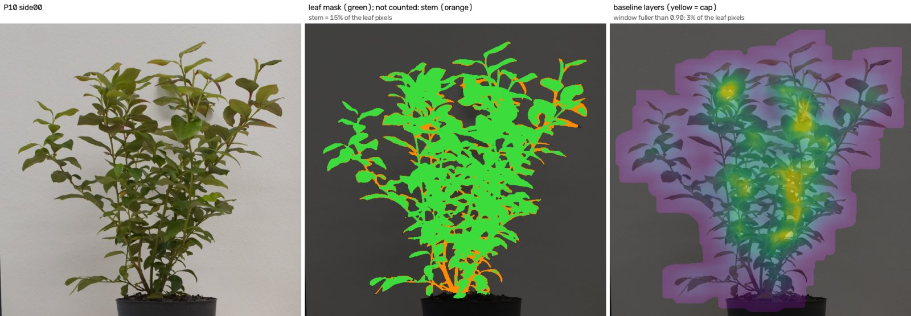

An open plant with little overlap: almost nothing reaches the cap (1% over the plant). Many of the orange "stem"
pixels are not stems: they are the reddish and brown **edges and tips of leaves** (top right), and leaves turned
edge-on to the camera. The baseline leaves those out, so P10 loses leaf area it really has.

### P13, +6.9%: a narrow plant with its leaves in one column

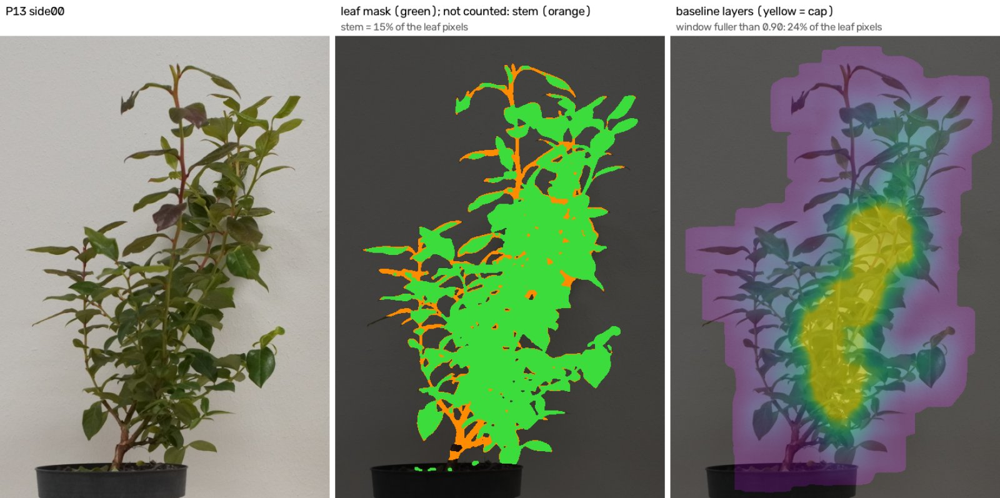

The smallest plant, tall and narrow, leaning to one side. Its leaves are bunched in one column, which at kernel 64
looks solid from this side (24% of the leaf pixels at the cap in this photo, 4% over all photos). The baseline gives
it more optical mass than its leaf area.

### P2, +5.7%: an open plant with large, light leaves

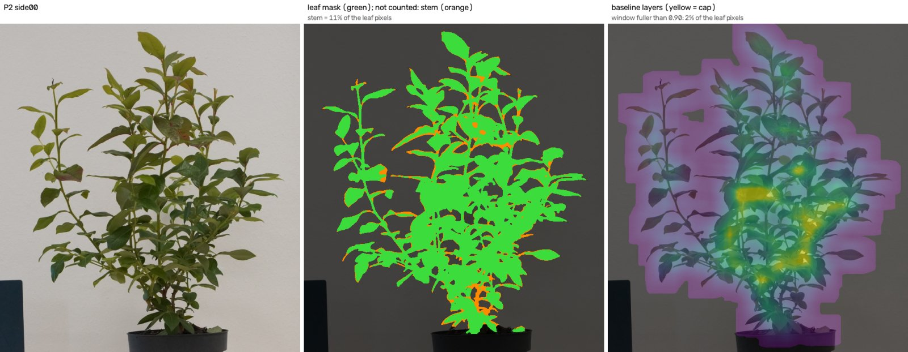

Open and wide, with few stems (13%) and little at the cap (3%). The leaves are large and light green and many face the
camera, spread out with little overlap. It looks bigger in the photos than its leaf area: the opposite of P10, which is
just as open.

### P15, +5.3%: a sparse, leaning plant

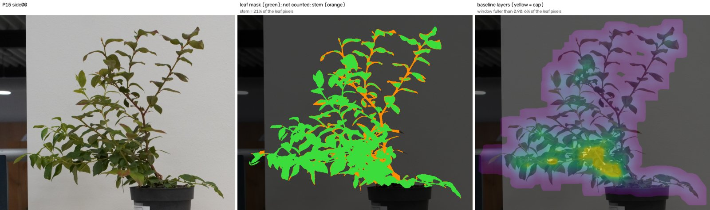

Long bare red stems (18% stem pixels), the leaves mostly low and to the left, and one dense clump at the base.

### P8, +3.2%: red twigs, not counted

Within 5% for the baseline, but it has the most stem pixels (20%), and they really are twigs: thin red shoots all
through the plant, not leaf parts. The baseline doesn't count them, which is right for P8.

## The best run of 05: what goes wrong

Each picture: the photo, what 05 counts (leaf green + stem orange: both count now), and 05's layers at kernel 144
(purple 0, yellow = 2.4 layers or more; the cap of 0.995 allows up to 5.3).

### P8, +9.2%: the twigs count as leaf

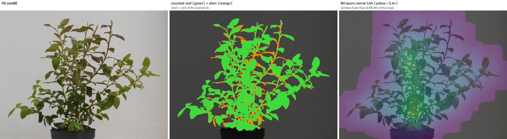

The same red twigs now count as plant, and P8 has the most of them (20%). It is an open plant (1% of the windows
full at kernel 144), so nothing else makes up for them: it looks much bigger than its leaf area. P8 alone is 45% of
05's squared error, and it pulls c up more than any other plant.

### P5 +3.7% and P6 +3.5%: dense cores counted deep

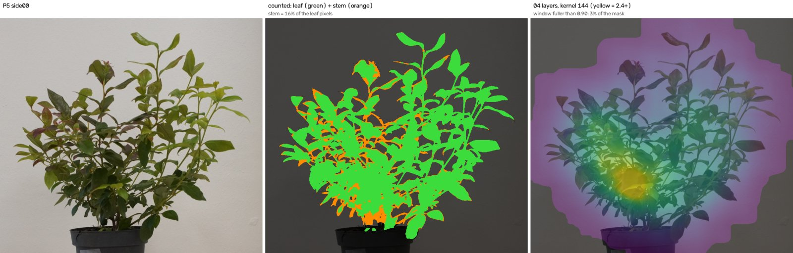

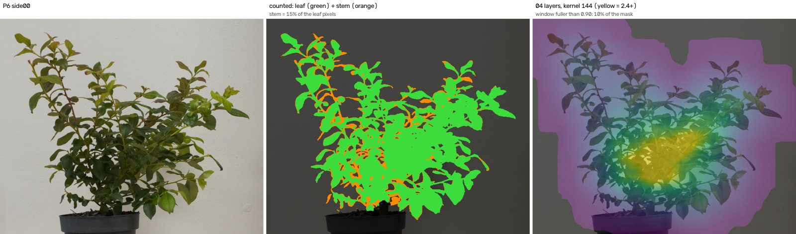

Both were right in the baseline (+0.6%, +0.1%). At kernel 144 with a cap of 0.995, their dense centres (yellow) count
for many layers, which the 0.90 cap of the baseline didn't allow. On P5 a dense tangle of stems right above the pot
(orange) adds to that core. Both now look bigger than they are.

### P12, −4.9%: still hidden

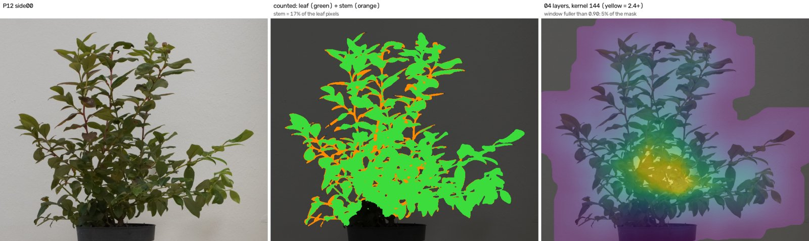

Better than in the baseline (−6.6%), because the high cap lets its core count for more. But still too low. The
yellow core sits up and to the right; below it and to the left, just above the pot, is a triangle of leaves that is
almost fully covered but **not counted at all**, neither as leaf nor as stem (the black hole in the middle picture).
The next section explains why. The core may also be deeper than the photo shows. **P5, P6 and
P12 all have dense cores, and the same treatment makes two of them too high and one too low**: how deep a core goes
can't be read from how solid it looks.

### P10 −4.6% and P4 −3.9%: open plants stay too low

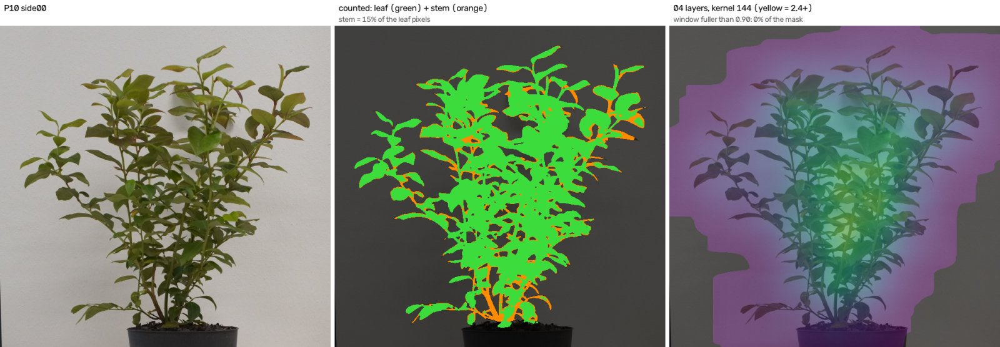

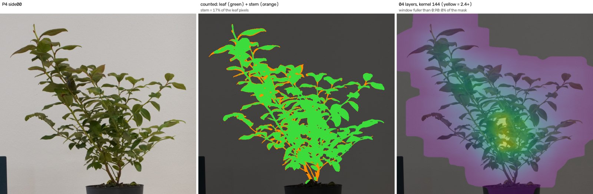

P10 gains a little (−5.7 → −4.6%): its leaf edges count now. But both are open plants where no window is full at
kernel 144 (0–2%), so they get no extra layers, while c is now set by plants whose cores count deep. P4 got worse
(−2.5 → −3.9%). P2, P9 and P13 are just as open and are now right, so openness alone doesn't explain it.

## Leaf lost to the pot (P12)

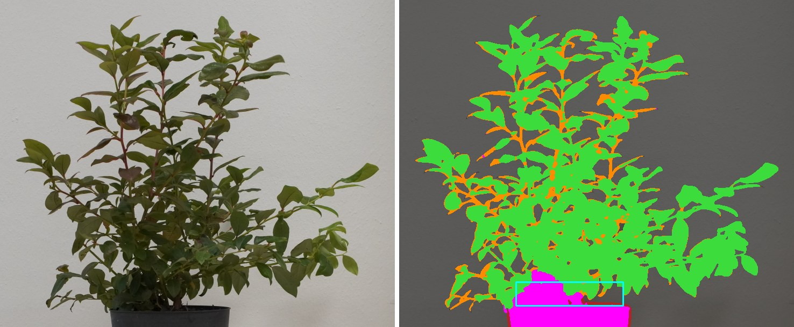

Right: green is leaf, orange is stem, **magenta is in front of the wall but counted as neither**. The cyan box is the
"trunk zone" (below). The magenta triangle above the rim is the dense area that is missing for P12; below the rim it
is the pot itself, which is meant to be left out.

The shaded leaves above the pot are treated as **part of the pot**. Two rules of the segmentation
(`image_processing/masks.py`, `segment` and `scene_zones`) do it:

1. **Dark background objects.** Before finding leaves, the segmentation looks for large dark, non-green blobs: the
   dark opening on the left, a laptop, and the pot. Any such blob larger than 1.2% of the image is switched off: no
   leaf rule and no stem mask inside it, only the older mask M0. The shaded leaves above the pot are dark and, in the
   shadow of the plant, hardly green, but they touch the dark pot, so the two merge into one blob. On P12 at 0° the
   pot blob reaches **62 px above the rim** and takes the leaves with it. M0 misses dark leaves too, so the area ends
   up as a hole.
2. **The trunk zone** (cyan box): a strip just above the rim, 0.22 × the pot width high (44 px here). Anything there
   that isn't green is taken to be trunk or soil and is never accepted as leaf.

Both rules are there to keep the pot, the soil and the trunk base out of the mask. On a dense plant that hangs down
over its pot, they cut away real leaf as well. In the box just above P12's pot (0°), 87.5% of the pixels stand out
from the wall, but only 68.6% are counted as leaf and 5.5% as stem: **13.4% are lost**.

It happens on every plant that hangs over its pot. Lost pixels above the rim, within the pot's width, as a % of the
leaf pixels:

| plant | mean over 18 photos | worst photo |
|---|---|---|
| P11 | 2.2% | 4.5% (140°) |
| P7 | 1.7% | 3.1% (240°) |
| **P12** | **1.6%** | 4.2% (320°) |
| P6 | 1.5% | 4.8% (120°) |
| P3 | 1.0% | 3.1% (340°) |
| P2, P4, P5, P8, P10, P15 | 0.5–0.7% | 1.2–2.8% |
| P9, P13 | 0.1–0.2% | ≤ 0.9% |

What this means:

- **It is not P12 alone.** All plants lose some of it, and c absorbs the average; only a plant's difference from the
  average shows up as error.
- **These pixels weigh more than their count.** They lie in the densest part of the plant, so they would count for
  many layers and also fill the windows around them. 1.6% of the pixels may be several % of P12's optical mass,
  especially at kernel 144 with a high cap (not yet computed).
- **It likely explains part of P12's error, not all of it:** P11 loses even more and is at −1.2% with 05.

**Fixed in experiment 09** ([`09_pot_fix/`](../09_pot_fix/)): the rim line is now measured from the pot's bottom,
nothing above it counts as pot, and the trunk zone is gone. P12 gets +2.7% optical mass with the baseline and its error
goes from −6.6 to −5.2% (with 05: −4.9 to −3.9%). The baseline as a whole goes from 4.05 to 3.74%.
- The count covers only the area above the rim within the pot's width, so it may be too low.

## Comparison

**What 05 fixes:**

- **Narrow columns and local clumps (P13, P15):** a 64 px window sees P13's leaf column and P15's clump at the base as
  solid; a 144 px window takes in the gaps around them (P13: 24% → 3% of the pixels full in the photo above).
  P13 +6.9 → +2.1%, P15 +5.3 → +1.9%.
- **Plants with few stems that were too high (P2, P9):** counting the stems raises every plant's optical mass, and c
  drops to match; plants with few stem pixels (13%) gain least, so their predictions most likely come down for that
  reason. P2 +5.7 → −0.4%, P9 +4.3 → −0.2%.
- **Leaf edges counted as stem (P10):** partly, −5.7 → −4.6%. P3 also improves (−3.3 → +0.4%).

**What 05 breaks:**

- **Twigs (P8):** +3.2 → +9.2%. Counting all stems counts P8's red twigs as leaf.
- **Dense cores counted deep (P5, P6):** ≈ 0 → +3.5–3.7%. The high cap lets their cores count for many layers.

**What neither fixes:**

- **P12's missing core** (−6.6 / −4.9%): partly leaf lost to the pot zone (above), partly perhaps depth a side
  photo can't show. **Open plants that are too low** (P10 −5.7 / −4.6%, P4 −2.5 / −3.9%).

**Which does better:** on these 13 plants 05 does, on every measure: 3.70% against 4.05%, mean error 3.0% against
3.5%, and 12 plants within 5% against 8. Its errors are also of a different kind: spread over a few plants for the
baseline, almost all in one plant (P8) for 05. But 05 was picked from 165 runs on these plants; counted honestly it
gives 4.32%, so it is **not shown to be better**. The baseline's errors come from **what the mask leaves out** and
**local clumps at kernel 64**; 05's come from **what the mask wrongly counts** (twigs) and **how deep a dense core
is**.

## Conclusion

- **Counting the stems in is right for most plants:** leaf edges and leaves seen edge-on end up in the stem class,
  and leaving them out makes plants like P10 too low. But the stem class mixes them with twigs, and on P8 they are
  mostly twigs. Neither "all stems" nor "no stems" is right for every plant.
- **A larger kernel helps** plants with narrow columns and local clumps (P13, P15).
- **Part of P12's error is the segmentation, not the method:** the dense leaves right above the pot merge with the
  dark pot and are left out as background. Every plant that hangs over its pot loses some (P11, P7, P12, P6 most).
  Fixed in experiment 09: P12 goes from −6.6 to −5.2% with the baseline (−4.9 to −3.9% with 05), so it explains
  part of P12's error, not all of it.
- **The depth of a dense core may be the limit of a side photo:** P5, P6 and P12 look alike from the side, but the
  same high cap makes P12 a little better and P5 and P6 worse.
- **P8 is 05's main problem:** the only plant outside 5%, and 45% of its squared error. Fixing it needs telling twigs
  apart from leaf edges inside the stem class.

All the photo observations come from one photo per plant (side 0°); the other 17 angles can look different.
