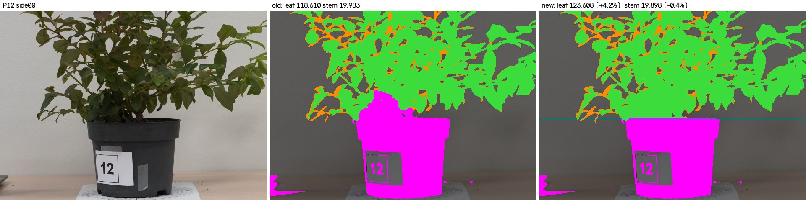
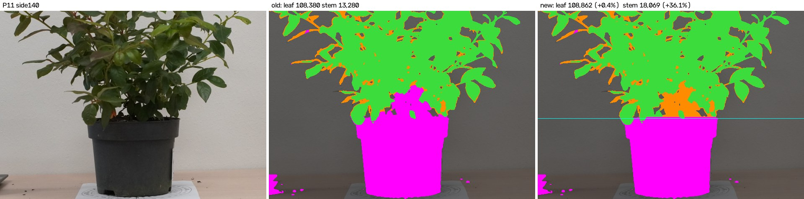
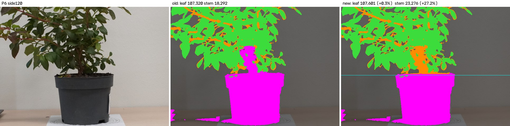

# 09 Pot fix and pot scaling

**Results:** [full report](results/report.md)

**Question:** do the baseline and the best run of experiment 05 get better when the segmentation stops cutting
leaves away at the pot, and when every plant is brought to the same scale by its pot?

## Why

- **Leaves lost to the pot** ([`08_problem_plants/README.md`](../08_problem_plants/README.md)): dark, shaded
  leaves right above the pot merged with the dark pot into one "background object", where the segmentation looked for
  neither leaf nor stem. P12 lost a dense, fully covered triangle of leaves this way, and P11, P7 and P6 lost some too.
- **Scale:** the optical mass is in pixels, the leaf area in mm². A different camera distance would change the pixel
  count of the same plant.

## Method

**1. Pot fix,** in our segmentation (`common/masks.py`; see its docstring):

- **The rim line is measured from the pot's bottom:** bottom − 0.945 × the pot width. All pots are the same model;
  0.945 is the 5th percentile of the pot's height / width over all 234 photos (median 0.963, raised by leaves on the
  rim). The bottom is never hidden by leaves, the top often is. On the photos the line lies on the top edge of the rim.
- **Nothing above the rim line counts as pot:** the part of a dark object above the line, within one pot width of the
  pot's axis, is freed and goes through the normal leaf and stem rules.
- **The trunk zone is gone:** before, a strip just above the rim (0.22 × the pot width high) never counted non-green
  pixels as leaf, taking them for the trunk and the soil.

**2. Pot scaling** (`common/data.py`, `pot_scale`): every plant's optical mass × (199 / its median pot width)², 199 px
being the median over all photos. The median over the plant's 18 photos, because a single photo's width jitters by
2–3% with the detection.

Both are tested on the **baseline** (leaf, kernel 64, cap 0.90) and on the **best run of 05** (leaf + stem, kernel
144, cap 0.995). The old masks can't be made any more, so their optical masses are taken from experiment 05's
`runs.csv`, which was made with them.

```bash
.venv/bin/python 09_pot_fix/pot_fix.py $PHOTOS          # about 30 s (segments every photo again after a change)
.venv/bin/python 00_evaluation/evaluate.py 09_pot_fix/results/runs.csv
```

### What it looks like

Old and new masks around the pot: leaf green, stem orange, in front of the wall but counted as neither magenta, the
new rim line cyan. (Made once with the original segmentation, when the fix was made.)



P12: the dense triangle above the pot on the left, a hole before, is now leaf (+4.2% leaf pixels in this photo).



P11: the shaded mass above the rim is now counted, as stem: it is too dark and too large a blob for the leaf rule
(+36% stem pixels in this photo).



P6: the cost of removing the trunk zone. The bare trunk above the soil and a thin strip along the rim (soil or the back
of the rim) now count as stem (+27% stem pixels in this photo). This matters only for the leaf + stem model.

## Result

Current leaf areas (`01_leaf_measurement/results/monday.csv`), 13 plants, P1 left out. Error per plant (plant left out, + = predicted
too high):

| | P2 | P3 | P4 | P5 | P6 | P7 | P8 | P9 | P10 | P11 | P12 | P13 | P15 | typical | within 5% |
|---|---|---|---|---|---|---|---|---|---|---|---|---|---|---|---|
| baseline, old masks | +5.7 | −3.3 | −2.5 | +0.6 | +0.1 | +0.2 | +3.2 | +4.3 | −5.7 | +0.8 | −6.6 | +6.9 | +5.3 | 4.05% | 8 |
| **baseline, new masks** | +4.8 | −3.2 | −3.3 | +0.9 | −0.3 | +0.3 | +3.0 | +3.1 | −6.4 | +2.1 | **−5.2** | +5.9 | +5.4 | **3.74%** | 9 |
| baseline, new masks, scaled | +3.6 | −2.7 | −3.4 | +0.2 | −0.4 | +0.7 | +4.6 | +3.5 | −6.0 | +1.4 | −5.6 | +6.6 | +5.8 | 3.79% | 9 |
| 05 best, old masks | −0.4 | +0.4 | −3.9 | +3.7 | +3.5 | −2.8 | +9.2 | −0.2 | −4.6 | −1.2 | −4.9 | +2.1 | +1.9 | 3.70% | 12 |
| **05 best, new masks** | −1.3 | +0.5 | −5.1 | +2.7 | +4.7 | −2.1 | +8.3 | −1.9 | −5.6 | +1.7 | **−3.9** | +0.5 | +1.3 | **3.59%** | 10 |
| 05 best, new masks, scaled | −2.5 | +0.9 | −5.2 | +2.0 | +4.6 | −1.7 | +9.9 | −1.5 | −5.2 | +1.0 | −4.3 | +1.1 | +1.6 | 3.78% | 10 |

How much the pot fix adds to each plant's optical mass:

| | P2 | P3 | P4 | P5 | P6 | P7 | P8 | P9 | P10 | P11 | P12 | P13 | P15 |
|---|---|---|---|---|---|---|---|---|---|---|---|---|---|
| baseline | +0.6 | +1.5 | +0.6 | +1.6 | +1.0 | +1.5 | +1.2 | +0.3 | +0.7 | +2.5 | **+2.7** | +0.5 | +1.4 |
| 05 best | +1.0 | +1.9 | +0.6 | +0.9 | +2.9 | +2.6 | +1.1 | +0.2 | +0.9 | **+4.6** | +2.9 | +0.4 | +1.2 |

Pot widths per plant (`results/pot_scale.csv`): medians 198.0–200.5 px, scale factors 0.985–1.010.

- **The pot fix helps both models.** The baseline goes from 4.05% to **3.74%**, the best run of 05 from 3.70% to
  **3.59%**. P12 gains the most leaf (+2.7% optical mass) and its error shrinks: −6.6 → −5.2% with the baseline,
  −4.9 → −3.9% with 05.
- **For the baseline this is an honest gain:** the fix wasn't tuned on the errors (0.945 comes from the pot's shape),
  so 3.74% needs no nested correction. With 13 plants, 0.3 points is still within the noise.
- **For 05 it moves plants both ways:** P11 (+4.6% optical mass) and P6 (+2.9%), which lose the most leaf to the pot,
  gain the most, partly from the trunk now counted as stem. P6 goes to +4.7%, and P4 and P10 slip just outside 5%,
  so fewer plants are within 5% (10 instead of 12) although the typical error is lower.
- **Pot scaling makes both slightly worse** (3.74 → 3.79%, 3.59 → 3.78%). The pots are the same size in every photo
  to within ±0.6% (the camera distance was the same), so scaling only adds the small noise of the width detection:
  P8, for example, gets a factor of 1.010 and goes from +8.3 to +9.9%.

## Conclusion

**Keep the pot fix, don't scale by the pot.** The fix gives back leaves the segmentation wrongly took for the pot, and
improves the baseline honestly (4.05 → 3.74%) and the best run of 05 (3.70 → 3.59%). P12 is still the most
underpredicted plant with the baseline (−5.2%), so the lost leaf explains part of its error, not all of it. Pot scaling
isn't needed: the photos are already at the same scale.

The pot fix changes the masks of every experiment. Experiments 02–08 and 10 were run with the old masks; their results stay
as they are until they are run again.
