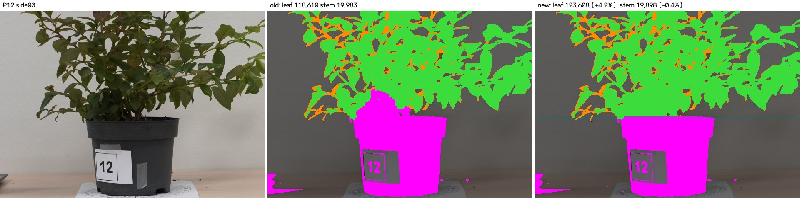
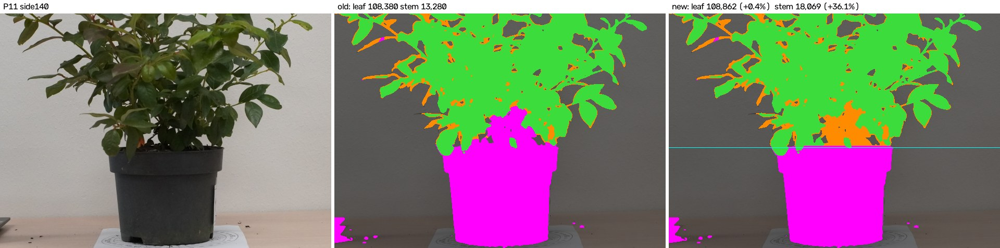
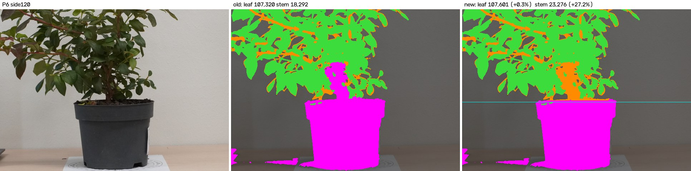
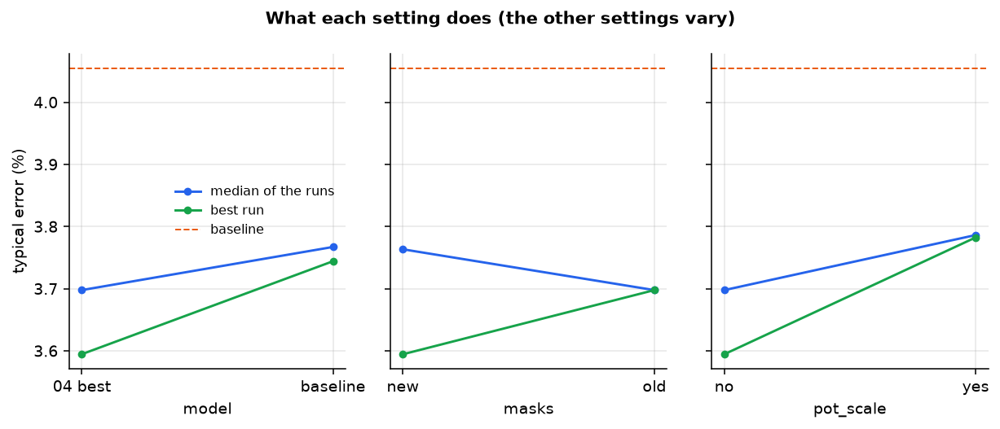
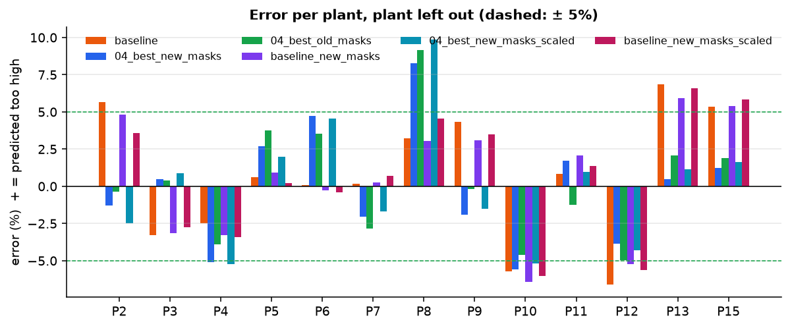
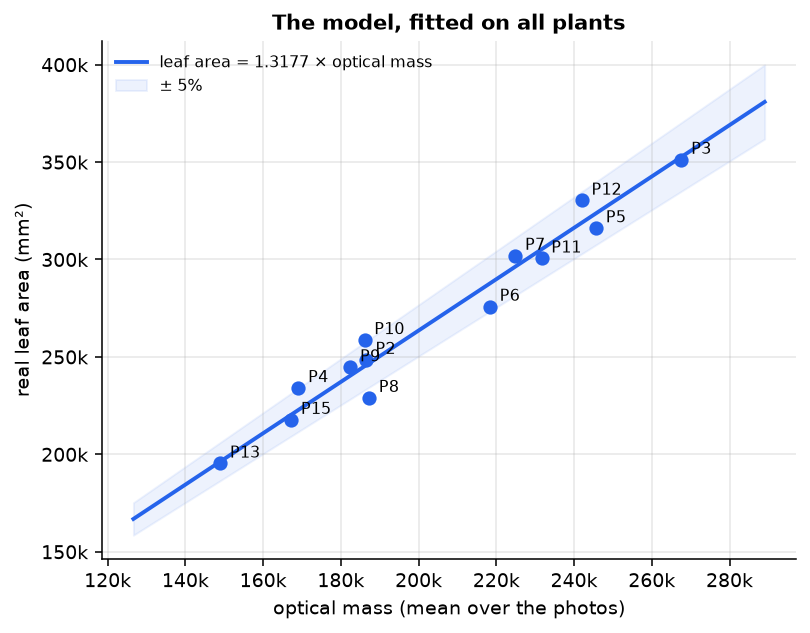
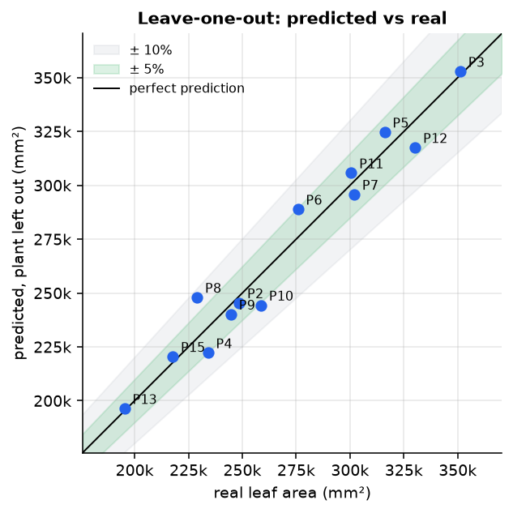
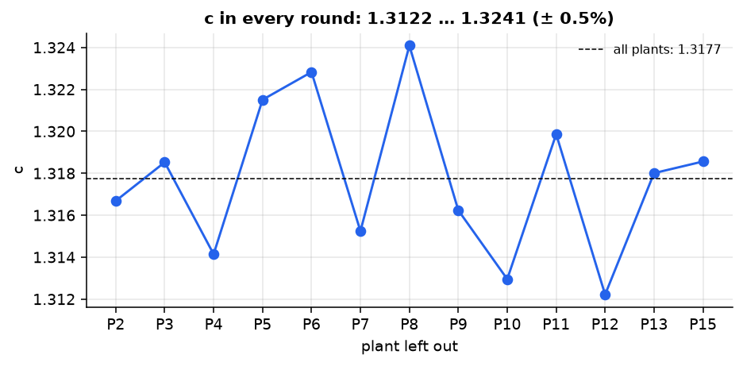
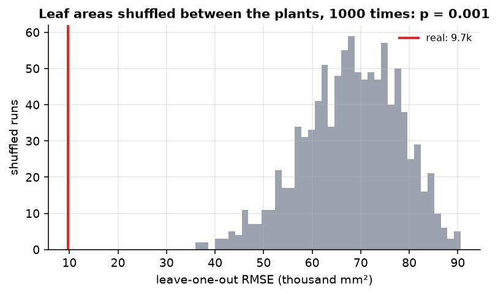

# Experiment 09_pot_fix

5 runs + baseline · 13 plants (P2, P3, P4, P5, P6, P7, P8, P9, P10, P11, P12, P13, P15) · leaf area = c × optical mass, leave-one-out

**Contents**

1. [Summary](#summary) — the baseline, the best run and the honest score, and the verdict
2. [The method](#the-method) — what the experiment changes, its settings and how many runs it makes
3. [What the method looks like](#what-the-method-looks-like) — the method drawn on example photos
4. [All runs](#all-runs) — how the runs are spread, what each setting does, the best runs
5. [Per plant: baseline vs every run](#per-plant-baseline-vs-every-run) — how far off each plant is, the baseline next to every run
6. [Best run in detail](#best-run-in-detail-04_best_new_masks) — its fit, every plant's prediction, whether one plant decides the model, and the shuffle test

How to read this page

**The model.** `leaf area = c × optical mass`: a straight line through zero, with c the one number learned from the plants. It is the model of the regression (`Regression/docs/single_feature_model.md`).

**Leave-one-out.** Every plant in turn is left out, c is learned from the others, and the left-out plant is predicted. Each plant is predicted by a model that never saw it.

**Typical error** = the RMSE of those predictions as a % of the average leaf area, the number the regression reports. **Mean error** = the average of the absolute errors in %. **R²**: 1 is perfect, 0 is no better than guessing the average plant.

**Baseline** = the current method, `T_64_0.9`: 64 px window, cap 0.9, leaf mask M1, mean over all side photos. Every experiment is compared with it on the same plants and leaf areas.

**Nested (honest) score.** With many runs, the best one is partly lucky: its settings happen to suit these plants. The nested score repeats the whole search once per plant: the best run is chosen on the other plants only, then predicts the left-out plant. Compare **that** number with the baseline.

**Noise.** With 14 plants, one plant can move the typical error by about a point. Differences below about 1 point are not a result.

## Summary

- **4.05%** baseline T_64_0.9
- **3.59%** best run: 04_best_new_masks (optimistic)
- **4.79%** honest: run chosen without the plant (nested)
- **5 / 5** runs better than the baseline

**Verdict:** choosing the run on the other plants (nested) gives **4.79%**, against **4.05%** for the baseline (+0.74 points). That is within the ~1 point of noise: **no clear difference**.

Runs the nested search chose: 04_best_new_masks (6×), baseline_new_masks (3×), baseline_new_masks_scaled (2×), 04_best_old_masks (1×), 04_best_new_masks_scaled (1×)

## The method

**Question:** do the baseline and the best run of experiment 04 get better when the segmentation stops cutting leaves away at the pot, and when every plant is brought to the same scale by its pot?

**1. Pot fix** (in the segmentation, `common/masks.py`). Before, dark, shaded leaves right above the pot merged with the dark pot into one "background object", where neither leaf nor stem was looked for; P12 lost a dense, fully covered triangle of leaves this way. Now:

- the rim line is measured from the pot's bottom, which leaves never hide: bottom − 0.945 × the pot width (all pots are the same model);
- nothing above the rim line counts as pot: the part of a dark object above it is freed;
- the "trunk zone" just above the rim, where non-green pixels never counted as leaf, is gone.

**2. Pot scaling.** The optical mass is in pixels, the leaf area in mm². If the camera distance differed between plants, the same plant would give a different pixel count. Every plant's optical mass is multiplied by (199 / its median pot width)², 199 px being the median over all photos. The median over the plant's 18 photos is used because a single photo's width jitters by 2–3% with the detection.

Both are tested on the baseline (leaf, kernel 64, cap 0.90) and on the best run of 04 (leaf + stem, kernel 144, cap 0.995). The "old masks" runs are taken from experiment 04, made before the fix. These are not a sweep: compare each model's three versions with each other; the nested score doesn't mean much here.

### The settings

What the settings in the run names and tables mean.

| setting | what it does | values tried |
|---|---|---|
| **model** | baseline: leaf mask, kernel 64, cap 0.90. 04 best: leaf + stem mask, kernel 144, cap 0.995 | baseline, 04 best |
| **masks** | old: the segmentation before the pot fix (results of experiment 04). new: with the pot fix | old, new |
| **pot_scale** | yes: every plant's optical mass multiplied by (199 / its median pot width)^2 | no, yes |

**Runs:** 5 runs, plus the baseline.

## What the method looks like

*P12 at 0°: the photo, the old masks and the new ones (leaf green, stem orange, in front of the wall but counted as neither magenta; cyan: the new rim line). The dense triangle above the pot on the left, a hole before, is now leaf: +4.2% leaf pixels in this photo.*

*P11 at 140°: the shaded mass above the rim, a hole before, is now counted, as stem (too dark and too large a blob for the leaf rule): +36% stem pixels in this photo.*

*P6 at 120°: the cost of removing the trunk zone. The bare trunk above the soil and a thin strip along the rim (soil or the back of the rim) now count as stem (+27% stem pixels in this photo).*

## All runs

### What each setting does

One panel per setting. For each value of the setting, the runs with that value are taken together, whatever the other settings: blue is their median typical error, green the best of them. The orange line is the baseline. A flat line means the setting doesn't matter; a slope shows which values are better.

### The best runs

| run | model | masks | pot_scale | c | typical error | mean error | R² | within 5% | vs baseline |
|---|---|---|---|---|---|---|---|---|---|
| baseline | baseline | old | no | 1.5042 | 4.05% | 3.48% | 0.942 | 8/13 | +0.00 |
| 04_best_new_masks | 04 best | new | no | 1.3177 | 3.59% | 3.03% | 0.955 | 10/13 | -0.46 |
| 04_best_old_masks | 04 best | old | no | 1.3421 | 3.70% | 2.99% | 0.952 | 12/13 | -0.36 |
| baseline_new_masks | baseline | new | no | 1.4839 | 3.74% | 3.37% | 0.951 | 9/13 | -0.31 |
| 04_best_new_masks_scaled | 04 best | new | yes | 1.3225 | 3.78% | 3.19% | 0.950 | 10/13 | -0.27 |
| baseline_new_masks_scaled | baseline | new | yes | 1.4894 | 3.79% | 3.43% | 0.949 | 9/13 | -0.26 |

## Per plant: baseline vs every run

The error of every plant when it is predicted by the model learned without it, for the baseline (orange) and every run. Above 0: predicted too high; below: too low. Between the green dashed lines the plant is within 5%. A plant that is off the same way for both is missed by the optical mass itself, not by the setting.

## Best run in detail: 04_best_new_masks

settings: model **04 best** · masks **new** · pot_scale **no**

- **3.6%** typical error
- **0.95** R²
- **10 / 13** plants within 5%
- **1.3177** c, fitted on all plants

### The fit and the predictions

Left: every plant's optical mass against its real leaf area, with the line `leaf area = c × optical mass` fitted on all plants. Right: each plant predicted by the model learned without it (leave-one-out), against its real leaf area. On the black line the prediction is perfect; inside the green band it is within 5%.

### Per plant

| plant | optical mass | real mm² | predicted mm² | error | baseline error |
|---|---|---|---|---|---|
| P2 | 186,391 | 248,603 | 245,418 | -1.3% | +5.7% |
| P3 | 267,630 | 351,253 | 352,876 | +0.5% | -3.3% |
| P4 | 169,070 | 234,098 | 222,182 | -5.1% | -2.5% |
| P5 | 245,677 | 316,107 | 324,664 | +2.7% | +0.6% |
| P6 | 218,356 | 275,843 | 288,847 | +4.7% | +0.1% |
| P7 | 224,882 | 301,997 | 295,774 | -2.1% | +0.2% |
| P8 | 187,264 | 229,026 | 247,953 | +8.3% | +3.2% |
| P9 | 182,427 | 244,749 | 240,116 | -1.9% | +4.3% |
| P10 | 186,090 | 258,726 | 244,327 | -5.6% | -5.7% |
| P11 | 231,631 | 300,609 | 305,721 | +1.7% | +0.8% |
| P12 | 241,976 | 330,299 | 317,524 | -3.9% | -6.6% |
| P13 | 148,952 | 195,339 | 196,320 | +0.5% | +6.9% |
| P15 | 167,222 | 217,768 | 220,492 | +1.3% | +5.3% |

### c in every round: does one plant decide the model?

Leave-one-out fits c 13 times, each time without one plant. Each point is the c fitted **without** the plant on the x-axis; the dashed line is c fitted on all plants. A flat line means no single plant drives the model. A point far from the line means that plant on its own pulls c up or down, and it is usually also predicted badly. Here c moves by ± 0.5%; the plant that moves it most is P8.

### Shuffle test: is the fit real or luck?

The leaf areas are shuffled randomly between the plants 1000 times, so they no longer belong to their photos, and the same leave-one-out test is run each time. Grey: the errors of the shuffled data. Red: the error of the real data. If red lies left of nearly all of grey, the optical mass really carries the leaf area. p is the share of shuffles that did as well as the real data (p < 0.05: not luck). It says the run is not noise, not that it beats the baseline. Here 0 of 1000 shuffles did as well (p = 0.001, so it is not luck).

