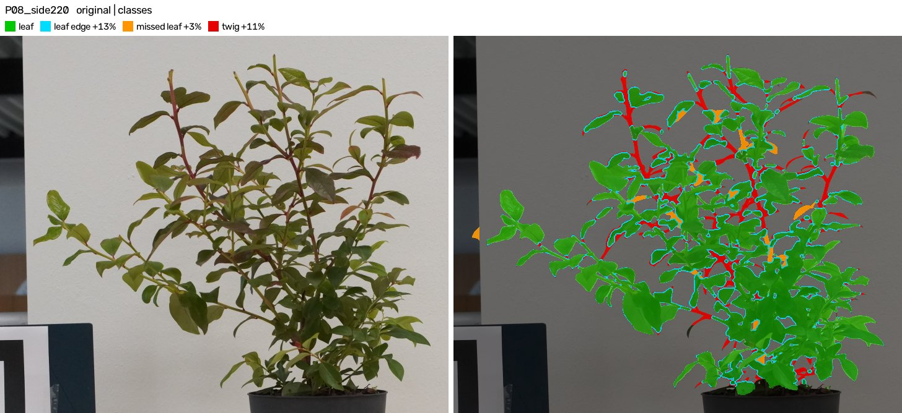
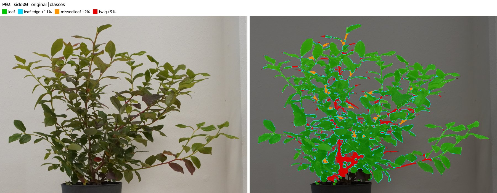

# 10 Stem classes

**Results:** [full report](results/report.md)

> **Run earlier than the experiments around it, and not redone.** It used an earlier version of experiments 03 and
> 05 (leaf + stem at kernel 144, cap 0.99), the masks before the pot fix (09), and the leaf areas of Sunday (baseline
> 4.19%, against 4.05% on the current ones). Its numbers can only be compared with each other.

**Question:** can the stems be counted without overcounting P8, by treating twigs as wood instead of leaf?

The "stem" mask of `image_processing/masks.py` isn't a stem detector. It is every pixel the segmentation sees as plant
in front of the wall but didn't accept as leaf. Counting all of it as leaf (experiments 03 and 05) helps most plants,
but overcounts P8, the plant with the most red twigs (+9% with the best model of the earlier experiment 05). This experiment splits those
pixels into what they really are, and treats each part differently.

## Method

**Classes** of the stem pixels, with rules fixed before any scoring:

| class | rule | counted as |
|---|---|---|
| leaf edge | within 2 px of a leaf pixel: the blurred rim of the leaf | leaf |
| missed leaf | a piece at least 7 px (~5 mm) wide **and** compact (area ≤ 3 × width², the same shape test as the leaf mask) | leaf |
| twig | everything else: thin, or long and narrow | wood |

The first version used width alone. The pictures showed that the main red stems are about 5 mm wide too, so they
came out as missed leaf; the compactness test fixed that. That change was made after looking at the pictures and
before looking at any score.

**Twigs as wood.** Twigs have no leaf area, but they block the view like leaves. So in the twig-corrected run they
count for how full a window is, and their share of the layers is taken out. This is the woody correction canopy
instruments use:

```
f_all   = share of (leaf + edge + missed leaf + twig) in the window
f_leaf  = share of (leaf + edge + missed leaf) in the window
value   = −ln(1 − min(f_all, cap)) × f_leaf / f_all
```

**Runs,** all at kernel 144 and cap 0.99, the best settings of experiment 05 at the time, plus the baseline:

| run | mask |
|---|---|
| leaf | leaf only |
| all_stems | leaf + every stem pixel (experiment 05) |
| no_twigs | leaf + edge + missed leaf; twigs left out |
| twig_corrected | leaf + edge + missed leaf, twigs only block the view |

```bash
.venv/bin/python 10_stem_classes/stem_classes.py $PHOTOS          # about 20 s with cached masks
.venv/bin/python 00_evaluation/evaluate.py 10_stem_classes/results/runs.csv --detail twig_corrected leaf
```

13 plants: P1 is left out (wrong leaf photos), P14 has no leaf area. Leaf areas: `common/real_leaf_area_mm2.csv`.

## The classes



P8 at 220°, the plant with the most twigs. Green = leaf mask, cyan = leaf edge, orange = missed leaf, red = twig. The
red stems are twigs, the edges are a thin rim around every leaf, and only small compact patches are missed leaf.



P3: the same pattern. The large dark patch at the base, partly trunk and partly shaded leaves, comes out as twig: it
still makes the core count as fuller, but adds no leaf area.

The pictures of all 13 plants are in `results/pictures/` and in the report.

Per plant, as a share of the leaf pixels (`results/classes.csv`):

| | leaf edge | missed leaf | twig |
|---|---|---|---|
| range | 7.5% (P11) – 11.4% (P8) | 0.7% (P2) – 1.9% (P8, P15) | 2.9% (P9) – 6.5% (P8) |

- **Most of the "stems" are leaf edges:** the leaf mask leaves out a rim of about 9% of its own area. That is real
  leaf area, but nearly the same share on every plant, so c mostly absorbs it.
- **Real twigs are 3–6.5%,** and P8 has the most of every class.

## Result

| run | c | typical error | R² | within 5% |
|---|---|---|---|---|
| baseline (leaf, 64, 0.90) | 1.503 | 4.19% | 0.939 | 7 / 13 |
| leaf | 1.688 | 4.12% | 0.941 | 9 / 13 |
| all_stems | 1.341 | 3.72% | 0.952 | 11 / 13 |
| no_twigs | 1.434 | 3.57% | 0.956 | 11 / 13 |
| **twig_corrected** | 1.393 | **3.54%** | 0.956 | 10 / 13 |

Honest score (run chosen without the plant it predicts): **4.08%**.

Error per plant (plant left out, + = predicted too high):

| | P2 | P3 | P4 | P5 | P6 | P7 | P8 | P9 | P10 | P11 | P12 | P13 | P15 |
|---|---|---|---|---|---|---|---|---|---|---|---|---|---|
| baseline | +5.6 | −3.4 | −2.6 | +0.5 | −0.0 | +0.1 | +3.1 | +5.9 | −5.8 | +0.7 | −6.7 | +6.8 | +5.2 |
| all_stems | −0.5 | +0.2 | −4.0 | +3.6 | +3.4 | −2.9 | +9.1 | +1.4 | −4.7 | −1.3 | −5.0 | +2.0 | +1.8 |
| twig_corrected | +0.5 | +0.0 | −4.4 | +3.3 | +2.9 | −1.9 | +7.3 | +2.8 | −5.2 | +0.1 | −5.6 | +2.1 | +1.0 |

- **Treating twigs as wood is the best variant** (3.54%), and leaving twigs out entirely is almost as good (3.57%).
  Both beat counting every stem pixel as leaf (3.72%). The direction is right: twigs shouldn't add leaf area.
- **P8 improves only partly:** +9.1% → +7.3%. With twigs out, P8 is still +6.9% against +4.2% with leaf only. So
  P8's overcount comes not only from its twigs, but also from its leaf edges and missed leaf (it has the most of
  both), which here count as leaf.
- **All the differences are within the noise.** The best run is 0.65 points better than the baseline, and the honest
  score (4.08%) is the same as the baseline's. With 13 plants, less than about 1 point can't be told apart.

## Conclusion

The classes look right in the pictures, and the twig correction is the best way to count the stems so far. But on
these 13 plants it can't be shown to beat the baseline. If stems are counted, they should be counted this way:
edges and missed leaf as leaf, twigs only as blocking the view.

What is left of P8's overcount comes from its edges and missed leaf. Why P8's leaves have the widest rim (11.4%) is
worth a look in its pictures: reddish leaf margins, or a slightly blurrier photo set.
