# Experiment 10_stem_classes

4 runs + baseline · 13 plants (P2, P3, P4, P5, P6, P7, P8, P9, P10, P11, P12, P13, P15) · leaf area = c × optical mass, leave-one-out

How to read this page

**The model.** `leaf area = c × optical mass`: a straight line through zero, with c the one number learned from the plants. It is the model of the regression (`Regression/docs/single_feature_model.md`).

**Leave-one-out.** Every plant in turn is left out, c is learned from the others, and the left-out plant is predicted. Each plant is predicted by a model that never saw it.

**Typical error** = the RMSE of those predictions as a % of the average leaf area, the number the regression reports. **Mean error** = the average of the absolute errors in %. **R²**: 1 is perfect, 0 is no better than guessing the average plant.

**Baseline** = the current method, `T_64_0.9`: 64 px window, cap 0.9, leaf mask M1, mean over all side photos. Every experiment is compared with it on the same plants and leaf areas.

**Nested (honest) score.** With many runs, the best one is partly lucky: its settings happen to suit these plants. The nested score repeats the whole search once per plant: the best run is chosen on the other plants only, then predicts the left-out plant. Compare **that** number with the baseline.

**Noise.** With 14 plants, one plant can move the typical error by about a point. Differences below about 1 point are not a result.

- **4.19%** baseline T_64_0.9
- **3.54%** best run: twig_corrected (optimistic)
- **4.08%** honest: run chosen without the plant (nested)
- **4 / 4** runs better than the baseline

**Verdict:** choosing the run on the other plants (nested) gives **4.08%**, against **4.19%** for the baseline (-0.11 points). That is within the ~1 point of noise: **no clear difference**.

Runs the nested search chose: twig_corrected (8×), no_twigs (4×), all_stems (1×)

## What the method looks like

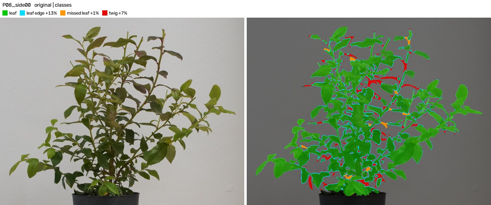

*P08_side00: green = leaf (the leaf mask), yellow = leaf edge, orange = missed leaf (both counted as leaf), red = twig (only blocks the view). The percentages are the pixels of each class as a share of the leaf pixels.*

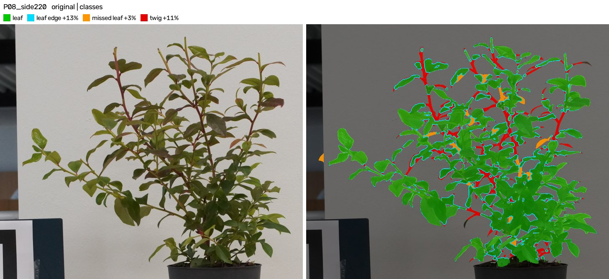

*P08_side220: green = leaf (the leaf mask), yellow = leaf edge, orange = missed leaf (both counted as leaf), red = twig (only blocks the view). The percentages are the pixels of each class as a share of the leaf pixels.*

The other plants (12)

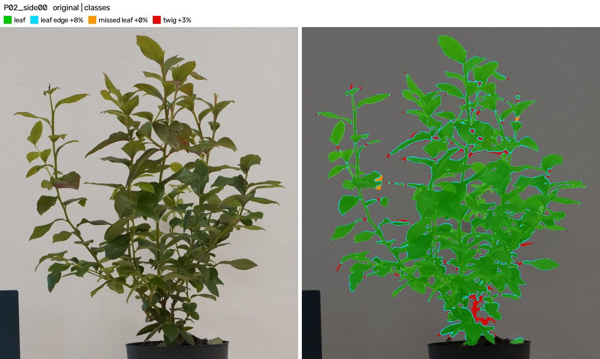

*P02_side00: green = leaf (the leaf mask), yellow = leaf edge, orange = missed leaf (both counted as leaf), red = twig (only blocks the view). The percentages are the pixels of each class as a share of the leaf pixels.*

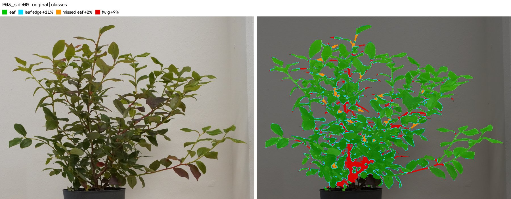

*P03_side00: green = leaf (the leaf mask), yellow = leaf edge, orange = missed leaf (both counted as leaf), red = twig (only blocks the view). The percentages are the pixels of each class as a share of the leaf pixels.*

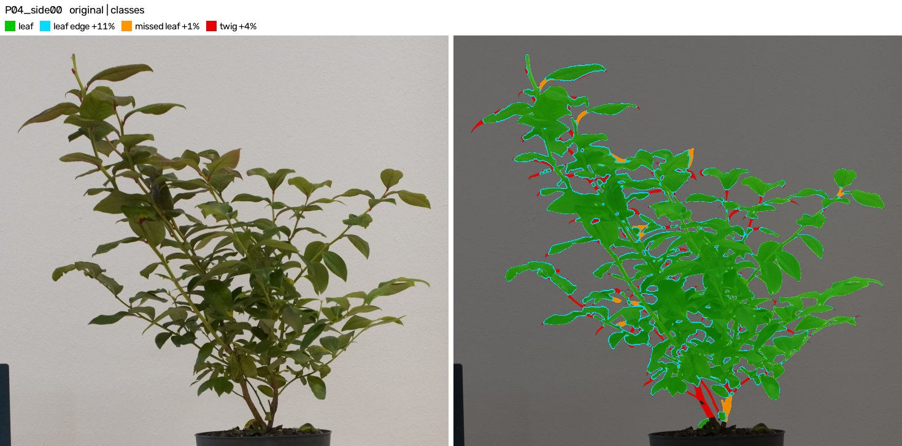

*P04_side00: green = leaf (the leaf mask), yellow = leaf edge, orange = missed leaf (both counted as leaf), red = twig (only blocks the view). The percentages are the pixels of each class as a share of the leaf pixels.*

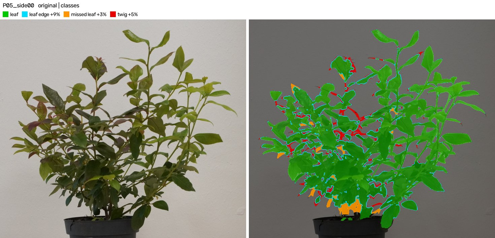

*P05_side00: green = leaf (the leaf mask), yellow = leaf edge, orange = missed leaf (both counted as leaf), red = twig (only blocks the view). The percentages are the pixels of each class as a share of the leaf pixels.*

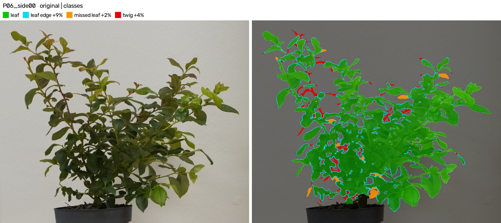

*P06_side00: green = leaf (the leaf mask), yellow = leaf edge, orange = missed leaf (both counted as leaf), red = twig (only blocks the view). The percentages are the pixels of each class as a share of the leaf pixels.*

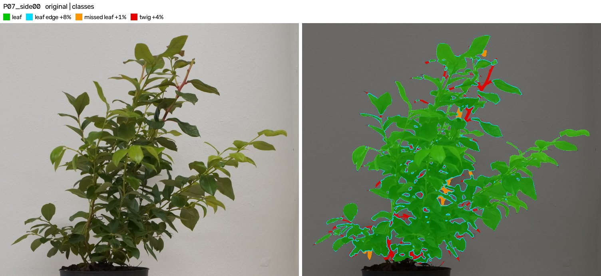

*P07_side00: green = leaf (the leaf mask), yellow = leaf edge, orange = missed leaf (both counted as leaf), red = twig (only blocks the view). The percentages are the pixels of each class as a share of the leaf pixels.*

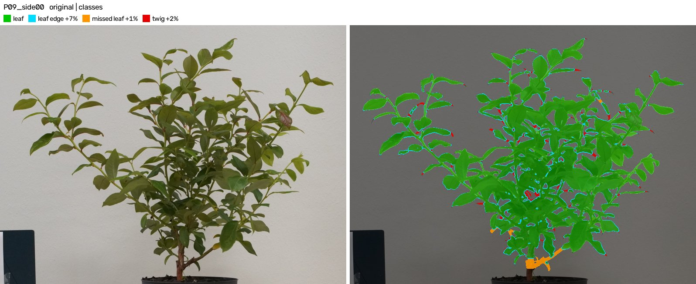

*P09_side00: green = leaf (the leaf mask), yellow = leaf edge, orange = missed leaf (both counted as leaf), red = twig (only blocks the view). The percentages are the pixels of each class as a share of the leaf pixels.*

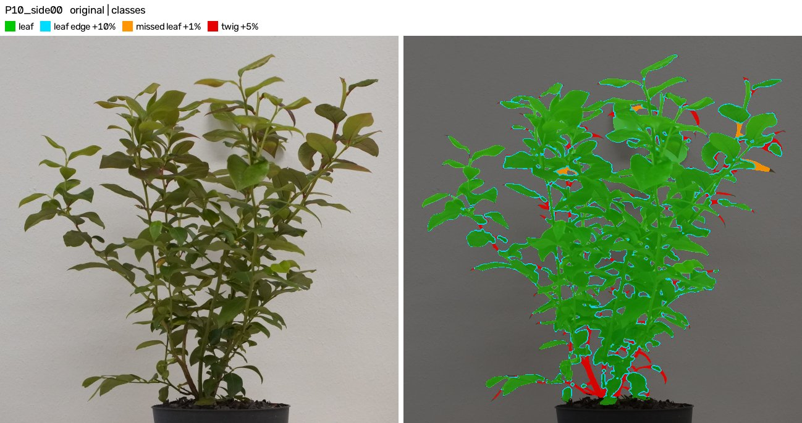

*P10_side00: green = leaf (the leaf mask), yellow = leaf edge, orange = missed leaf (both counted as leaf), red = twig (only blocks the view). The percentages are the pixels of each class as a share of the leaf pixels.*

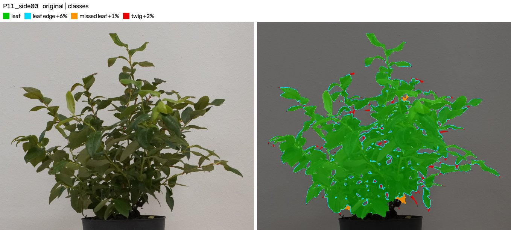

*P11_side00: green = leaf (the leaf mask), yellow = leaf edge, orange = missed leaf (both counted as leaf), red = twig (only blocks the view). The percentages are the pixels of each class as a share of the leaf pixels.*

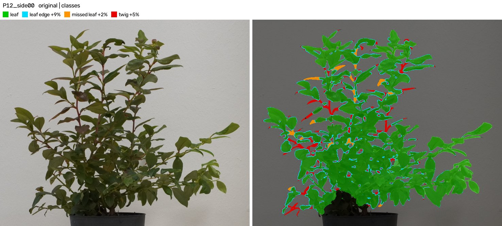

*P12_side00: green = leaf (the leaf mask), yellow = leaf edge, orange = missed leaf (both counted as leaf), red = twig (only blocks the view). The percentages are the pixels of each class as a share of the leaf pixels.*

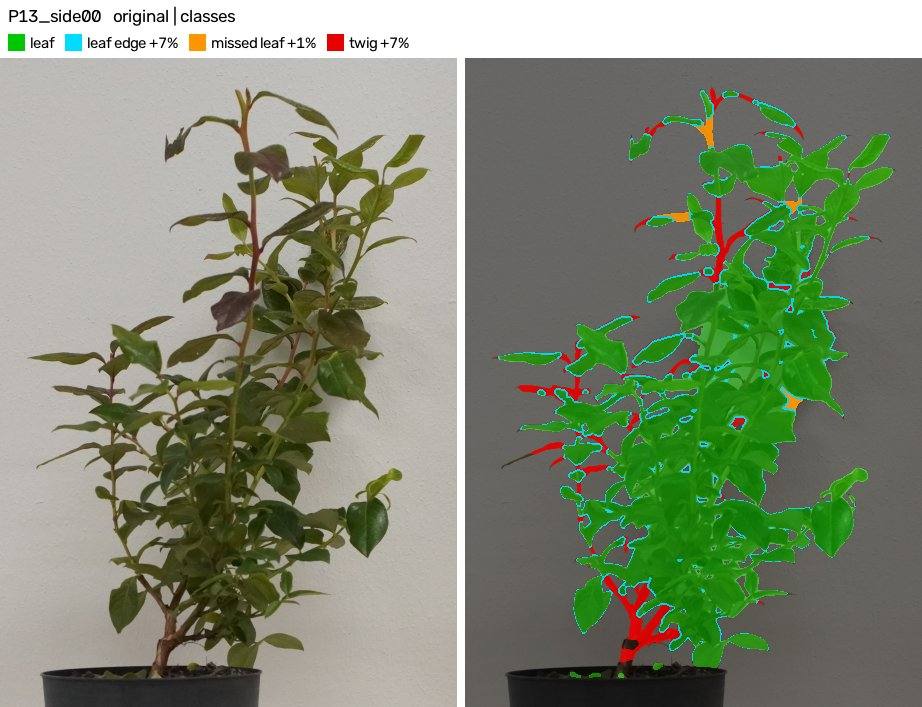

*P13_side00: green = leaf (the leaf mask), yellow = leaf edge, orange = missed leaf (both counted as leaf), red = twig (only blocks the view). The percentages are the pixels of each class as a share of the leaf pixels.*

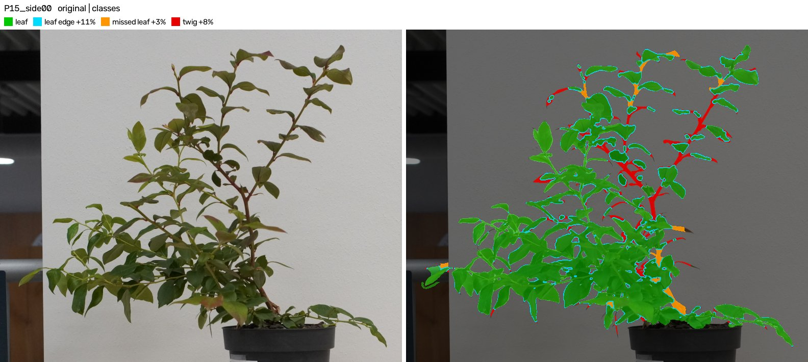

*P15_side00: green = leaf (the leaf mask), yellow = leaf edge, orange = missed leaf (both counted as leaf), red = twig (only blocks the view). The percentages are the pixels of each class as a share of the leaf pixels.*

## All runs

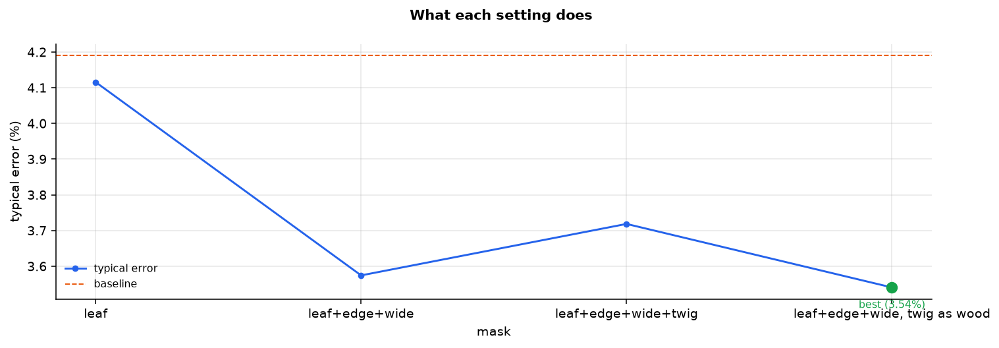

| run | mask | kernel | cap | c | typical error | mean error | R² | within 5% | vs baseline |
|---|---|---|---|---|---|---|---|---|---|
| baseline | leaf | 64 | 0.9 | 1.5027 | 4.19% | 3.57% | 0.939 | 7/13 | +0.00 |
| twig_corrected | leaf+edge+wide, twig as wood | 144 | 0.99 | 1.3932 | 3.54% | 2.85% | 0.956 | 10/13 | -0.65 |
| no_twigs | leaf+edge+wide | 144 | 0.99 | 1.4337 | 3.57% | 3.03% | 0.955 | 11/13 | -0.62 |
| all_stems | leaf+edge+wide+twig | 144 | 0.99 | 1.3410 | 3.72% | 3.08% | 0.952 | 11/13 | -0.47 |
| leaf | leaf | 144 | 0.99 | 1.6878 | 4.12% | 3.46% | 0.941 | 9/13 | -0.07 |

## Per plant

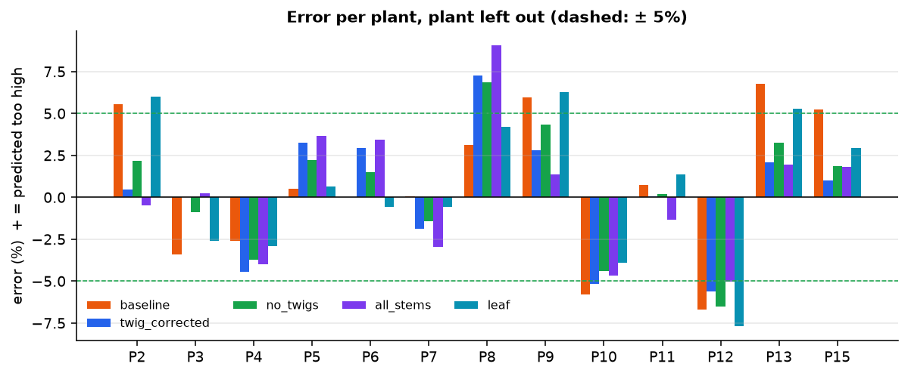

## Run: baseline

settings: mask **leaf** · kernel **64** · cap **0.9**

- **4.2%** typical error
- **0.94** R²
- **7 / 13** plants within 5%
- **1.5027** c, fitted on all plants

With the leaf areas shuffled between the plants, 0 of 1000 runs did as well (p = 0.001, so it is not luck).

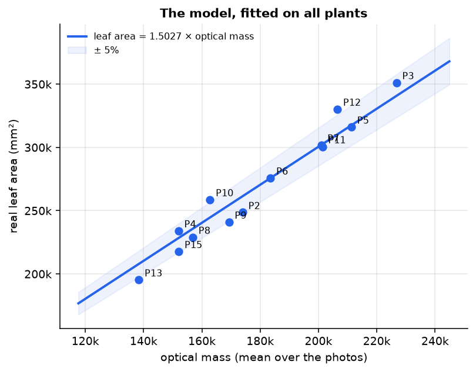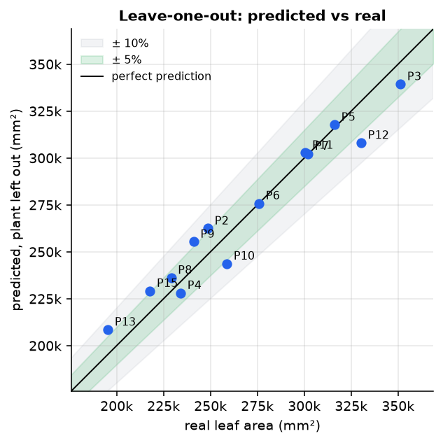

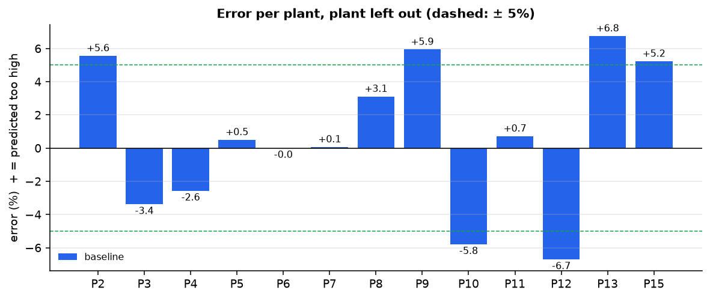

### Per plant

| plant | optical mass | real mm² | predicted mm² | error |
|---|---|---|---|---|
| P2 | 173,982 | 248,603 | 262,427 | +5.6% |
| P3 | 226,759 | 351,253 | 339,331 | -3.4% |
| P4 | 151,977 | 234,098 | 228,057 | -2.6% |
| P5 | 211,302 | 316,107 | 317,700 | +0.5% |
| P6 | 183,546 | 275,843 | 275,821 | -0.0% |
| P7 | 201,092 | 301,997 | 302,210 | +0.1% |
| P8 | 156,880 | 229,026 | 236,160 | +3.1% |
| P9 | 169,281 | 241,016 | 255,344 | +5.9% |
| P10 | 162,788 | 258,726 | 243,701 | -5.8% |
| P11 | 201,345 | 300,609 | 302,775 | +0.7% |
| P12 | 206,502 | 330,299 | 308,113 | -6.7% |
| P13 | 138,375 | 195,339 | 208,531 | +6.8% |
| P15 | 152,085 | 217,768 | 229,160 | +5.2% |

### Other models, tested the same way

| model | fitted on all plants | R² | typical error | mean error | worst plant |
|---|---|---|---|---|---|
| c × optical mass | c = 1.5027 | 0.939 | 4.2% | 3.6% | 6.8% |
| a + b × optical mass | a = -35k, b = 1.693 | 0.947 | 3.9% | 3.3% | 7.8% |
| a × optical mass^b | a = 0.307, b = 1.131 | 0.948 | 3.9% | 3.3% | 7.9% |
| average plant (no photo) | 269k mm² | -0.174 | 18.4% | 16.5% | 41.0% |
| pick the best model, then predict (nested) | a + b × optical mass 2×, a × optical mass^b 11× | 0.947 | 3.9% | 3.3% | 7.9% |

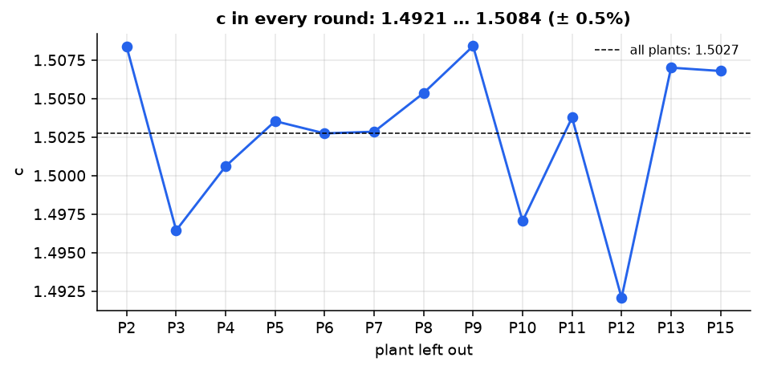 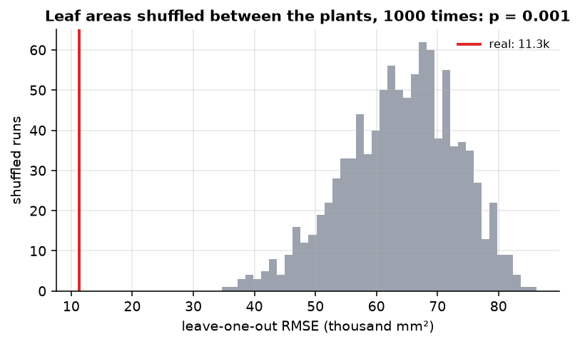

## Run: twig_corrected

settings: mask **leaf+edge+wide, twig as wood** · kernel **144** · cap **0.99**

- **3.5%** typical error
- **0.96** R²
- **10 / 13** plants within 5%
- **1.3932** c, fitted on all plants

With the leaf areas shuffled between the plants, 0 of 1000 runs did as well (p = 0.001, so it is not luck).

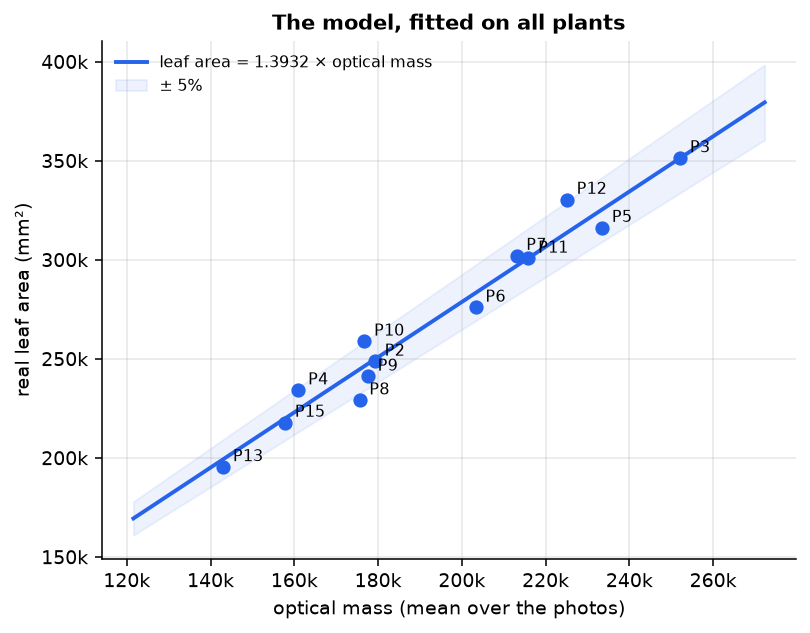

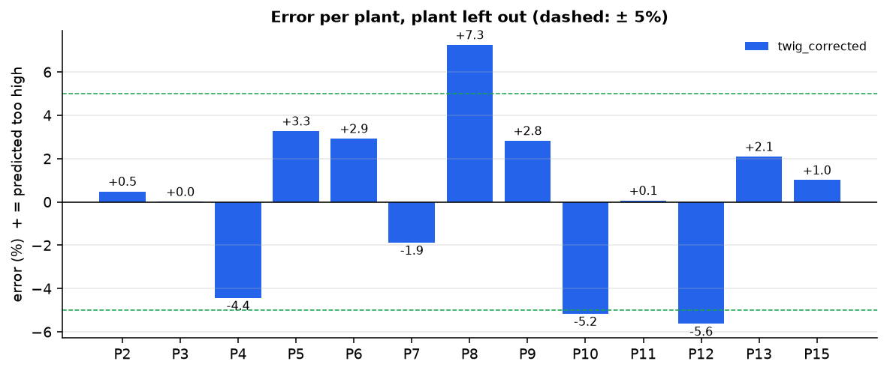

### Per plant

| plant | optical mass | real mm² | predicted mm² | error | baseline error |
|---|---|---|---|---|---|
| P2 | 179,250 | 248,603 | 249,810 | +0.5% | +5.6% |
| P3 | 252,133 | 351,253 | 351,276 | +0.0% | -3.4% |
| P4 | 160,963 | 234,098 | 223,715 | -4.4% | -2.6% |
| P5 | 233,503 | 316,107 | 326,446 | +3.3% | +0.5% |
| P6 | 203,302 | 275,843 | 283,909 | +2.9% | -0.0% |
| P7 | 213,056 | 301,997 | 296,313 | -1.9% | +0.1% |
| P8 | 175,574 | 229,026 | 245,636 | +7.3% | +3.1% |
| P9 | 177,575 | 241,016 | 247,828 | +2.8% | +5.9% |
| P10 | 176,714 | 258,726 | 245,363 | -5.2% | -5.8% |
| P11 | 215,897 | 300,609 | 300,806 | +0.1% | +0.7% |
| P12 | 225,088 | 330,299 | 311,706 | -5.6% | -6.7% |
| P13 | 143,018 | 195,339 | 199,421 | +2.1% | +6.8% |
| P15 | 157,805 | 217,768 | 219,965 | +1.0% | +5.2% |

### Other models, tested the same way

| model | fitted on all plants | R² | typical error | mean error | worst plant |
|---|---|---|---|---|---|
| c × optical mass | c = 1.3932 | 0.956 | 3.5% | 2.8% | 7.3% |
| a + b × optical mass | a = -5k, b = 1.418 | 0.951 | 3.8% | 3.0% | 7.3% |
| a × optical mass^b | a = 1.09, b = 1.020 | 0.951 | 3.8% | 3.0% | 7.2% |
| average plant (no photo) | 269k mm² | -0.174 | 18.4% | 16.5% | 41.0% |
| pick the best model, then predict (nested) | c × optical mass 13× | 0.956 | 3.5% | 2.8% | 7.3% |

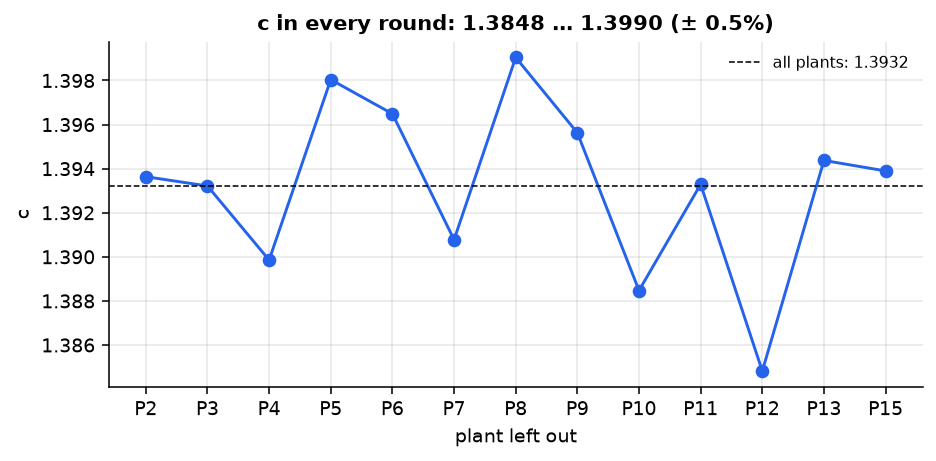 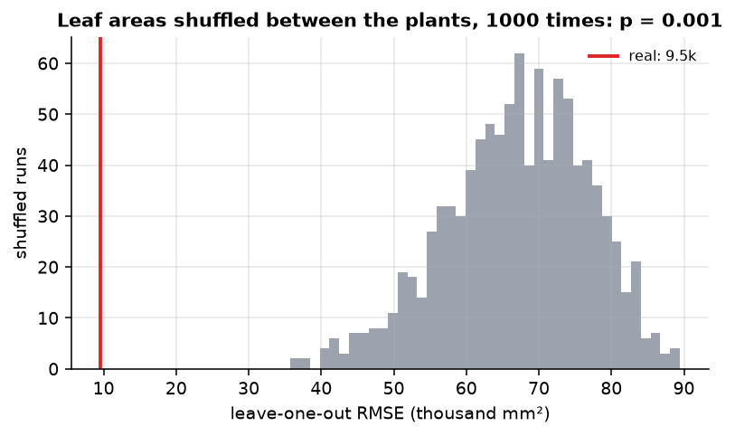

## Run: leaf

settings: mask **leaf** · kernel **144** · cap **0.99**

- **4.1%** typical error
- **0.94** R²
- **9 / 13** plants within 5%
- **1.6878** c, fitted on all plants

With the leaf areas shuffled between the plants, 0 of 1000 runs did as well (p = 0.001, so it is not luck).

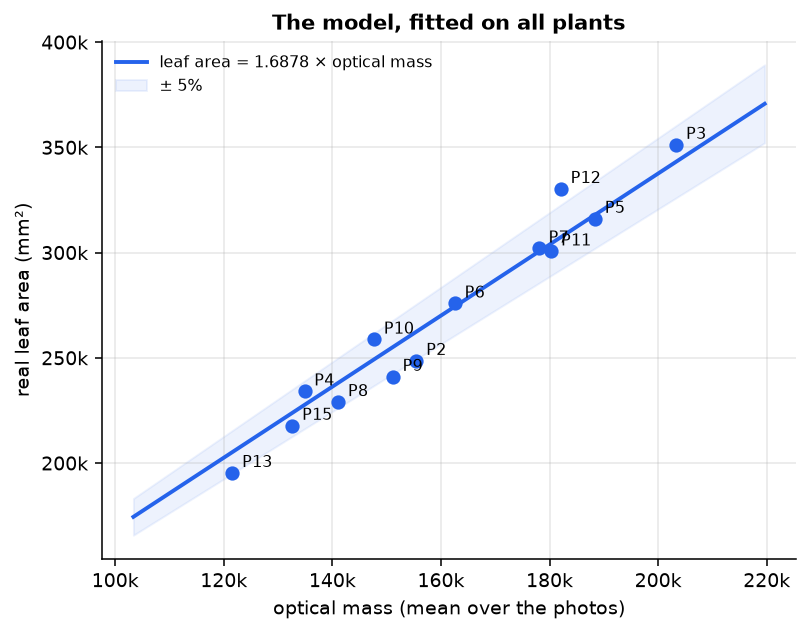

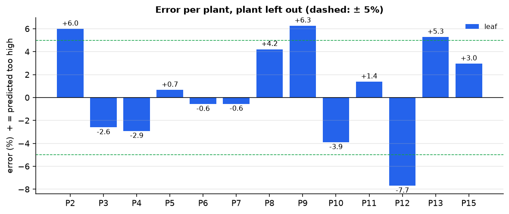

### Per plant

| plant | optical mass | real mm² | predicted mm² | error | baseline error |
|---|---|---|---|---|---|
| P2 | 155,485 | 248,603 | 263,489 | +6.0% | +5.6% |
| P3 | 203,349 | 351,253 | 342,103 | -2.6% | -3.4% |
| P4 | 134,863 | 234,098 | 227,258 | -2.9% | -2.6% |
| P5 | 188,388 | 316,107 | 318,181 | +0.7% | +0.5% |
| P6 | 162,566 | 275,843 | 274,258 | -0.6% | -0.0% |
| P7 | 178,025 | 301,997 | 300,317 | -0.6% | +0.1% |
| P8 | 141,076 | 229,026 | 238,676 | +4.2% | +3.1% |
| P9 | 151,135 | 241,016 | 256,102 | +6.3% | +5.9% |
| P10 | 147,687 | 258,726 | 248,620 | -3.9% | -5.8% |
| P11 | 180,328 | 300,609 | 304,757 | +1.4% | +0.7% |
| P12 | 182,094 | 330,299 | 304,861 | -7.7% | -6.7% |
| P13 | 121,582 | 195,339 | 205,657 | +5.3% | +6.8% |
| P15 | 132,635 | 217,768 | 224,197 | +3.0% | +5.2% |

### Other models, tested the same way

| model | fitted on all plants | R² | typical error | mean error | worst plant |
|---|---|---|---|---|---|
| c × optical mass | c = 1.6878 | 0.941 | 4.1% | 3.5% | 7.7% |
| a + b × optical mass | a = -31k, b = 1.875 | 0.947 | 3.9% | 3.0% | 6.9% |
| a × optical mass^b | a = 0.436, b = 1.113 | 0.948 | 3.9% | 3.1% | 6.9% |
| average plant (no photo) | 269k mm² | -0.174 | 18.4% | 16.5% | 41.0% |
| pick the best model, then predict (nested) | a + b × optical mass 2×, a × optical mass^b 11× | 0.947 | 3.9% | 3.1% | 6.9% |

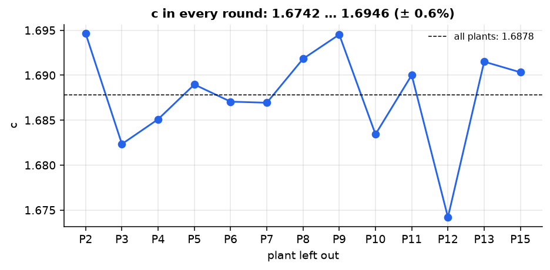 
