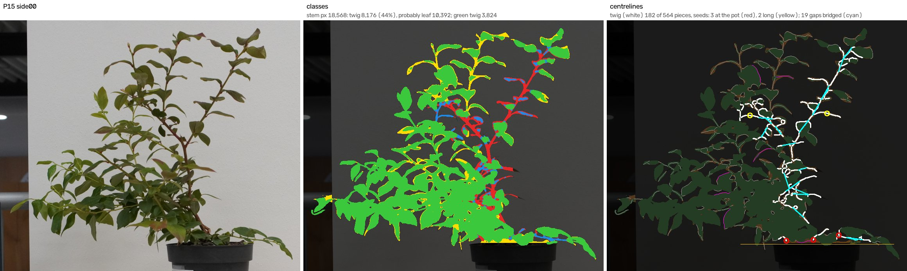

# 11 Twig tracing

**Results:** [all photos with their overlays](results/report.md)

**Question:** can the twigs be told apart from leaf edges and edge-on leaves by tracing them from the pot?

**Status: dropped.** Looked at by eye, the tracing was still far from accurate (see "First look" below), so the idea
isn't taken further. Overlays only, nothing scored.

## Why

The stem mask of the segmentation (`common/masks.py`) is "in front of the wall, near the plant, but not leaf". It
mixes real twigs with reddish leaf edges, leaves seen edge-on and shaded leaf parts
([`08_problem_plants/README.md`](../08_problem_plants/README.md)). Counting all of it as leaf overcounts P8's
red twigs; leaving all of it out loses P10's leaf edges. Twigs have a shape and a place of their own: they grow in
fairly straight lines without sudden turns, out of the pot or out of other twigs. Green shoots are twigs too, but they
are in the leaf mask.

## Method

1. **Candidates:** the stem mask, plus the parts of the leaf mask narrower than 11 px (green shoots and petioles; a
   leaf is ~35 px across).
2. **Centrelines** (`skimage` skeletonize), side spurs under 6 px pruned, cut into pieces at the junctions and where a
   line turns sharper than 45° (a twig bends smoothly).
3. **Each piece:** length, mean width, straightness (end-to-end distance / length; a half circle around a leaf is
   0.64).
4. **Not the rim:** pieces lying flat within 10 px above the pot's rim are the soil or the back of the rim.
5. **Seeds**, where tracing starts:
   - at the pot: pieces just above the rim (within 0.15 × the pot width), around the pot's axis, at least 10 px long and
     rising (within 50° of vertical);
   - long and straight: a thin piece at least 50 px long with a straightness of at least 0.9 is a twig by itself (longer
     than any leaf), even where its base is hidden behind leaves.
6. **Growing out from the seeds,** a piece becomes a twig if it is straight enough (≥ 0.75, or shorter than 15 px)
   and at most 18 px wide, and either
   - meets a twig at a junction: a branch may leave at any angle, or
   - lies in the line of a twig's end across a gap of up to 45 px (within 20°, running on within 30°, the gap at least
     60% inside the plant): twigs pass behind leaves. Only pieces of at least 12 px bridge, to pieces of at least 8 px.
7. **Everything else in the stem mask is probably leaf.** Thin parts of the leaf mask that aren't reached stay leaf.

```bash
.venv/bin/python 11_twig_tracing/twig_tracing.py $PHOTOS                        # 10 photos, about 10 s
.venv/bin/python 11_twig_tracing/twig_tracing.py $PHOTOS --photos P8_side220 ...  # other photos
```

Photos: P8 (red twigs), P10 (leaf edges), P3 and P12 (dense), P15 (long bare stems), at 0° and 120° each.

Each picture: the photo | the classes (leaf green, twig red, green twig blue, stem mask taken as leaf yellow) | the
centrelines (white = twig; rejected: orange too wide, pink too bent, brown on the rim, grey not connected; magenta =
long and straight but not connected; cyan = bridged gaps; red circles = seeds at the pot; yellow circles = long
straight seeds).



## First look

| photo | stem pixels taken as twig | green twig px |
|---|---|---|
| P8 0° | 78% | 12,205 |
| P8 120° | 16% | 1,456 |
| P10 0° | 30% | 3,612 |
| P10 120° | 38% | 7,232 |
| P3 0° | 50% | 9,269 |
| P3 120° | 32% | 2,665 |
| P12 0° | 22% | 2,359 |
| P12 120° | 52% | 7,948 |
| P15 0° | 44% | 3,824 |
| P15 120° | 46% | 3,036 |

**What works:**

- **Visible twigs are traced from the pot to the tips:** P15's main stem, most of P8's red twig network at 0°, and P3's
  branches, including its long green shoot to the right (blue), across several leaves.
- **Leaf edges stay leaf:** the reddish edges around P10's upper leaves and most curved slivers along leaf borders are
  yellow (curved, or not connected).
- **Shaded leaf masses aren't twigs:** the dark core above P3's pot is too wide.
- **The soil strip on the rim** (left in the stem mask by the pot fix of 09) is excluded.

**What doesn't (yet):**

- **Twigs broken up by the leaves in front of them aren't reached.** On P8 at 120°, P12's lower left and P10's upper
  part, the twigs are visible in the photo, but in the masks they are short fragments between leaves, too far apart or
  too short to bridge. The result varies a lot between photos of the same plant (P8: 78% at 0°, 16% at 120°).
- **Some bridges cross leaves** where two unrelated pieces happen to line up (a few on P8 at 0°).
- **No ground truth:** whether a pixel is really a twig is judged by eye. Hand-marking the twigs on a few photos would
  give a number.

**Dropped** after this first look: too inaccurate to build on. What it would have needed next: get further into the fragmented twigs (longer gaps for long, straight pieces, or
tracing through the leaf mask along a twig's direction), then run it on all photos and test the optical mass with
leaf + traced twigs, or leaf + stem without the twigs.
