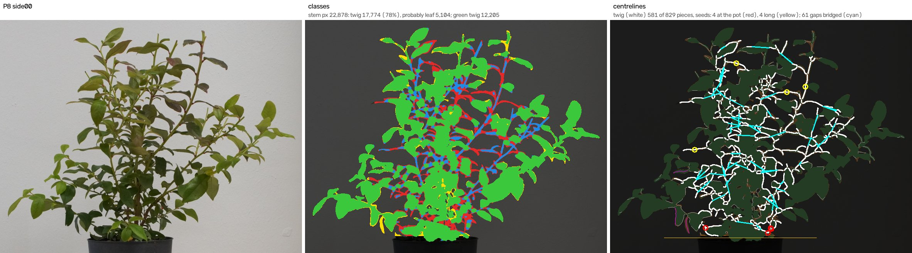
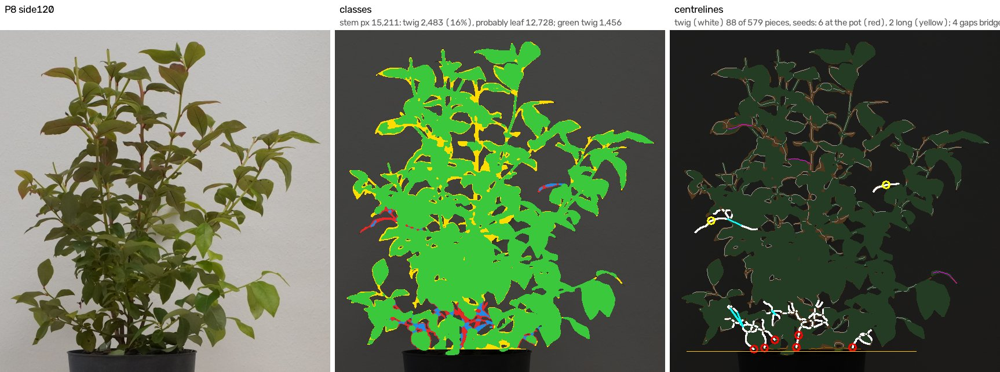
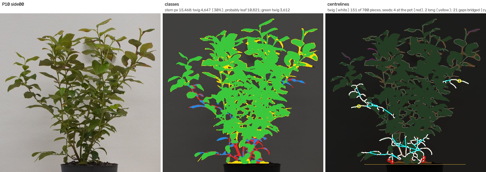
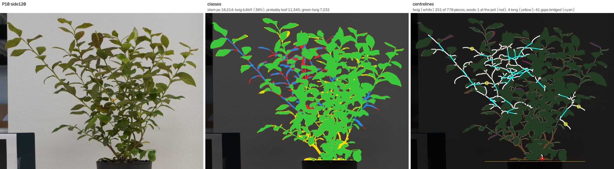
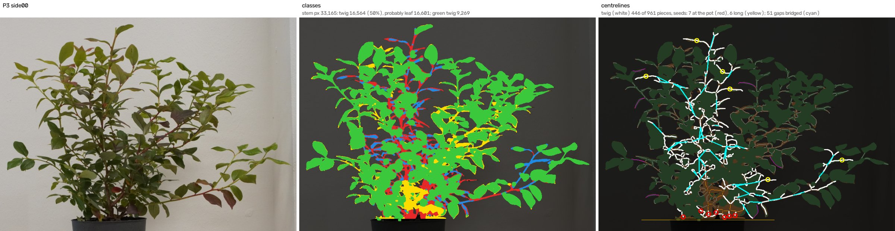
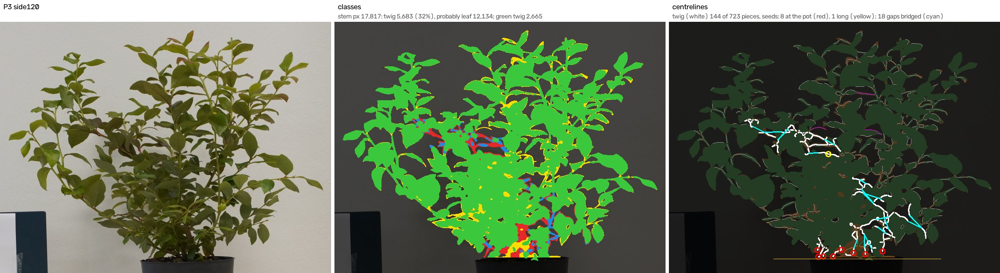
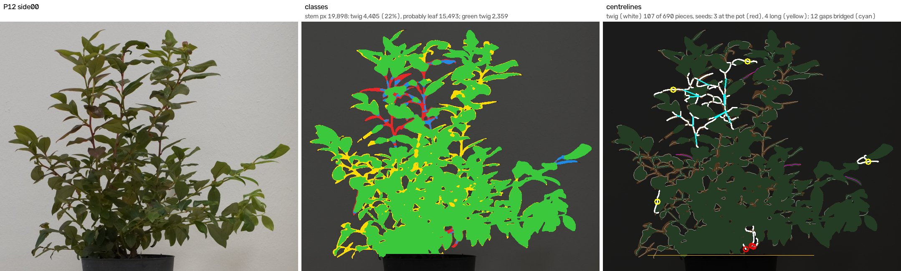
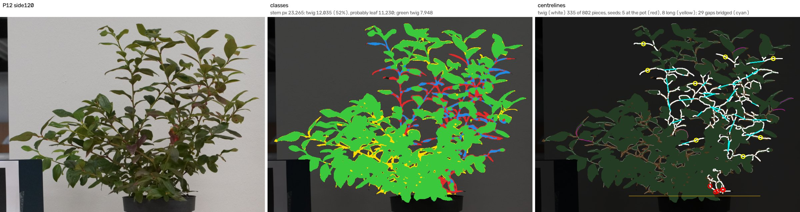
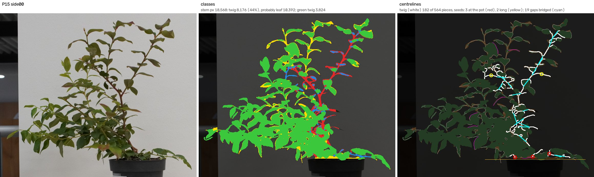
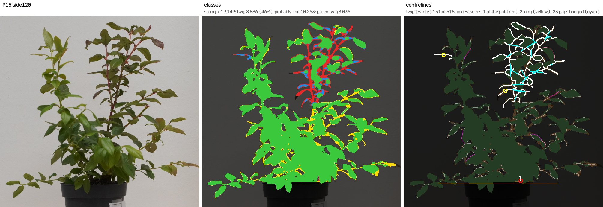

# Experiment 11_twig_tracing: twig tracing

Experiment 10: overlays only, to check the method by eye. Nothing is scored.

**The idea.** Twigs grow in fairly straight lines without sudden turns, and they grow out of the pot or out of other twigs. The stem mask is everything in front of the wall that isn't leaf; it mixes twigs with leaf edges, leaves seen edge-on and shaded leaf. Here a piece of the stem mask, or a thin part of the leaf mask (a green shoot), is a twig only if its centreline can be followed, smoothly, back to the pot.

1. **Candidates:** the stem mask plus the parts of the leaf mask narrower than 11 px (a leaf is ~35 px across).
2. **Centrelines** (skeletonize; side spurs under 6 px pruned), cut into pieces at junctions and where they turn sharper than 45°.
3. **Not the rim:** pieces lying flat within 10 px above the pot's rim are the soil or the back of the rim, never twigs.
4. **Seeds:** pieces just above the pot's rim (within 0.15 × the pot width), around its axis, at least 10 px long and rising (within 50° of vertical, not lying along the rim).
5. **Long straight seeds:** a thin piece at least 50 px long with a straightness of at least 0.9 is a twig by itself: longer than any leaf (~35 px across). It starts tracing where a twig's base is hidden behind leaves.
6. **Growing out from the seeds,** a piece becomes a twig if it is straight (end-to-end distance / length ≥ 0.75, or shorter than 15 px), at most 18 px wide on average, and either meets a twig at a junction (a branch may leave at any angle) or lies in the line of a twig's end across a gap of up to 45 px (within 20°, running on within 30°, the gap at least 60% inside the plant): twigs pass behind leaves. Only twig pieces of at least 12 px bridge gaps, to pieces of at least 8 px: a shorter piece has no reliable direction.
7. Everything else in the stem mask is **probably leaf**.

**Each picture:** the photo | the classes: 🟩 leaf 🟥 twig (in the stem mask) 🟦 twig (green shoot, in the leaf mask) 🟨 stem mask, probably leaf | the centrelines: white = twig; not a twig because too wide (orange), too bent (pink), lying on the rim (brown) or not connected to a twig (grey); magenta = straight and long but not connected; cyan = gaps bridged; red circles = seeds at the pot; yellow circles = long straight seeds; orange line = the pot's rim.

## Summary

| photo | stem px | twig | share | probably leaf | green twig | seeds |
|---|---|---|---|---|---|---|
| P8_side00 | 22,878 | 17,774 | 78% | 5,104 | 12,205 | 4 |
| P8_side120 | 15,211 | 2,483 | 16% | 12,728 | 1,456 | 6 |
| P10_side00 | 15,468 | 4,647 | 30% | 10,821 | 3,612 | 4 |
| P10_side120 | 18,214 | 6,869 | 38% | 11,345 | 7,232 | 1 |
| P3_side00 | 33,165 | 16,564 | 50% | 16,601 | 9,269 | 7 |
| P3_side120 | 17,817 | 5,683 | 32% | 12,134 | 2,665 | 8 |
| P12_side00 | 19,898 | 4,405 | 22% | 15,493 | 2,359 | 3 |
| P12_side120 | 23,265 | 12,035 | 52% | 11,230 | 7,948 | 5 |
| P15_side00 | 18,568 | 8,176 | 44% | 10,392 | 3,824 | 3 |
| P15_side120 | 19,149 | 8,886 | 46% | 10,263 | 3,036 | 1 |

## Photos

### P8 side00

stem mask 22,878 px: twig 17,774 (78%), probably leaf 5,104. Green twig (from the leaf mask): 12,205 px.

### P8 side120

stem mask 15,211 px: twig 2,483 (16%), probably leaf 12,728. Green twig (from the leaf mask): 1,456 px.

### P10 side00

stem mask 15,468 px: twig 4,647 (30%), probably leaf 10,821. Green twig (from the leaf mask): 3,612 px.

### P10 side120

stem mask 18,214 px: twig 6,869 (38%), probably leaf 11,345. Green twig (from the leaf mask): 7,232 px.

### P3 side00

stem mask 33,165 px: twig 16,564 (50%), probably leaf 16,601. Green twig (from the leaf mask): 9,269 px.

### P3 side120

stem mask 17,817 px: twig 5,683 (32%), probably leaf 12,134. Green twig (from the leaf mask): 2,665 px.

### P12 side00

stem mask 19,898 px: twig 4,405 (22%), probably leaf 15,493. Green twig (from the leaf mask): 2,359 px.

### P12 side120

stem mask 23,265 px: twig 12,035 (52%), probably leaf 11,230. Green twig (from the leaf mask): 7,948 px.

### P15 side00

stem mask 18,568 px: twig 8,176 (44%), probably leaf 10,392. Green twig (from the leaf mask): 3,824 px.

### P15 side120

stem mask 19,149 px: twig 8,886 (46%), probably leaf 10,263. Green twig (from the leaf mask): 3,036 px.
