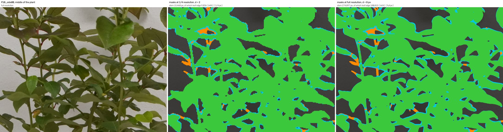
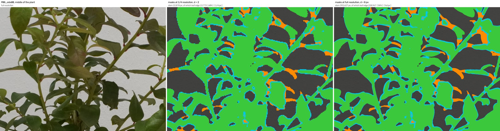

# 12 Leaf edges, stem weight and full resolution

**Results:** [full report](results/report.md) · [overlays of the best run](results/overlays.md)

**Question:** how should the stem mask be counted? Three simple ways, tested together: leaf edges by distance, a
weight for the remaining stems, and the masks at full resolution.

## Why

The segmentation's "stem" mask is everything in front of the wall, near the plant, that isn't leaf: real twigs, but
also reddish and brown leaf edges, leaves seen edge-on and shaded leaf. Leaving it out (the baseline) loses the leaf
parts, such as P10's leaf edges; counting it fully (experiments 03–05) counts P8's red twigs as leaf. Tracing the
twigs one by one (experiment 11) wasn't accurate enough. These three don't need to find every twig: they only need to
count leaf parts and not twigs, on average.

## Method

1. **Leaf edges by distance (d):** stem pixels within d px of the leaf mask are the leaf's own edges and count as
   leaf. Twigs touch leaves only where a leaf grows off them, so most of a twig stays further away.
2. **A weight for the rest (w):** the remaining stem pixels count with a weight w, from 0 (left out, as the baseline)
   to 1 (counted fully, as 03–05).
3. **Full resolution (res):** the masks segmented at full resolution (6000 × 4000), where a twig is 12–24 px wide
   instead of 3–6 and the leaf edges are sharper, then reduced to 1/4 resolution as fractions (the share of each 4 × 4
   block), so the optical mass uses the same windows as always. Every size in the segmentation is scaled ×4 and every
   area ×16 (`common/masks.py`, `segment(img, s=4)`; with s = 1 it gives exactly the masks as before).

Per photo: `mask = leaf + edge_d + w × (stem − edge_d)`, then the optical mass as always. d = 0–4 px at 1/4 resolution
(0–16 px at full), w = 0, 0.25, 0.5, 0.75, 1, at 1/4 and full resolution, with the baseline's settings (kernel 64, cap
0.90) and those of the best run of 05 (kernel 144, cap 0.995): **100 runs**. All on the pot-fixed masks of 09. The
baseline is the pot-fixed baseline: leaf only, 1/4 resolution, kernel 64, cap 0.90 (3.74%).

```bash
.venv/bin/python 12_leaf_edges/stem_weight.py $PHOTOS --jobs 3    # ~50 min the first time (full resolution, ~2 GB
                                                                   # per job), cached in cache/masks_full/ after that
.venv/bin/python 00_evaluation/evaluate.py 12_leaf_edges/results/runs.csv
```

### What it looks like

The middle of a plant, at full resolution: leaf green, stem pixels within d of a leaf (counted as leaf) cyan, the
remaining stem pixels (counted with weight w) orange; the masks at 1/4 resolution (d = 2) and at full resolution
(d = 8 px, the same distance).



P10: most of the "stem" mask is a thin rim around **every** leaf (64% of it within 2 px of a leaf): the leaves' own
edges, which the leaf mask cuts slightly too tight. What is left (orange) is mostly petioles and twigs between leaves.



P8: the red twigs stay orange (weighted), the rims around the leaves are cyan (counted as leaf). P12 is in
`results/pictures/` too. Full resolution tells the same story with sharper edges.

## Result

Current leaf areas (`01_leaf_measurement/results/monday.csv`), 13 plants, P1 left out. Typical error of every run (rows d, columns w):

| d \ w | 0 | 0.25 | 0.5 | 0.75 | 1 |
|---|---|---|---|---|---|
| **kernel 64, 1/4 res** | | | | | |
| 0 | **3.74** (baseline) | 3.52 | 3.45 | 3.53 | 3.76 |
| 2 | 3.50 | 3.49 | 3.52 | 3.62 | 3.76 |
| 3 | 3.49 | 3.52 | 3.57 | 3.65 | 3.76 |
| **kernel 64, full res** | | | | | |
| 0 | 3.80 | 3.49 | 3.35 | 3.43 | 3.67 |
| 2 | 3.32 | 3.30 | 3.36 | 3.49 | 3.67 |
| 3 | 3.29 | 3.33 | 3.41 | 3.53 | 3.67 |
| **kernel 144, 1/4 res** | | | | | |
| 0 | 3.63 | 3.33 | 3.18 | 3.23 | 3.59 (05 best) |
| 2 | 3.17 | 3.11 | 3.15 | 3.30 | 3.59 |
| 3 | 3.10 | 3.14 | 3.23 | 3.37 | 3.59 |
| **kernel 144, full res** | | | | | |
| 0 | 3.60 | 3.25 | 3.07 | 3.13 | 3.54 |
| 1 | 3.33 | 3.09 | 3.00 | 3.13 | 3.54 |
| 2 | 3.01 | 2.96 | 3.01 | 3.20 | 3.54 |
| 3 | **2.93** | 2.97 | 3.08 | 3.26 | 3.54 |
| 4 | 2.95 | 3.03 | 3.15 | 3.31 | 3.54 |

(d = 1 and 4 for the other three blocks are in `results/summary.csv`; they follow the same pattern.)

Best: **full resolution, d = 3, w = 0, kernel 144: 2.93%**. Honest score (all four settings chosen without the plant
it predicts, over all 100 runs): **2.99%**; the nested search picked this run in 12 of 13 rounds and d = 4 once.
93 of 100 runs beat the baseline. The best 10% of the runs are all at full resolution and kernel 144, with d 2–4 and
w 0–0.5.

Error per plant (plant left out, + = predicted too high):

| | P2 | P3 | P4 | P5 | P6 | P7 | P8 | P9 | P10 | P11 | P12 | P13 | P15 | typical | within 5% |
|---|---|---|---|---|---|---|---|---|---|---|---|---|---|---|---|
| baseline (pot fix) | +4.8 | −3.2 | −3.3 | +0.9 | −0.3 | +0.3 | +3.0 | +3.1 | −6.4 | +2.1 | −5.2 | +5.9 | +5.4 | 3.74% | 9 |
| all stems, k144 (05 best) | −1.3 | +0.5 | −5.1 | +2.7 | +4.7 | −2.1 | +8.3 | −1.9 | −5.6 | +1.7 | −3.9 | +0.5 | +1.3 | 3.59% | 10 |
| edges d 2, k64, 1/4 | +3.8 | −2.5 | −2.8 | +1.5 | +0.6 | −0.3 | +6.1 | +3.1 | −4.4 | −1.1 | −5.6 | +5.5 | +4.1 | 3.50% | 10 |
| edges d 3, k64, full | +2.4 | −2.0 | −2.9 | +1.5 | +0.7 | −0.1 | +6.6 | +2.5 | −5.0 | −1.3 | −4.6 | +5.2 | +4.1 | 3.29% | 11 |
| edges d 3, k144, 1/4 | +1.5 | −1.0 | −4.1 | +2.0 | +1.5 | −1.3 | +6.8 | +1.1 | −4.5 | +2.6 | −4.8 | +1.8 | +1.4 | 3.10% | 12 |
| **edges d 3, k144, full (best)** | +1.2 | −1.0 | −4.0 | +1.6 | +0.5 | −0.8 | **+6.5** | +1.4 | −4.9 | +2.7 | −4.1 | +2.3 | +1.6 | **2.93%** | 12 |

The leaf edges (d = 3, w = 0) add 13–23% to every plant's optical mass: least for P11 (13–15%), most for P8 (22–23%).

- **All three help, and they add up.** Leaf edges at d = 2–3 take 0.25–0.5 points off (more at full resolution),
  full resolution 0.15–0.2, kernel 144 about 0.35. The best run combines all three.
- **The leaf mask cuts every leaf's rim.** Most of the "stem" mask is a thin rim around the leaves, and counting it as
  leaf adds 13–23% to the optical mass. That is why counting all stems helped some plants before: much of it was leaf.
- **Once the edges count, the rest of the stem mask is best left out or counted lightly** (w = 0–0.25; with no edges,
  w = 0.5 is best: a rough average of edges and twigs). Counting the rest fully (w = 1) is always worse.
- **One smooth region, picked consistently:** the honest score (2.99%) is almost the best run's (2.93%), because the
  nested search picks the same run in 12 of 13 rounds. This is the first tuned result whose honest score clearly beats
  the baseline: by 0.75 points against the pot-fixed baseline (3.74%), and by 1.06 points against the original one
  (4.05%), beyond the ~1 point of noise.
- **Every plant except P8 is within 5%** (12 of 13). P8 is still too high (+6.5%): its twigs run close to its leaves,
  so part of them counts as leaf edge (P8 gains the most from the edges, 22–23%). But it is much better than with all
  stems counted (+8.3%).
- **P12 and P10 are still too low** (−4.1%, −4.9%), but within 5%.

## Conclusion

**Count the stem pixels within ~3 px of a leaf (at 1/4 resolution) as leaf, leave the rest out, segment at full
resolution and use kernel 144:** 2.93%, honest 2.99%, against 3.74% for the pot-fixed baseline and 4.05% for the
original. It's the best and the most stable result so far. Full resolution costs ~16 s per photo to segment (cached
once done); without it, the same rule at 1/4 resolution gives 3.10%.
