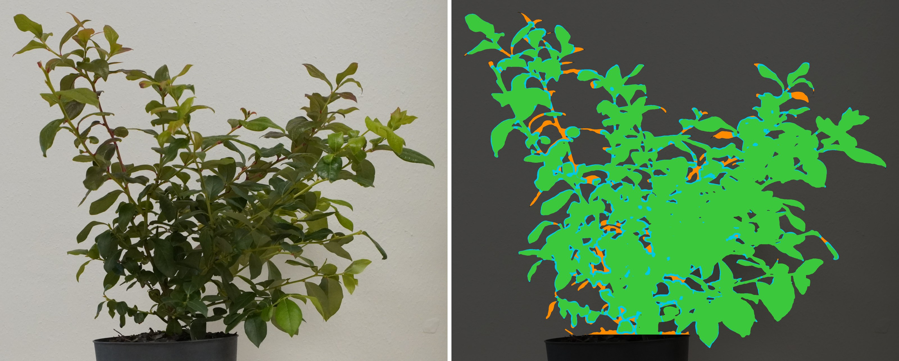
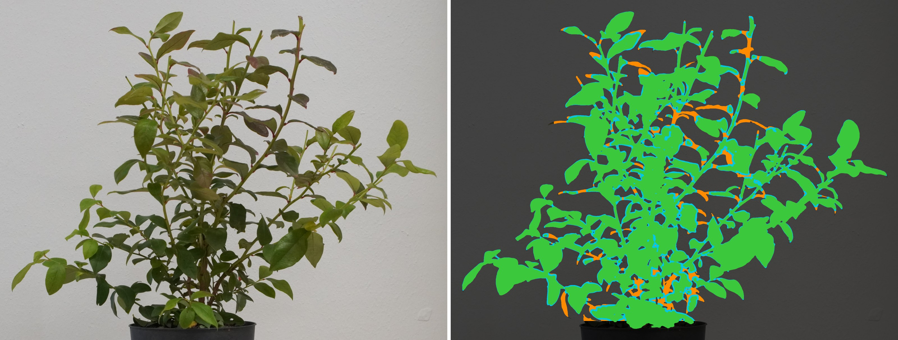
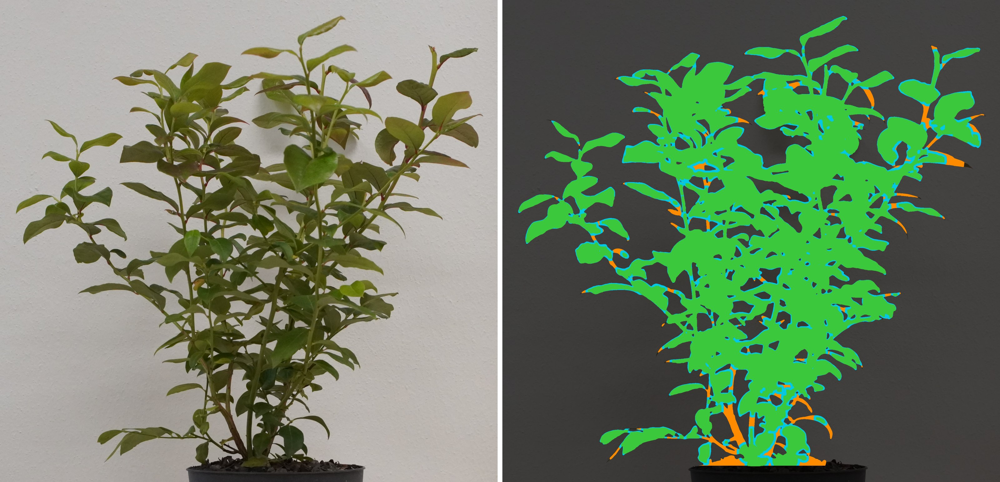
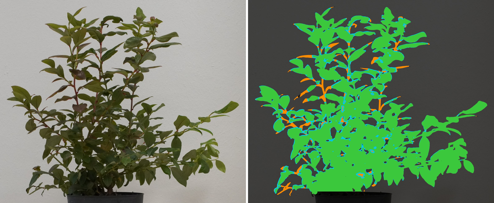
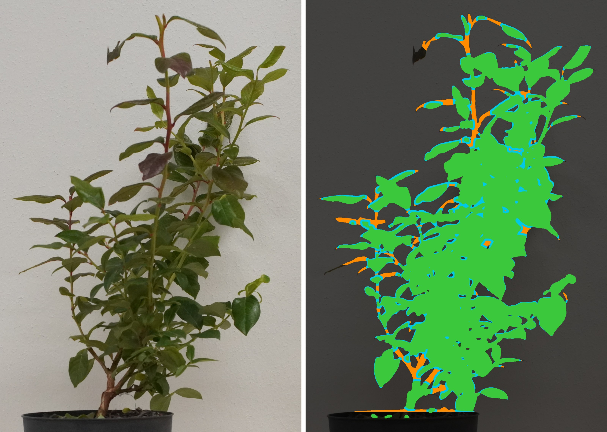
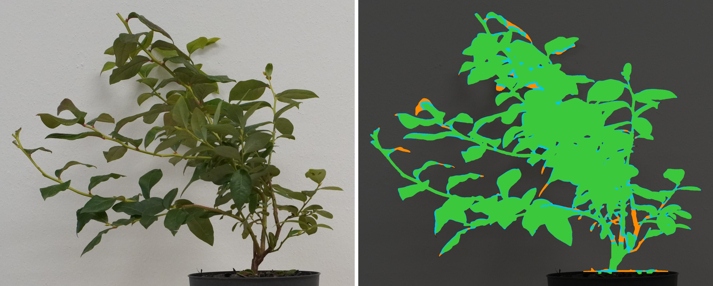
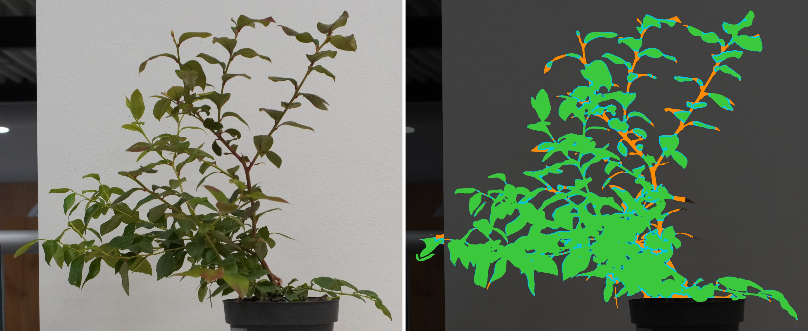

# What the best run of experiment 11 counts

The best run (`full_d3_w0.00_k144`, 2.93%, honest 2.99%): masks segmented at full resolution; stem pixels within 3 px of a leaf (at 1/4 resolution, 12 px at full) count as leaf, because they are the leaves' own edges; the rest of the stem mask is left out. Kernel 144, cap 0.995.

Each picture: the photo | 🟩 **leaf** (counted) 🟦 **leaf edge**, from the stem mask (counted as leaf) 🟧 **stem / twig**, the rest of the stem mask (left out). Click a picture for the full size.

P6 went well with the best run; the others are the problem plants (P14 has no measured leaf area). One photo per plant (0°).

## P6 side00

error with the best run +0.5% (baseline -0.3%). Counted: leaf 1,758,388 px + leaf edge 207,782 px (+12%); left out: 78,829 px of stem (4% of what is counted). Full-resolution px.

## P8 side00

error with the best run +6.5% (baseline +3.0%). Counted: leaf 1,675,269 px + leaf edge 269,019 px (+16%); left out: 123,608 px of stem (6% of what is counted). Full-resolution px.

## P10 side00

error with the best run -4.9% (baseline -6.4%). Counted: leaf 1,580,321 px + leaf edge 204,850 px (+13%); left out: 70,047 px of stem (4% of what is counted). Full-resolution px.

## P12 side00

error with the best run -4.1% (baseline -5.2%). Counted: leaf 1,937,463 px + leaf edge 225,707 px (+12%); left out: 106,425 px of stem (5% of what is counted). Full-resolution px.

## P13 side00

error with the best run +2.3% (baseline +5.9%). Counted: leaf 1,191,157 px + leaf edge 121,933 px (+10%); left out: 69,148 px of stem (5% of what is counted). Full-resolution px.

## P14 side00

no measured leaf area, so no error. Counted: leaf 1,144,987 px + leaf edge 100,702 px (+9%); left out: 37,194 px of stem (3% of what is counted). Full-resolution px.

## P15 side00

error with the best run +1.6% (baseline +5.4%). Counted: leaf 1,362,987 px + leaf edge 209,807 px (+15%); left out: 121,005 px of stem (8% of what is counted). Full-resolution px.

