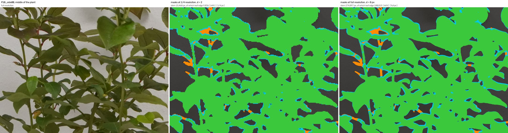
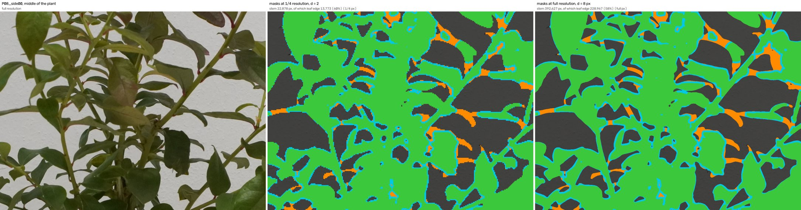
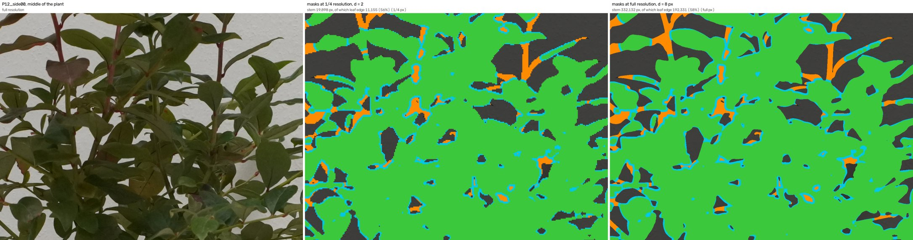
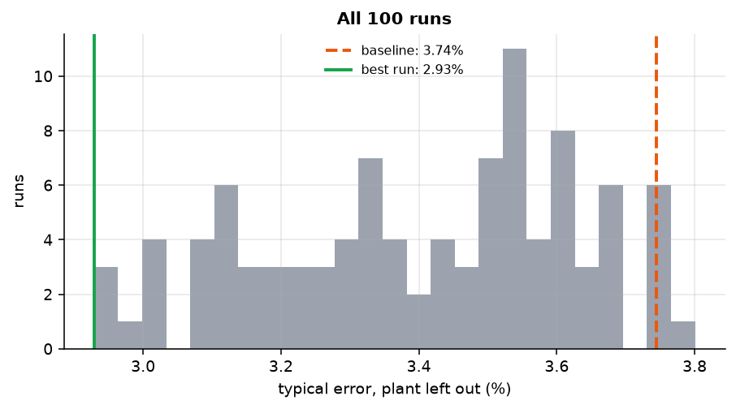
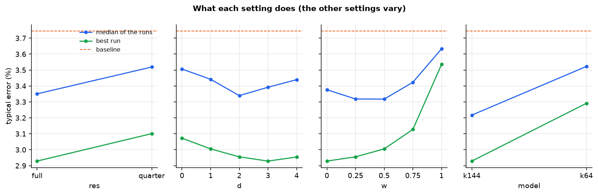
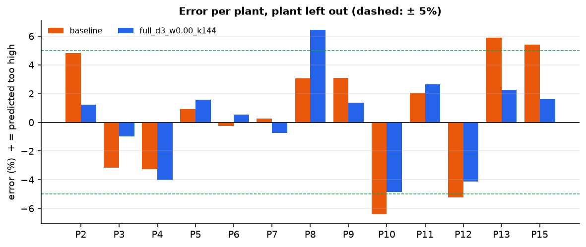
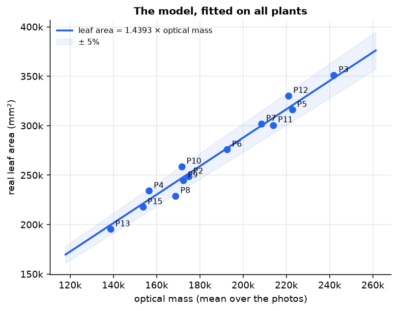
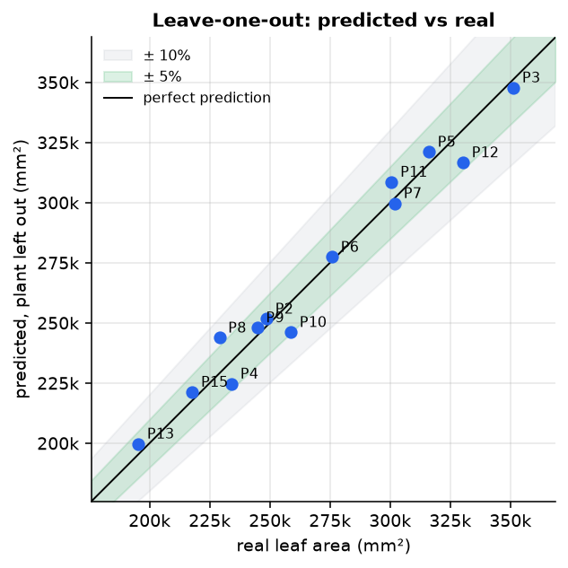
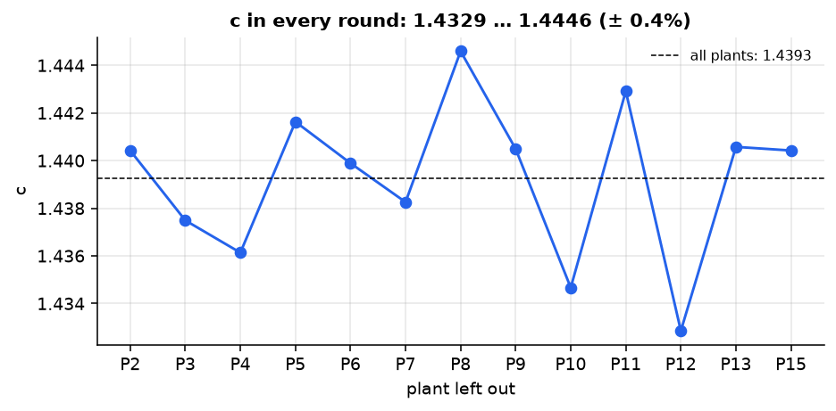
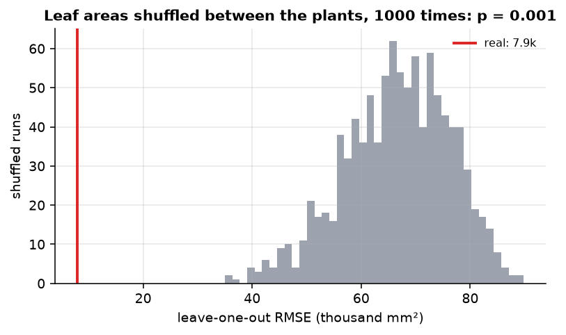

# Experiment 12_leaf_edges

100 runs + baseline · 13 plants (P2, P3, P4, P5, P6, P7, P8, P9, P10, P11, P12, P13, P15) · leaf area = c × optical mass, leave-one-out

**Contents**

1. [Summary](#summary) — the baseline, the best run and the honest score, and the verdict
2. [The method](#the-method) — what the experiment changes, its settings and how many runs it makes
3. [What the method looks like](#what-the-method-looks-like) — the method drawn on example photos
4. [All runs](#all-runs) — how the runs are spread, what each setting does, the best runs
5. [Per plant: baseline vs best run](#per-plant-baseline-vs-best-run) — how far off each plant is, the baseline next to the best run, full_d3_w0.00_k144
6. [Best run in detail](#best-run-in-detail-full_d3_w000_k144) — its fit, every plant's prediction, whether one plant decides the model, and the shuffle test

How to read this page

**The model.** `leaf area = c × optical mass`: a straight line through zero, with c the one number learned from the plants. It is the model of the regression (`Regression/docs/single_feature_model.md`).

**Leave-one-out.** Every plant in turn is left out, c is learned from the others, and the left-out plant is predicted. Each plant is predicted by a model that never saw it.

**Typical error** = the RMSE of those predictions as a % of the average leaf area, the number the regression reports. **Mean error** = the average of the absolute errors in %. **R²**: 1 is perfect, 0 is no better than guessing the average plant.

**Baseline** = the current method, `T_64_0.9`: 64 px window, cap 0.9, leaf mask M1, mean over all side photos. Every experiment is compared with it on the same plants and leaf areas.

**Nested (honest) score.** With many runs, the best one is partly lucky: its settings happen to suit these plants. The nested score repeats the whole search once per plant: the best run is chosen on the other plants only, then predicts the left-out plant. Compare **that** number with the baseline.

**Noise.** With 14 plants, one plant can move the typical error by about a point. Differences below about 1 point are not a result.

## Summary

- **3.74%** baseline T_64_0.9
- **2.93%** best run: full_d3_w0.00_k144 (optimistic)
- **2.99%** honest: run chosen without the plant (nested)
- **93 / 100** runs better than the baseline

**Verdict:** choosing the run on the other plants (nested) gives **2.99%**, against **3.74%** for the baseline (-0.76 points). That is within the ~1 point of noise: **no clear difference**.

Runs the nested search chose: full_d3_w0.00_k144 (12×), full_d4_w0.00_k144 (1×)

## The method

**Question:** how should the stem mask be counted? The segmentation's "stem" mask is everything in front of the wall, near the plant, that isn't leaf: real twigs, but also reddish and brown leaf edges, leaves seen edge-on and shaded leaf. Leaving it out (the baseline) loses the leaf parts; counting it fully (experiments 02–04) counts the twigs as leaf, which overshoots on P8.

1. **Leaf edges by distance (d):** stem pixels within d px of the leaf mask are the leaf's own edges and count as leaf. Twigs touch leaves only where a leaf grows off them, so most of a twig stays further away.
2. **A weight for the rest (w):** the remaining stem pixels count with a weight w, from 0 (left out, as the baseline) to 1 (counted fully, as in 02–04): the best average treatment of twigs, edge-on leaves and shaded leaf.
3. **Full resolution (res):** the masks segmented at full resolution, where a twig is 12–24 px wide instead of 3–6 px and leaf edges are sharper, then reduced to 1/4 resolution as fractions, so the optical mass uses the same windows. Every size in the segmentation is scaled ×4 (areas ×16).

Per photo: `mask = leaf + edge_d + w × (stem − edge_d)`, then the optical mass as always. Both on the baseline's settings (kernel 64, cap 0.90) and on those of the best run of 04 (kernel 144, cap 0.995). All on the pot-fixed masks of experiment 09.

A run's name is its resolution, d, w and model: `full_d2_w0.50_k144` is full resolution, leaf edges within 2 px, the remaining stems at weight 0.5, kernel 144 with cap 0.995. d is in px at 1/4 resolution (×4 at full). The baseline is `quarter_d0_w0.00_k64`: leaf only, kernel 64, cap 0.90, on the pot-fixed masks.

### The settings

What the settings in the run names and tables mean.

| setting | what it does | values tried |
|---|---|---|
| **res** | resolution of the segmentation: quarter (as always) or full (x4, reduced to 1/4 as fractions) | quarter, full |
| **d** | stem pixels within d px of the leaf mask count as leaf (its edges); px at 1/4 resolution | 0, 1, 2, 3, 4 |
| **w** | weight of the remaining stem pixels: 0 = left out (baseline), 1 = counted fully (02-04) | 0, 0.25, 0.5, 0.75, 1 |
| **model** | k64: kernel 64, cap 0.90 (the baseline's). k144: kernel 144, cap 0.995 (best run of 04) | k64, k144 |

**Runs:** every combination of the settings, 2 res × 5 d × 5 w × 2 model = **100 runs**, plus the baseline.

## What the method looks like

*P10, whose leaf edges are often reddish or brown. Green: leaf. Cyan: stem pixels within d of a leaf, counted as leaf (its edges). Orange: the remaining stem pixels, counted with weight w.*

*P8, the plant with the most red twigs. Green: leaf. Cyan: stem pixels within d of a leaf, counted as leaf (its edges). Orange: the remaining stem pixels, counted with weight w.*

*P12, a dense plant. Green: leaf. Cyan: stem pixels within d of a leaf, counted as leaf (its edges). Orange: the remaining stem pixels, counted with weight w.*

## All runs

The typical error of every run. Runs left of the orange line beat the baseline; the green line is the best run (before the honest correction).

### What each setting does

One panel per setting. For each value of the setting, the runs with that value are taken together, whatever the other settings: blue is their median typical error, green the best of them. The orange line is the baseline. A flat line means the setting doesn't matter; a slope shows which values are better.

### Where the best 10% of the runs lie (10 runs, typical error ≤ 3.08%)

| setting | range in the best 10% | share of the best 10% per value | if it didn't matter |
|---|---|---|---|
| res | full | full: 100% · quarter: 0% | 50% |
| d | 0 – 4 | 0: 10% · 1: 10% · 2: 30% · 3: 30% · 4: 20% | 20% |
| w | 0 – 0.5 | 0: 30% · 0.25: 30% · 0.5: 40% · 0.75: 0% · 1: 0% | 20% |
| model | k144 | k144: 100% · k64: 0% | 50% |

Green: the value is at least 1.5× as common among the best runs as in the grid; grey: at most half as common. A setting whose values all sit near the "didn't matter" share has no effect.

### The best runs

| run | res | d | w | model | c | typical error | mean error | R² | within 5% | vs baseline |
|---|---|---|---|---|---|---|---|---|---|---|
| baseline |   |   |   |   | 1.4839 | 3.74% | 3.37% | 0.951 | 9/13 | +0.00 |
| full_d3_w0.00_k144 | full | 3 | 0 | k144 | 1.4393 | 2.93% | 2.49% | 0.970 | 12/13 | -0.82 |
| full_d4_w0.00_k144 | full | 4 | 0 | k144 | 1.4158 | 2.95% | 2.45% | 0.969 | 11/13 | -0.79 |
| full_d2_w0.25_k144 | full | 2 | 0.25 | k144 | 1.4442 | 2.96% | 2.55% | 0.969 | 12/13 | -0.79 |
| full_d3_w0.25_k144 | full | 3 | 0.25 | k144 | 1.4159 | 2.97% | 2.48% | 0.969 | 12/13 | -0.77 |
| full_d1_w0.50_k144 | full | 1 | 0.5 | k144 | 1.4503 | 3.01% | 2.62% | 0.968 | 12/13 | -0.74 |
| full_d2_w0.00_k144 | full | 2 | 0 | k144 | 1.4772 | 3.01% | 2.66% | 0.968 | 12/13 | -0.74 |
| full_d2_w0.50_k144 | full | 2 | 0.5 | k144 | 1.4113 | 3.01% | 2.52% | 0.968 | 12/13 | -0.73 |
| full_d4_w0.25_k144 | full | 4 | 0.25 | k144 | 1.3983 | 3.03% | 2.45% | 0.968 | 11/13 | -0.71 |
| full_d0_w0.50_k144 | full | 0 | 0.5 | k144 | 1.5299 | 3.07% | 2.73% | 0.967 | 11/13 | -0.67 |
| full_d3_w0.50_k144 | full | 3 | 0.5 | k144 | 1.3924 | 3.08% | 2.50% | 0.967 | 11/13 | -0.66 |
| full_d1_w0.25_k144 | full | 1 | 0.25 | k144 | 1.5033 | 3.09% | 2.77% | 0.966 | 12/13 | -0.66 |
| quarter_d3_w0.00_k144 | quarter | 3 | 0 | k144 | 1.4028 | 3.10% | 2.64% | 0.966 | 12/13 | -0.64 |
| quarter_d2_w0.25_k144 | quarter | 2 | 0.25 | k144 | 1.4119 | 3.11% | 2.69% | 0.966 | 12/13 | -0.63 |
| full_d0_w0.75_k144 | full | 0 | 0.75 | k144 | 1.4364 | 3.13% | 2.62% | 0.966 | 11/13 | -0.62 |
| quarter_d4_w0.00_k144 | quarter | 4 | 0 | k144 | 1.3817 | 3.13% | 2.58% | 0.965 | 12/13 | -0.61 |
| quarter_d1_w0.50_k144 | quarter | 1 | 0.5 | k144 | 1.4153 | 3.13% | 2.72% | 0.965 | 12/13 | -0.61 |
| full_d1_w0.75_k144 | full | 1 | 0.75 | k144 | 1.3976 | 3.14% | 2.59% | 0.965 | 11/13 | -0.61 |
| quarter_d3_w0.25_k144 | quarter | 3 | 0.25 | k144 | 1.3820 | 3.14% | 2.59% | 0.965 | 12/13 | -0.61 |
| quarter_d2_w0.50_k144 | quarter | 2 | 0.5 | k144 | 1.3810 | 3.15% | 2.62% | 0.965 | 12/13 | -0.59 |
| full_d4_w0.50_k144 | full | 4 | 0.5 | k144 | 1.3806 | 3.15% | 2.56% | 0.965 | 11/13 | -0.59 |
| quarter_d2_w0.00_k144 | quarter | 2 | 0 | k144 | 1.4427 | 3.17% | 2.77% | 0.965 | 11/13 | -0.57 |
| quarter_d0_w0.50_k144 | quarter | 0 | 0.5 | k144 | 1.4868 | 3.18% | 2.83% | 0.964 | 11/13 | -0.56 |
| quarter_d4_w0.25_k144 | quarter | 4 | 0.25 | k144 | 1.3662 | 3.19% | 2.57% | 0.964 | 12/13 | -0.55 |
| full_d2_w0.75_k144 | full | 2 | 0.75 | k144 | 1.3781 | 3.20% | 2.62% | 0.964 | 11/13 | -0.55 |
| quarter_d1_w0.25_k144 | quarter | 1 | 0.25 | k144 | 1.4636 | 3.21% | 2.84% | 0.964 | 11/13 | -0.53 |

Best 25 of 100 runs. All runs: summary.csv.

## Per plant: baseline vs best run

The error of every plant when it is predicted by the model learned without it, for the baseline (orange) and the best run, full_d3_w0.00_k144. Above 0: predicted too high; below: too low. Between the green dashed lines the plant is within 5%. A plant that is off the same way for both is missed by the optical mass itself, not by the setting.

## Best run in detail: full_d3_w0.00_k144

settings: res **full** · d **3** · w **0** · model **k144**

- **2.9%** typical error
- **0.97** R²
- **12 / 13** plants within 5%
- **1.4393** c, fitted on all plants

### The fit and the predictions

Left: every plant's optical mass against its real leaf area, with the line `leaf area = c × optical mass` fitted on all plants. Right: each plant predicted by the model learned without it (leave-one-out), against its real leaf area. On the black line the prediction is perfect; inside the green band it is within 5%.

### Per plant

| plant | optical mass | real mm² | predicted mm² | error | baseline error |
|---|---|---|---|---|---|
| P2 | 174,731 | 248,603 | 251,686 | +1.2% | +4.8% |
| P3 | 241,948 | 351,253 | 347,798 | -1.0% | -3.2% |
| P4 | 156,462 | 234,098 | 224,701 | -4.0% | -3.3% |
| P5 | 222,714 | 316,107 | 321,072 | +1.6% | +0.9% |
| P6 | 192,618 | 275,843 | 277,348 | +0.5% | -0.3% |
| P7 | 208,387 | 301,997 | 299,715 | -0.8% | +0.3% |
| P8 | 168,770 | 229,026 | 243,803 | +6.5% | +3.0% |
| P9 | 172,206 | 244,749 | 248,061 | +1.4% | +3.1% |
| P10 | 171,566 | 258,726 | 246,140 | -4.9% | -6.4% |
| P11 | 213,867 | 300,609 | 308,592 | +2.7% | +2.1% |
| P12 | 221,018 | 330,299 | 316,687 | -4.1% | -5.2% |
| P13 | 138,657 | 195,339 | 199,746 | +2.3% | +5.9% |
| P15 | 153,623 | 217,768 | 221,282 | +1.6% | +5.4% |

### c in every round: does one plant decide the model?

Leave-one-out fits c 13 times, each time without one plant. Each point is the c fitted **without** the plant on the x-axis; the dashed line is c fitted on all plants. A flat line means no single plant drives the model. A point far from the line means that plant on its own pulls c up or down, and it is usually also predicted badly. Here c moves by ± 0.4%; the plant that moves it most is P12.

### Shuffle test: is the fit real or luck?

The leaf areas are shuffled randomly between the plants 1000 times, so they no longer belong to their photos, and the same leave-one-out test is run each time. Grey: the errors of the shuffled data. Red: the error of the real data. If red lies left of nearly all of grey, the optical mass really carries the leaf area. p is the share of shuffles that did as well as the real data (p < 0.05: not luck). It says the run is not noise, not that it beats the baseline. Here 0 of 1000 shuffles did as well (p = 0.001, so it is not luck).

