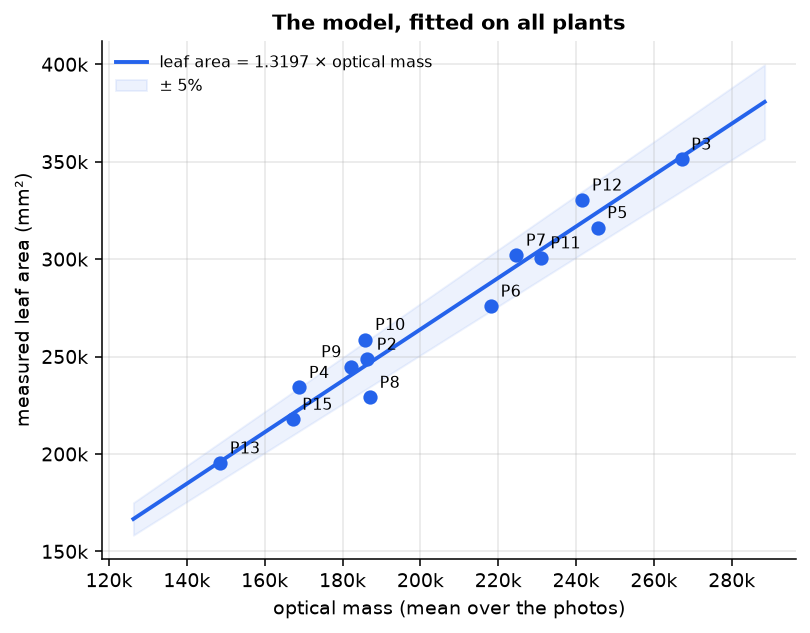
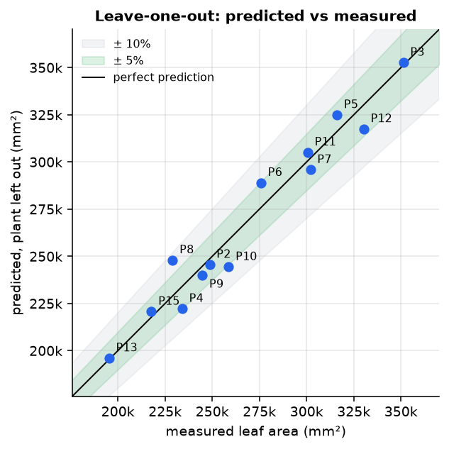
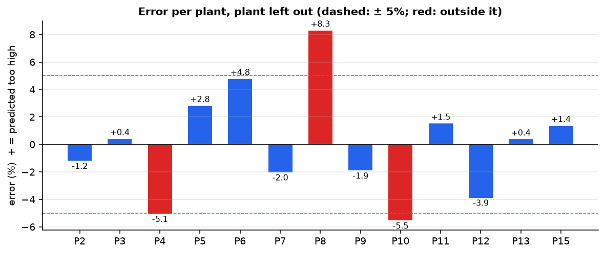
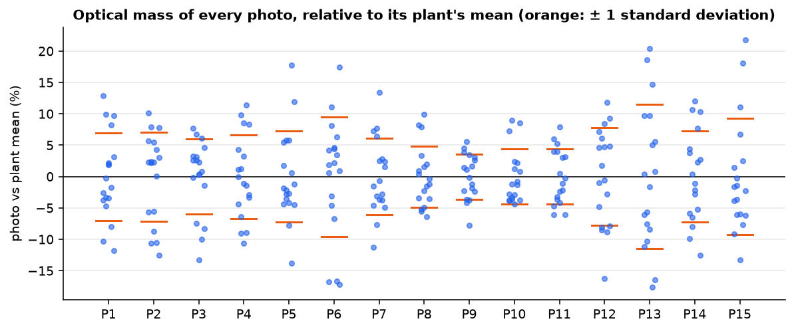
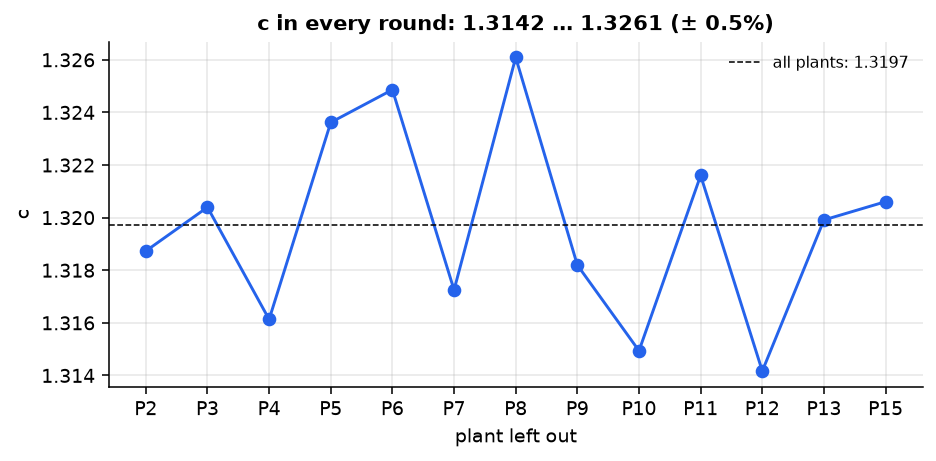
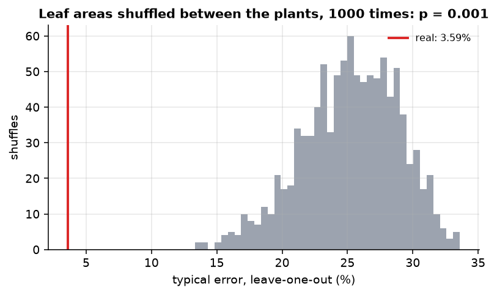

# Results

Run on 2026-11-24 · **270 photos of 15 plants** · kernel 144 px, cap 0.995, 1/4 resolution · 28 s

**Contents**

1. [Summary](#summary): the scores in short
2. [The method](#the-method): the settings of this run
3. [The fit and the predictions](#the-fit-and-the-predictions): the model, and every plant predicted without it
4. [Per plant](#per-plant): how far off each plant is
5. [Optical mass over the photos](#optical-mass-over-the-photos): how much one view of a plant differs from the next
6. [c in every round](#c-in-every-round-does-one-plant-decide-the-model): whether one plant decides the model
7. [Shuffle test](#shuffle-test-is-the-fit-real-or-luck): whether the fit is real or luck

How to read this page

**The model.** `leaf area = c × optical mass`: a straight line through zero, with c the one number learned from the plants.

**Leave-one-out.** Every plant in turn is left out, c is learned from the others, and the left-out plant is predicted. Each plant is predicted by a model that never saw it.

**Typical error** = the RMSE of those predictions as a % of the mean leaf area. **Mean error** = the average of the absolute errors in %. **R²**: 1 is perfect, 0 is no better than guessing the average plant.

**Noise.** With 13 plants, one plant more or less moves the typical error by about a point.

**The settings were chosen on these plants** (kernel and cap, in experiment 05), so this score is somewhat optimistic: new plants are needed for an independent test.

## Summary

- **3.59%** typical error (RMSE as % of the mean leaf area)
- **0.955** R²
- **3.01%** mean absolute error; worst plant P8, 8.3% off
- **10 / 13** plants within 5% (outside: P8 +8.3%, P10 -5.5%, P4 -5.1%)
- **1.3197** c, learned on all plants (mm² per unit of optical mass)
- shuffle test: **p = 0.001**

## The method

Every side photo: the plant mask (every plant pixel in front of the wall, leaves and twigs alike, the pot taken out), the leaf density in a window around every pixel, leaf layers by Beer-Lambert, summed: the optical mass. The mean over the plant's photos is its optical mass. The steps are described, with pictures, in the [main README](../README.md#the-method).

| setting | value | what it does |
|---|---|---|
| kernel | 144 px | side of the window of the leaf density (px at 1/4 resolution) |
| cap | 0.995 | the density is capped at this before Beer-Lambert: at most 5.3 layers |
| resolution | 1/4 (1500 × 1000) | the resolution the photos are segmented at |
| leaf areas | `data/real_leaf_area_mm2.csv` | the measured leaf areas the model is learned from |

## The fit and the predictions

Left: every plant's optical mass against its measured leaf area, with the line `leaf area = c × optical mass` fitted on all plants. Right: each plant predicted by the model learned without it (leave-one-out), against its measured leaf area. On the black line the prediction is perfect; inside the green band it is within 5%.

## Per plant

The error of every plant when it is predicted by the model learned without it. Above 0: predicted too high; below: too low.

| plant | photos | optical mass | measured leaf area, mm² | predicted, mm² | error | c without the plant |
|---|---|---|---|---|---|---|
| P2 | 18 | 186,271 | 248,603 | 245,641 | -1.2% | 1.3187 |
| P3 | 18 | 267,088 | 351,253 | 352,661 | +0.4% | 1.3204 |
| P4 | 18 | 168,873 | 234,098 | 222,260 | **-5.1%** | 1.3161 |
| P5 | 18 | 245,506 | 316,107 | 324,956 | +2.8% | 1.3236 |
| P6 | 18 | 218,121 | 275,843 | 288,980 | +4.8% | 1.3249 |
| P7 | 18 | 224,612 | 301,997 | 295,870 | -2.0% | 1.3173 |
| P8 | 18 | 187,020 | 229,026 | 248,005 | **+8.3%** | 1.3261 |
| P9 | 18 | 182,133 | 244,749 | 240,087 | -1.9% | 1.3182 |
| P10 | 18 | 185,856 | 258,726 | 244,390 | **-5.5%** | 1.3149 |
| P11 | 18 | 230,895 | 300,609 | 305,151 | +1.5% | 1.3216 |
| P12 | 18 | 241,593 | 330,299 | 317,493 | -3.9% | 1.3142 |
| P13 | 18 | 148,538 | 195,339 | 196,057 | +0.4% | 1.3199 |
| P15 | 18 | 167,139 | 217,768 | 220,724 | +1.4% | 1.3206 |

Errors over 5% in bold.

Not in the test (no measured leaf area): P1 (optical mass 197,861), P14 (optical mass 132,608).

## Optical mass over the photos

Every plant is photographed from 18 sides. Each dot is one photo's optical mass, as a % of the plant's mean: a plant seen from its wide or its narrow side gives a different number. The mean over all photos averages that out; it is the plant's optical mass.

| plant | photos | mean optical mass | standard deviation | lowest … highest photo |
|---|---|---|---|---|
| P1 | 18 | 197,861 | ±7.0% | -12% … +13% |
| P2 | 18 | 186,271 | ±7.1% | -13% … +10% |
| P3 | 18 | 267,088 | ±6.0% | -13% … +8% |
| P4 | 18 | 168,873 | ±6.7% | -11% … +11% |
| P5 | 18 | 245,506 | ±7.3% | -14% … +18% |
| P6 | 18 | 218,121 | ±9.5% | -17% … +17% |
| P7 | 18 | 224,612 | ±6.1% | -11% … +13% |
| P8 | 18 | 187,020 | ±4.9% | -6% … +10% |
| P9 | 18 | 182,133 | ±3.6% | -8% … +6% |
| P10 | 18 | 185,856 | ±4.4% | -4% … +9% |
| P11 | 18 | 230,895 | ±4.4% | -6% … +8% |
| P12 | 18 | 241,593 | ±7.8% | -16% … +12% |
| P13 | 18 | 148,538 | ±11.5% | -18% … +20% |
| P14 | 18 | 132,608 | ±7.3% | -13% … +12% |
| P15 | 18 | 167,139 | ±9.2% | -13% … +22% |

## c in every round: does one plant decide the model?

Leave-one-out fits c 13 times, each time without one plant. Each point is the c fitted **without** the plant on the x-axis; the dashed line is c fitted on all plants. A flat line means no single plant drives the model. A point far from the line means that plant on its own pulls c up or down, and it is usually also predicted badly. Here c moves by ± 0.5%; the plant that moves it most is P8.

## Shuffle test: is the fit real or luck?

The leaf areas are shuffled randomly between the plants 1000 times, so they no longer belong to their photos, and the same leave-one-out test is run each time. Grey: the errors of the shuffled data. Red: the error of the real data. If red lies left of nearly all of grey, the optical mass really carries the leaf area. p is the share of shuffles that did as well as the real data (p < 0.05: not luck). Here 0 of 1000 shuffles did as well (median 25.4%, best 13.3%), p = 0.001.

## Files

| file | |
|---|---|
| `per_photo.csv` | optical mass, plant pixels and pot width of every photo |
| `per_plant.csv` | mean optical mass per plant, and its spread over the photos |
| `evaluation.csv` | per plant: measured and predicted leaf area, error %, c learned without the plant |
| `evaluation.json` | the scores, c, the shuffle test and the settings |
| `settings.json` | the settings of the run |
| `report_files/` | the charts of this page |
